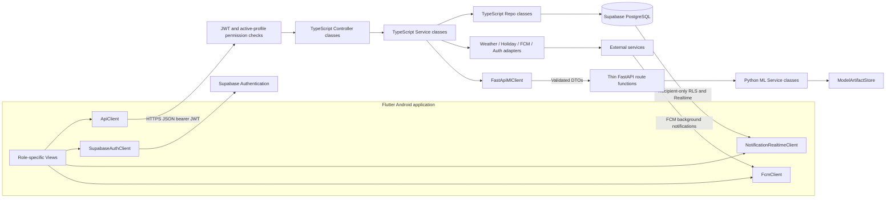

# Smart Bakery layered client-server MVC architecture

Current proposed design, reconciled 2026-10-11 with [the latest report mirror](../RSW_SooKinMin_Project1.docx.md), Sections 4.2-4.5, 4.8-4.10. The DOCX governs. This document is not evidence of implemented components. The earlier July 2026 architecture was a planning snapshot, not a higher authority.

## 1. Component boundaries

Supabase Authentication, Supabase Realtime for relevant foreground notifications, and FCM reception are the explicit client-platform exceptions in Sections 4.2.4 and 4.8. Realtime subscribes only to the authenticated recipient's permitted notification events. Node polling, SSE or WebSocket relays do not replace the selected Realtime design. All ordinary application-table CRUD, notification creation and mark-read operations go through Node.

FastAPI receives no Supabase database client, URL/service credentials or application-table Repos. It accepts authenticated server-to-server DTOs, performs feature/prediction/training/evaluation calculations and returns typed results. Node validates and persists results. `ModelArtifactStore` stores model artifacts; it is not an application database Repo.

## 2. MVC and class conventions

| Layer | Planned responsibilities | Restrictions |
|---|---|---|
| Flutter Views | Role navigation, input/confirmation, null-safe presentation, contextual error/retry messages | No trusted role/actor/feasibility claims; no local privileged data writes |
| ApiClient/platform clients | Protected Node calls; Supabase Auth, scoped Realtime and FCM exceptions | No database service secret; unsubscribe/clear session on logout |
| Express route modules | Register HTTP path/method and middleware, delegate to Controller methods | Modules are not UML classes |
| Controllers | Validate request shape, use authenticated principal, call Services, serialize DTO/errors | No SQL, Repo shortcuts or model logic |
| Services | Permission/ownership enforcement, orchestration, algorithms, transaction coordination | Use Repos/adapters; do not trust client validation |
| Repos | Parameterized persistence, locked reads and atomic RPC boundaries | No UI, prediction generation or external HTTP calls |
| External adapters | Weather, holiday, auth administration, FCM, export and ML protocol handling | Credentials stay in server environment/secret configuration |
| FastAPI routes | Pydantic request/result validation and Python Service delegation | Thin functions, excluded from class diagrams |
| Python Services | Feature engineering, model/cold-start prediction, confidence, training, metrics/artifacts | No application persistence; no activation side effect |

Use `Controller`, `Service`, `Repo` and `View` suffixes consistently. Named algorithm components `RecommendationEngine`, `PredictionService`, `FeaturePreparationService` and `IngredientCalculator` are service-layer classes. Use `DailyPrediction`, `DailySalesRecord`, `DailyProduction`, `DailyResult`, `WasteRecord` and exact `DataOrigin` values. Shared JSON DTOs use camelCase with explicit snake_case storage mappings in [the schema](../database_canonical_design.md). Proposed artifact/class names do not mean files exist.

## 3. Authorization and administration

The request chain validates JWT signature, issuer, audience and expiry, loads the current ACTIVE `user_profiles` row, then checks the action's permission. Exactly one stored role is `BAKERY_MANAGER` or `SYSTEM_ADMINISTRATOR`. Roles are not inferred from email or body fields. Administrator accounts do not inherit manager-only permissions (Table 4.27).

| Action | Manager | Administrator | Boundary |
|---|---|---|---|
| Generate prediction; review/confirm production; run simulation; allocate leftovers/status | Yes | No | PredictionOrchestrationService; ProductionDecisionService; PosSimulationService; LeftoverManagementService |
| Ingredients, batches, categories, recipes | No | Yes | InventoryService; RecipeService and master-data Services |
| Training, evaluation, activation, restoration | No | Yes | ModelManagementService -> FastApiMlClient / MlModelVersionRepo |
| Users/roles; settings; charity partners; audit review | No | Yes | UserAdministrationService; SettingsService; CharityPartnerService; AuditService |
| Own profile; own notifications/preferences/tokens; permitted reports/dashboard | Yes | Yes | ProfileService; NotificationService; ReportService; DashboardService |

`UserAdministrationService`/`UserProfileRepo` and `AuthAdminAdapter` separate profile-role/status storage from provider-managed credentials. Lock account changes to preserve the final active administrator, including demotion/deactivation races. `ProfileService` permits only own editable fields, never role/status changes. `SettingsService` uses singleton `BakerySettingsRepo` and typed/validated `SystemSettingsRepo` values; provider secrets stay outside database settings. `AuditService`/`SystemLogRepo` record actor, action, entity, timestamp and outcome without secrets. [Module 1](nodejs_middleware/README.md) defines endpoints and failure handling.

## 4. ML and history boundary

`PredictionOrchestrationService` loads active categories, settings, prioritized validated `DailySalesRecord` observations, model metadata and contextual data from Repos/Services. It passes DTOs through `FastApiMlClient`; `PredictionService` delegates to `FeaturePreparationService`, `ColdStartService`, `ConfidenceService` and model wrappers. Node validates and atomically stores the requested prediction set and context links.

Use one validated observation/category/day in ACTUAL_TRANSACTION -> IMPORTED_HISTORICAL -> SIMULATION_GENERATED priority order. Both the 30-distinct-day threshold and comparable evaluation use this selection. Target = unitsSold; estimatedDemand is analysis only. Model use additionally requires a valid active model.

`ConfidenceService`: `100 * max(0, min(1, 1 - sigma / max(abs(mu), 1)))`, where mu/sigma describe the RF tree predictions. MODEL confidence is numeric; COLD_START confidence/modelVersionId are null. Cold start uses the observed mean or configured base only when no observation exists, multiplied by weekday/monsoon/weather/holiday factors and rounded/clamped nonnegative. Threshold initially 75%; cold start is labelled a low-confidence heuristic separately.

`ModelManagementService` creates candidates through `ModelTrainingService`, evaluates through `ModelEvaluationService` on untouched chronological holdout data, and performs separate explicit activation/restoration operations. RF/LR use identical splits. Higher candidate MAE on the same later test set blocks activation and retains the active model. Undefined metrics remain unavailable. Origin labels, sample counts, data periods and artifacts remain traceable. See [ML contracts](ml_prediction/README.md).

## 5. Operational transaction boundaries

`RecommendationEngine` reads stored predictions; it never generates predictions. It reserves confirmed/unprocessed commitments in a temporary dated ingredient balance, then processes remaining categories by ascending display_order, subtracting each feasible recommendation before the next. `ProductionDecisionService` replaces an edited quantity, jointly validates outstanding decisions, and records confirmation/reason without deducting inventory.

`PosSimulationService` requires stored predictions and explicit manager-confirmed decisions for the selected date (current date by default). `SimulationCommitRepo` owns one PostgreSQL transaction/RPC, locking operational records and relevant inventory, revalidating joint commitments, deducting FIFO before sales, and persisting batch/snapshot movements, production, transaction detail, results and simulation-origin daily history together. Other outstanding commitments must remain feasible. Consistent locks plus unique decision/production/result references prevent duplicate deductions. All failure paths roll back the transaction; compensating batches are not a substitute.

FIFO uses eligible batches ordered `received_date, id`, not expiry order. Snapshot batch unit costs and transaction unit prices determine historical financial values. POS varies time slots/stochastic demand without multiplying stored context again. Re-simulation is future work until exact batch movements and linked-history replacement have an explicit atomic design; no additional SimulationRun/LeftoverRecord table is proposed.

`LeftoverManagementService` locks `DailyResult`, validates a positive donation/waste quantity, active charity/disposal reason and manager confirmation, then records allocation plus remaining balance atomically. Concurrent requests cannot over-allocate. Category is obtained through DailyResult. Donation status has a separate audited update operation; cancellation/reallocation semantics remain open.

## 6. Notification and report boundaries

`NotificationService` persists recipient_user_id notifications via `NotificationRepo`. Recipient-only authenticated SELECT/RLS supports foreground Realtime; ordinary app tables have no direct client CRUD policies. Node handles all writes/read-state changes with recipient checks. Per-type `NotificationPreferenceRepo`, recipient-owned active `FcmTokenRepo` and `NotificationDeliveryRepo` gate and record FCM attempts. States are PENDING/SUBMITTED/DELIVERED/FAILED/SKIPPED; provider submission alone cannot mark delivery. Include low stock/expiry, low confidence, lost sales/surplus, donation status and external/system failures. Avoid indiscriminate all-staff sends and global unread/deduplication keys.

`PendingActionService` computes missing predictions/confirmations/simulation/allocation indicators on open, refresh or explicit GET. No background scheduler or operation-triggering reminder is in current scope.

`ReportService` and `ReportRepo` use selected dates/period/category and common calculations for `DashboardService` and `ReportExportAdapter` CSV/PDF. Sales error = units_sold - predicted_units_sold, never estimated demand or production minus sales. Ingredient cost follows actual FIFO batch cost snapshots, not current master prices. Signed errors/negative gross profit are valid; zero-denominator rates are Not Applicable; leftovers are not automatically discarded waste. Transactions are detail of daily totals, not additional revenue. Simulation origin labels remain in views/exports.

## 7. Dependency order and verification

Build Module 0 schema/contracts; Module 1 access, settings, Repos/adapters; Module 2 ML; Module 3 joint planning; Module 4 atomic simulation; Module 5 UI/allocation/reporting; Module 6 event notification/pending indicators and integration/UAT. Access and notification contracts are cross-cutting dependencies from the start. The eight functional modules remain mapped in [the project plan](fyp_food_waste.md#functional-modules-and-technical-build-mapping).

[Logical classifiers](../logical_view_canonical_design.md), [database verification](../database_schema_verification.md) and [acceptance plan](operation_reminders_testing/README.md) define planned checks. Verify forbidden cross-layer dependencies, both directions of cross-role rejection, recipient RLS isolation, null confidence contracts, origin selection, activation rejection, commitment concurrency, FIFO-versus-FEFO, atomic failure/duplicate simulation, allocation concurrency, snapshots and consistent exports. These are future checks, not completed test evidence.
