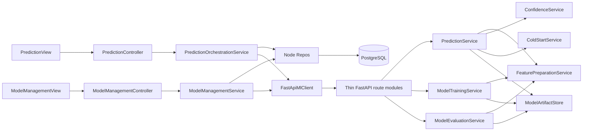

# Module 2: ML Prediction — Detailed Proposed Design

Reconciled on 2026-10-11 from the latest `RSW_SooKinMin_Project1 (1).docx`, especially Sections 3.5–3.6, 4.2, 4.5.3–4.5.4, 4.8 and 4.9.2. Formula images in Section 4.9.2 are part of the source. This document specifies future work; no Python server, TypeScript backend, schema migration or test result is claimed as implemented.

See [module scope](MODULE.md), [architecture](../ARCHITECTURE.md), [canonical schema](../../database_canonical_design.md), [logical design](../../logical_view_canonical_design.md) and [requirement traceability](../../planning_documents_change_report.md). The report governs; prior July design assertions have no overriding authority.

## 1. Responsibilities and permissions

Technical Module 2 maps to Demand Prediction, with reporting, notification and administrative integration. Prediction serves configured active categories for one Android bakery. Four categories/five ingredients are sample seeds, not application limits. Reference workload: up to 20 categories and 365 daily records/category.

| Operation | Authorized role | Planned boundary |
|---|---|---|
| Generate next-day predictions | BAKERY_MANAGER only | `PredictionController → PredictionOrchestrationService` |
| View permitted prediction history/dashboard | Both ACTIVE roles | Node read Service and Repos |
| Train candidate, evaluate, activate, restore | SYSTEM_ADMINISTRATOR only | `ModelManagementController → ModelManagementService` |
| View own low-confidence/failure notifications | Intended authenticated recipient | `NotificationService`, recipient Realtime policy and notification Views |

Node validates JWT signature, issuer, audience and expiry, then loads `user_profiles` and rejects missing/INACTIVE profiles before role checks. It uses the one stored role and authenticated actor, never email or client claims about actor/role. Supabase Auth, recipient-only foreground Realtime and FCM are Flutter platform exceptions; all business CRUD uses Node. No background operation initiates prediction or training.

## 2. Proposed architecture and component contracts



The arrows express dependencies, not database access from Python. Routes are registration modules, not UML Controller classes. Repos are TypeScript classes: `DailySalesRecordRepo`, `BreadCategoryRepo`, `DailyPredictionRepo`, `MlModelVersionRepo`, `ModelEvaluationRepo`, `FeatureImportanceRepo`, `WeatherRepo` and `CalendarRepo`. Services use these Repos and adapters; Controllers only delegate to Services.

`FastApiMlClient` supplies validated DTOs. FastAPI has no Supabase client, credential, database Repo or activation endpoint. `ModelArtifactStore` reads/writes retained model files only; safe artifact identifiers come from the trusted Node contract, not arbitrary client paths.

## 3. Historical observations and feature preparation

The training target and comparable prediction-performance actual are `DailySalesRecord.unitsSold` (SQL `units_sold`). `lostSales` and `estimatedDemand = unitsSold + lostSales` remain operational analytics.

Node's `HistorySelectionService` selects only validated rows, groups by category/business date and chooses one row per group:

1. `ACTUAL_TRANSACTION`
2. `IMPORTED_HISTORICAL`
3. `SIMULATION_GENERATED`

Origin-specific uniqueness prevents duplicates within an origin; invalid actual rows do not suppress valid lower-priority rows. Unresolved same-origin duplicates are rejected for validation rather than silently counted twice. The model threshold counts distinct selected valid days, not raw rows. Actual/imported rows retain their external source reference; simulation rows require `source_daily_result_id`. Preserve each selected origin, even when replacing a lower-priority observation.

Only records preceding the prediction target date may contribute historical features. Planned features include lag sales, shifted rolling averages/trends and same-weekday history; day/weekend/month/monsoon; weather; and holiday information. Fit preprocessing only on the permitted training period. Validation is chronologically after training, and the untouched final test period is later still. Missing-feature handling and configurable feature windows must be recorded with the candidate, with context defaults marked for traceability.

Node owns weather/calendar retrieval and persists prediction references through `weather_record_id` and `prediction_calendar_events`. External failure produces an understandable retry action; configured permissible default/cached context is explicitly marked. Cost, price, revenue and gross profit do not enter the prediction target or recommendation logic.

## 4. Exact prediction algorithms

For each active category, MODEL requires **both** at least 30 distinct validated selected daily observations and a valid active Random Forest artifact. Otherwise return COLD_START with the reason. A missing/corrupt artifact is an operational warning, never a fabricated MODEL prediction.

`ConfidenceService` receives the predictions from all Random Forest trees. Let `mu` be their arithmetic mean and `sigma` their standard deviation. Section 4.9.2 specifies:

```text
predicted_units_sold = max(0, round(mu))
confidence = 100 * max(0, min(1, 1 - sigma / max(abs(mu), 1)))
is_low_confidence = confidence < configured_threshold  # initially 75
```

Calculate from the tree values before rounding the predicted units or display percentage. Nonfinite/empty tree output is a calculation failure, not zero confidence. Store the defined numerical value without imposing a display scale; determine the label from that persisted value before display rounding. A score just below 75 remains Low Confidence even if its displayed percentage rounds to 75. Confidence measures tree agreement. It is not accuracy probability and need not improve as history grows.

For COLD_START:

```text
selected = valid origin-prioritized observations for the category before target date
Bc = mean(selected.unitsSold) if selected is nonempty else configured_category_base
prediction = max(0, round(Bc * Dt * Mt * Wt * Ht))
predictionMode = COLD_START
modelVersionId = null
confidence = null
lowConfidence = true
```

`Dt`, `Mt`, `Wt`, `Ht` are configured weekday, monsoon, weather and holiday factors. A valid observed zero is included in the mean; it does not trigger the configured-base fallback. For the report's round operator, this plan chooses nearest integer with half ties away from zero across Python/Node/Dart; this is an engineering convention, not an additional report requirement. Do not rely on differing language-default tie behavior. Verify 2.5 -> 3 and 3.5 -> 4 for both prediction paths before the nonnegative clamp. `ColdStartService` owns this heuristic; it does not call `ConfidenceService`.

| Example | Expected proposed result |
|---|---|
| `mu=100, sigma=0` | 100 units, confidence 100 |
| `mu=100, sigma=25` | Confidence 75; not Low Confidence at a 75 threshold |
| `mu=100, sigma=26` | Confidence 74; Low Confidence |
| `mu=0, sigma=0` | 0 units, confidence 100 by the defined formula |
| `mu=0.2, sigma=0.8` | Confidence 20; denominator is 1 |
| `sigma >= max(abs(mu),1)` | Confidence 0 after clamping |
| Valid cold-start sales 10 and 14; base setting 99; all factors 1 | 12 units, null confidence; base setting is unused |
| No valid observations; base setting 20; factors 1.2, 1, 0.8, 1 | 19 units after rounding; null confidence |

These are formula examples, not achieved model performance.

## 5. Mode-dependent contracts across layers

Boundary DTO field names are camelCase. Node maps them explicitly to SQL snake_case: `predictedUnitsSold → predicted_units_sold`, `predictionMode → prediction_mode`, `modelVersionId → model_version_id`. Controlled values remain uppercase.

Proposed Zod/TypeScript example; it is not an implemented file:

```typescript
const PredictionCommon = z.object({
  breadCategoryId: z.string().uuid(),
  targetDate: z.string().date(),
  predictedUnitsSold: z.number().int().nonnegative(),
});
const PredictionResult = z.discriminatedUnion('predictionMode', [
  PredictionCommon.extend({
    predictionMode: z.literal('MODEL'),
    modelVersionId: z.string().uuid(),
    confidence: z.number().finite().min(0).max(100),
  }),
  PredictionCommon.extend({
    predictionMode: z.literal('COLD_START'),
    modelVersionId: z.null(),
    confidence: z.null(),
  }),
]);
type PredictionResultDto = z.infer<typeof PredictionResult>;
```

Proposed equivalent Pydantic boundary:

```python
from typing import Annotated, Literal, Union
from datetime import date
from uuid import UUID
from pydantic import BaseModel, Field

class PredictionBase(BaseModel):
    breadCategoryId: UUID
    targetDate: date
    predictedUnitsSold: int = Field(ge=0, strict=True)

class ModelPrediction(PredictionBase):
    predictionMode: Literal["MODEL"]
    modelVersionId: UUID
    confidence: float = Field(ge=0, le=100, allow_inf_nan=False)

class ColdStartPrediction(PredictionBase):
    predictionMode: Literal["COLD_START"]
    modelVersionId: None
    confidence: None

PredictionResult = Annotated[
    Union[ModelPrediction, ColdStartPrediction],
    Field(discriminator="predictionMode"),
]
```

Proposed SQL invariant sketch for the canonical `daily_predictions` table:

```sql
CHECK (
  (prediction_mode = 'MODEL'
    AND model_version_id IS NOT NULL
    AND confidence IS NOT NULL AND confidence BETWEEN 0 AND 100)
  OR
  (prediction_mode = 'COLD_START'
    AND model_version_id IS NULL AND confidence IS NULL)
)
```

`confidence` is nullable at column level; the CHECK makes it mandatory only for MODEL. Node verifies that a referenced model is valid and active at generation time. Later deactivation does not invalidate historical prediction references.

Dart DTOs retain `double? confidence` and `String? modelVersionId`, with runtime mode validation during decoding. MODEL rejects null/out-of-range confidence or absent version; COLD_START rejects any non-null confidence/version. The following is a proposed rendering example after successful decoding:

```dart
String confidenceLabel(PredictionDto value, double threshold) {
  if (value.predictionMode == PredictionMode.coldStart) {
    return 'Cold start — Low-confidence heuristic estimate';
  }
  final score = value.confidence!; // Non-null guaranteed by MODEL decoding.
  final label = score < threshold ? 'Low Confidence' : 'Model agreement';
  return '$label: ${score.toStringAsFixed(1)}%';
}
```

A dashboard average includes only MODEL values and reports its sample count. An all-cold-start selection shows Not Applicable, not 0% or a fabricated heuristic percentage.

| DTO | Required content and invariant |
|---|---|
| `PredictionRequest` | Contract version, target date, active category IDs, selected observations/origins, validated context/factors, category bases, threshold, eligible active artifact identifiers |
| `PredictionResponse` | One discriminated result per requested category, warnings and context provenance; Node verifies category/date/model correspondence |
| `TrainingRequest` | Category, selected validated observations/origins, chronological train/validation/test boundaries, feature/configuration version and candidate identity |
| `TrainingResponse` | Candidate artifact keys and hashes, data period/configuration, feature importance; no active-status claim |
| `EvaluationRequest` | Candidate/LR/current-active artifacts as applicable and the exact untouched later dataset |
| `EvaluationResponse` | MAE/RMSE/MAPE/R², sample counts, unavailable reasons, origin composition, comparison dataset fingerprint |

Dataset fingerprints describe evaluation metadata/DTOs, not a new relational entity. Node owns metadata storage.

## 6. Training, evaluation and model governance

1. An administrator initiates training. Revalidate at least 30 distinct valid daily records/category after deduplication. Insufficient data blocks training and reports the usable count.
2. Split chronologically. Configure/choose model parameters using only earlier training/validation data. Do not refit or select parameters using the final test set.
3. Fit Random Forest and Linear Regression on the same training data and evaluate them on the same test data. Retain preprocessing, feature definitions and source composition.
4. Store successfully completed artifacts as candidates and persist their metadata through Node. Training success does not change the active pointer. Incomplete artifacts/metadata cannot become a valid version.
5. Explicit evaluation records comparable metrics and provenance. To replace an active model, evaluate both candidate and current active model on the exact same chronologically later dataset, unused in either model's fitting or parameter selection.
6. On explicit activation confirmation, lock the category/model rows. Recheck valid artifacts, evaluation identity, the still-current active model and MAE. Reject candidate MAE greater than active MAE (NFR-ACC-05); equality is not a higher-MAE rejection. Missing/noncomparable/undefined primary MAE blocks replacement.
7. Atomically switch the current active row to INACTIVE and candidate to ACTIVE, retaining versions, evaluation history and actor/time audit. Enforce at most one active model/category. Any failure preserves the previous active version.
8. Restoration separately validates a retained previous version and atomically changes the active selection following administrator confirmation. It is explicitly audited as restoration, never disguised as candidate activation.

First activation has no active comparator; require a valid candidate and valid evaluation but do not manufacture an active-model MAE. The report does not prescribe a particular holdout percentage, tree count or minimum test sample count; these are versioned configuration choices, subject to a nonempty valid holdout and mathematically meaningful metrics.

| Metric | Calculation/undefined handling |
|---|---|
| MAE | Mean absolute error on all test observations, including zero actuals; empty test set is unavailable |
| RMSE | Square root of mean squared error on the same complete test set |
| MAPE | Mean absolute percentage error only where actual `unitsSold > 0`; no eligible observations means null/Not Applicable and sample count 0 |
| R² | Standard residual-versus-total variance measure; insufficient samples/zero actual variance means null/Not Applicable, not a library-forced perfect score; negative values are valid |

Every simulation-derived evaluation is visibly labelled simulation-based; mixed-origin evaluation reports composition. Simulated performance is not evidence of real-world forecasting accuracy. MAPE < 10% / R² > 0.85 are optional aspirational targets if retained in research notes. They neither override the higher-MAE activation guard nor establish achieved quality.

## 7. Endpoint and user-interface plan

| Method/path | Role | Planned handling |
|---|---|---|
| `POST /api/predictions` | Manager | Manually generate next-day predictions; accept target date, derive trusted configuration and active categories |
| `GET /api/predictions/:date` | Both, permitted data | Read stored mode/confidence/context/model details and origin-labelled comparisons |
| `GET /api/admin/models` | Administrator | Versions, data periods, configuration, origins, metrics and artifact validity |
| `POST /api/admin/models/train` | Administrator | Create candidates for validated selected categories |
| `POST /api/admin/models/:id/evaluate` | Administrator | Evaluate candidate/baseline and same-test active comparison |
| `POST /api/admin/models/:id/activate` | Administrator | Explicit confirmed, guarded activation |
| `POST /api/admin/models/:id/restore` | Administrator | Explicit confirmed restoration of retained valid version |

Internal `POST /predict`, `POST /train`, `POST /evaluate` accept Node DTOs only. Public model reads cannot expose internal artifact files/secrets. Request body actor/role, active-state claims, confidence and feasibility claims are not trusted.

`PredictionView` shows next-day target date, units, mode, confidence only for MODEL, Low Confidence/heuristic wording, major factors and marked context substitutions. `ModelManagementView` shows candidate versus active/LR metrics on their identified dataset and separate Train, Evaluate, Activate and Restore actions. It never presents candidate training as immediate activation.

Low-confidence and external/system-failure events are handed to Module 1's recipient-based `NotificationService`. It applies preferences, recipient-only foreground Realtime and optional FCM delivery tracking. Opening the app may derive pending-action indicators; no indicator initiates any operation.

## 8. Implementation order and planned verification

Future implementation order:

1. Agree canonical field mapping and discriminated DTOs with Module 0; create Node observation-selection and metadata Repo contracts.
2. Build authenticated Node Controllers/Services and `FastApiMlClient` boundary.
3. Implement Python feature preparation, artifact validation, `ColdStartService` and `ConfidenceService`, followed by thin routes.
4. Add training candidates, chronological evaluations and transactional activation/restoration.
5. Add atomic prediction persistence/context references and recipient events.
6. Build role-specific Views, reporting contracts and meaningful verification.

| Planned check | Expected evidence |
|---|---|
| All three origins on a date; invalid actual row; duplicate same-origin row | Exactly one valid prioritized day; invalid data cannot inflate the 30-day count |
| 29 versus 30 selected days; absent/corrupt active artifact | COLD_START until both eligibility conditions hold |
| Cold-start available zeros, nonzero history, no history | Mean of observations including zero; configured base only when none; factors applied once |
| SQL/Node/Python/Dart mode mismatch fixtures | MODEL/null confidence and COLD_START/numeric confidence both rejected |
| Formula boundaries in Section 4 | Defined scores, clamping and strictly below-threshold label |
| Feature/parameter-selection audit | No future leakage or test-data use; RF/LR use identical train/test observations |
| All-zero actuals, constant actuals, single-row/empty holdout | MAPE/R² unavailable where undefined; no synthetic perfect metrics |
| Higher candidate MAE; changed active version during activation | Replacement rejected, active model retained; stale comparison re-evaluated |
| Training/storage/activation/restoration failure injection | Active version unchanged, no valid incomplete candidate, rollback of activation |
| Manager model-management request; administrator prediction request; INACTIVE profile | Permission rejected before mutation |
| Simulation-origin and mixed-origin history | Labels/composition preserved in UI, evaluation and CSV/PDF reports |
| Reference environment | Prediction within 15 seconds; applicable 50-row screen requests meet 95% within 3 seconds |

Reference environment is Android 10+, at least 4 GB RAM, stable network >=10 Mbps, available backend, up to 20 active categories and 365 daily records/category. Check UI at 360×640 through 412×915 dp. Module 6 plans >=80% independent UAT completion of login, prediction, production confirmation, simulation and leftover recording; participant count and outcomes remain unreported.
