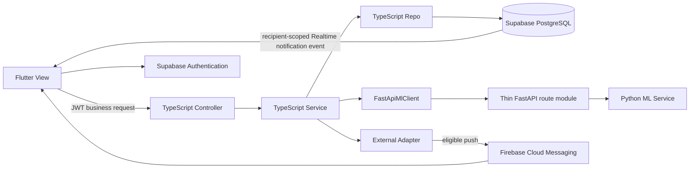

# Module 1: Middleware, Access and Administration — Detailed Plan

**Reconciled:** 2026-10-11 against the latest `RSW_SooKinMin_Project1 (1).docx`, Sections 3.4–3.6, 4.2, 4.5 and 4.8–4.9. **Implementation status:** proposed design only; the repository contains a Flutter starter and planning documents. Names, endpoint contracts, SQL and TypeScript below describe future work, not existing files or verified functionality. The [report mirror](../../RSW_SooKinMin_Project1.docx.md) is for navigation; the DOCX controls.

## 1. Architecture and dependency boundaries

Module 0 supplies the current relational catalogue, controlled values and field mappings in [database_canonical_design.md](../../database_canonical_design.md). Modules 2–5 supply domain behavior; Module 6 supplies pending-action integration and verification. This technical package supports all eight functional modules and directly owns User and Access Management, Alerts and Notifications infrastructure, and System Administration.



Express route modules bind HTTP verbs and paths to Controller methods; they are not Controller classes. Controllers validate transport input and delegate to Services. Services enforce domain permissions and invariants; Repos provide domain queries and transactional persistence. A generic Repo base must not expose unrestricted CRUD for audit, financial or operational records. Node supplies validated data to Python through `FastApiMlClient`; Python has no database credentials, Supabase client or application-table Repo. Flutter's explicit platform exceptions are Supabase Authentication, authenticated recipient-only Realtime notification reads and FCM; ordinary application data CRUD uses Node.

## 2. Identity, role and profile contracts

The request pipeline is: validate Bearer JWT signature/issuer/audience/expiry, obtain the authenticated provider user ID, load `user_profiles`, require `account_status = ACTIVE`, enforce endpoint permission, validate DTO, then call the Service. A missing or inactive profile cannot use a valid JWT to bypass authorization. Role/status changes apply to subsequent requests; do not retain stale authorization in long-lived client state.

```ts
// Proposed domain/transport sketch; authentication creates ActorContext.
type UserRole = 'BAKERY_MANAGER' | 'SYSTEM_ADMINISTRATOR';
type AccountStatus = 'ACTIVE' | 'INACTIVE';
type ActorContext = Readonly<{ userId: string; role: UserRole }>;
type ProfilePatch = { fullName?: string }; // maps to user_profiles.full_name
type AdminUserPatch = {
  fullName?: string;
  role?: UserRole;
  accountStatus?: AccountStatus;
};
```

Each user has exactly one stored role, not a role array or email-derived role. Node rejects client actor IDs, role claims, `confirmedBy`, recipient ownership assertions and asserted feasibility as authority. `ProfileService` allows only own-profile fields and cannot change role/status. Passwords and provider identity changes remain under Supabase Authentication; `AuthAdminAdapter` coordinates authorized provider operations and returns no provider secrets. A PostgreSQL transaction cannot atomically commit an external provider operation: provider-linked account updates require explicit completion/failure handling, and newly provisioned accounts stay inactive until a valid profile exists.

| Table 4.27 function | Bakery Manager | System Administrator |
|---|---|---|
| Own profile, personal notifications, permitted reports/dashboard | Allowed | Allowed |
| Generate prediction; review/confirm production; run POS simulation | Allowed | Rejected |
| Allocate leftovers; update donation status | Allowed | Rejected |
| Manage ingredients, batches, categories, recipes and charity partners | Rejected | Allowed |
| Train/evaluate/activate/restore models | Rejected | Allowed |
| Manage users/roles, approved settings, audit review | Rejected | Allowed |

`UserAdministrationService` validates role/status changes inside a transaction that serializes changes affecting active administrators. Demoting or deactivating the final active administrator is rejected, including concurrent requests that would jointly remove all administrators. Referenced accounts are deactivated, not deleted. `UserProfileRepo` performs the locked role/status update with the audit write; provider credentials are never stored in `user_profiles`.

## 3. Concrete Controllers, Services, Repos and Views

| Endpoints | Planned classes | Flutter responsibility |
|---|---|---|
| `GET/PATCH /api/profile` | `ProfileController -> ProfileService -> UserProfileRepo`; `AuthAdminAdapter` for provider identity | `ProfileView`: permitted personal details, validation and retry |
| `GET/POST /api/admin/users`; `PATCH /api/admin/users/:id` | `UserAdministrationController -> UserAdministrationService -> UserProfileRepo/AuthAdminAdapter` | `UserAdministrationView`: accounts, role/status forms, confirmation and final-admin error |
| `GET/PATCH /api/admin/settings` | `SettingsController -> SettingsService -> BakerySettingsRepo/SystemSettingsRepo` | `SettingsView`: typed allowlisted settings and previous values |
| `GET /api/admin/service-status` | `SettingsController -> SettingsService -> OpenWeatherMapClient/NagerDateClient/FcmPushAdapter` | `ServiceStatusView`: nonsecret connection state and manual retry |
| `GET /api/admin/audit` | `AuditController -> AuditService -> SystemLogRepo` | `AuditView`: read-only date/category/user/outcome filters and pagination |
| `GET /api/notifications`; `PATCH /api/notifications/:id/read` | `NotificationController -> NotificationService -> NotificationRepo` | `NotificationsView`: own notifications and Node mark-read request |
| `GET/PATCH /api/notification-preferences`; `POST/DELETE /api/fcm-tokens` | `NotificationController -> NotificationService -> NotificationPreferenceRepo/FcmTokenRepo` | `NotificationPreferencesView`: per-type choices and device token lifecycle |
| `GET /api/pending-actions?date=YYYY-MM-DD` | `PendingActionController -> PendingActionService -> DailyPredictionRepo/ProductionDecisionRepo/DailyResultRepo/DonationRepo/WasteRecordRepo` | `ManagerDashboardView` / `AdministratorDashboardView`: pending indicators on open/refresh and permitted actions |

The canonical [logical view](../../logical_view_canonical_design.md) gives domain Repo naming and associations. Read models may compose multiple Repos without creating new tables. One route module may register several Controller methods; a route path does not imply a new class or base table.

### Settings and audit details

`bakery_settings` has one singleton row for bakery identity, location, timezone and operating context. `system_settings` holds validated allowlisted operational configuration with type/range rules and updater traceability. Settings include cold-start base/factors, inventory thresholds, initially 75% low-confidence threshold, simulation periods, leftover rules and notification thresholds. The report's minimum of 30 distinct validated days remains enforced; there is no numerical cold-start-confidence setting, automatic production buffer or scheduled daily-reminder setting in current scope.

External-service settings store nonsecret endpoints, location, enabled/configuration status and protected credential references. Keys, service-role credentials and FCM credentials stay in server environment/secret storage, outside settings payloads, client code, logs and database setting values. Validate supported external destinations, dates, units and ranges before saving; a failed connection/configuration change retains the existing valid configuration. The application serves one bakery; no branch management is introduced.

`AuditService` records actor, action, affected entity, outcome, timestamp, severity and nonsecret context in append-only `system_logs`. Successful state changes and their audit writes share their local database transaction. Failed operations can emit a separate failure audit after rollback; this must not commit the failed business change. Audit Views cannot edit/delete original records. Include user-role/status changes, settings, inventory, production decisions, model lifecycle and important failures.

## 4. Context and ML integration contracts

`WeatherService` and `CalendarService` validate provider responses and cache them through `WeatherRepo` and `CalendarRepo`. `ContextService` composes independent context reads; `prediction_calendar_events` links each prediction to all applied calendar events. Missing context yields an understandable retry or an explicitly labeled configured fallback. Do not silently fabricate current weather or holiday results. Adapters hide provider details and use bounded timeouts; mobile requests cannot supply arbitrary provider credentials or URLs.

`PredictionOrchestrationService` validates history and context before `FastApiMlClient` calls Python. History selects one validated record per category/day using `ACTUAL_TRANSACTION`, then `IMPORTED_HISTORICAL`, then `SIMULATION_GENERATED`. Count distinct selected days, not rows, toward the 30-observation threshold. Simulation records reference their `DailyResult`; actual/imported rows preserve external source references. Training/evaluation targets `unitsSold`; estimated demand is analytical.

```ts
// Proposed response. JSON camelCase maps to canonical SQL snake_case.
type PredictionDto = {
  breadCategoryId: string;
  targetDate: string;
  predictedUnitsSold: number; // integer >= 0
  lowConfidence: boolean;
} & (
  | { predictionMode: 'MODEL'; modelVersionId: string; confidence: number }
  | { predictionMode: 'COLD_START'; modelVersionId: null; confidence: null }
);
```

Runtime schemas enforce finite MODEL confidence in `[0,100]`, a valid model version, and `lowConfidence = confidence < configuredThreshold`. MODEL requires both at least 30 selected validated days and an active valid model at generation. COLD_START requires null model version/confidence and `lowConfidence = true`. Do not serialize missing values as zero or a fixed score.

Python `ConfidenceService` is the dedicated calculation boundary: `mu = mean(tree predictions)`, `sigma = stddev(tree predictions)`, `predicted_units_sold = max(0, round(mu))`, `confidence = 100 * max(0, min(1, 1 - sigma / max(abs(mu), 1)))`. Cold start uses `max(0, round(Bc * Dt * Mt * Wt * Ht))`, where `Bc` is the mean of available valid category units sold, falling back to configured base only when none exist. Confidence measures tree agreement, not probability of accurate sales or a promise of improvement.

`ModelManagementController -> ModelManagementService` supports distinct administrator operations through `MlModelVersionRepo` and `FastApiMlClient`: candidate training, evaluation, activation and restoration. RF and LR use the same chronological training/test sets; the later holdout is excluded from fitting and parameter selection. Persist dataset identity/period/origins and MAE, RMSE, MAPE, R². Exclude zero actuals only from MAPE; report undefined MAPE/R² as unavailable. Compare candidate and active model MAE on the same later holdout, reject a higher-MAE candidate, and retain the previous active model on failure. When an active model exists, an unavailable valid comparison blocks activation pending evaluation. First activation with no active model requires a valid candidate, valid chronological evaluation, administrator review and explicit confirmation; no incumbent MAE is fabricated. Restoration selects a previous valid retained version with confirmation and audit. MAPE < 10% and R² > 0.85 are at most aspirational, not acceptance gates or achieved results.

## 5. Operational API integration

| Contract | Permission and invariants |
|---|---|
| `POST /api/predictions`; `GET /api/predictions/:date` | Manager generates next-day predictions; authorized read views preserve mode, null confidence and origins |
| `GET /api/recommendations/:date`; `PUT /api/production-decisions` | Manager reviews/accepts/reduces/overrides; server derives feasibility and actor; overrides require reason |
| `POST /api/admin/models/train`; `POST /api/admin/models/:id/evaluate`, `/activate`, `/restore` | Administrator; candidate remains inactive until explicit eligible activation |
| `POST /api/simulations` with `{ date? }`; `GET /api/simulations/:date` and `/api/simulations/:date/transactions` | Manager initiates simulation; date defaults to bakery current date; no operational `producedOverride` |
| `GET /api/leftovers`; `GET /api/leftovers/:resultId/recommendation`; `POST /api/donations`; `POST /api/waste-records`; `PATCH /api/donations/:id/status` | Role-permitted reads; manager-confirmed allocation/status changes; positive quantity, active charity/disposal reason and transactional bounds |
| `/api/admin/charity-partners` and `/:id` | Administrator create/update/deactivate; history retained |
| `GET /api/dashboard`; `GET /api/reports`; `GET /api/reports/export` | Both roles; date/range/period/category filters; manually requested weekly and other supported reports, CSV/PDF |

The recommendation engine reads stored predictions; it never generates predictions. It reserves confirmed but unprocessed decisions before allocating remaining shared ingredients in category `display_order`. Confirmation replaces any prior quantity for that decision, revalidates the combined plan, recalculates affected recommendations, and changes no stored inventory.

For official simulation, `PosSimulationService -> SimulationCommitRepo` owns one PostgreSQL transaction/RPC. Under row locks, validate stored prediction and matching confirmed decision, check prior processing/unique relationships, revalidate all outstanding ingredient requirements, then `FifoBatchService` consumes active, unexpired batches in ascending `received_date, id`. Inventory snapshots, exact batch movements with cost snapshots, production, sales transactions with price snapshots, DailyResult and one validated simulation-origin DailySalesRecord per category commit together. Any failure rolls them all back. Repeat completed requests return `409 ALREADY_SIMULATED` with a stored-result link and no writes or deductions. No `SimulationRun` or `LeftoverRecord` table is introduced. Re-simulation remains future work until an atomic reversal policy for exact original movements and linked history is defined.

The stored prediction already contains contextual effects; simulation applies only time-slot/stochastic variation. `IngredientCostService.calculateFromMovements` uses consumed batch costs, and reporting compares actual units sold with predicted units sold. External push delivery occurs after business commit; push failures must not roll back completed production or erase the notification.

## 6. Recipient notifications, Realtime and FCM

`NotificationService` receives a validated internal event, identifies authorized active recipients for its type, and creates a separate notification per intended recipient. Events include low stock, batch expiry, low confidence, lost sales, excessive surplus, donation-status updates, and external/system failures. This is not all-staff broadcasting. Operational details go only to users with permission to read the linked resource; push payloads contain a permitted minimal summary.

Notification persistence uses `recipient_user_id`; `NotificationPreferenceRepo` reads `(user_id, notification_type)` in-app/push settings, and `FcmTokenRepo` returns only active valid tokens belonging to that user. Any event duplicate key includes recipient, event/type and related entity/version as needed, so one user's event/read state cannot suppress another user's notification. Mark-read checks both authenticated ownership and notification ID.

Flutter subscribes directly to relevant foreground notification events through Supabase Realtime using its authenticated session. Realtime requires a narrowly scoped recipient-only read policy, not a Node relay. Proposed policy shape:

```sql
-- Design sketch only. Other application tables remain unavailable to client CRUD.
CREATE POLICY notifications_recipient_read
ON public.notifications FOR SELECT TO authenticated
USING (
  recipient_user_id = auth.uid()
  AND private.realtime_notification_allowed(notification_type)
);
```

The proposed `private.realtime_notification_allowed(notification_type)` helper checks the calling user's ACTIVE profile and that type's `in_app_enabled` preference. Use a protected implementation with fixed search path and no arbitrary-user lookup surface. Do not grant clients general `user_profiles` or `notification_preferences` SELECT just to evaluate this predicate. Publish only required notification events, not token/preference/delivery/audit tables. Node remains authoritative for protected linked details and every write/mark-read action. Test actual authenticated event visibility, per-type preference changes and deactivation behavior during implementation.

After a notification commits, push handling follows:

1. Check the recipient's type-specific push preference and account status. If disabled, create `SKIPPED` delivery metadata with a reason; do not call FCM.
2. Retrieve valid active recipient-owned tokens. No usable token yields a `SKIPPED` attempt with reason; an attempted send rejected as invalid is `FAILED` and deactivates the token.
3. Create a `PENDING` attempt for each eligible device, submit through `FcmPushAdapter`, and update to `SUBMITTED` on provider acceptance or `FAILED` on rejection.
4. Set `DELIVERED` only when delivery evidence is available; provider acceptance alone never confirms delivery. Record attempt/submission/delivery times, provider ID and failure reason according to status.
5. Preserve the in-app record regardless of push outcome. An explicit retry may add another tracked attempt where supported; do not introduce a scheduled background retry worker in current scope.

Device registration uses the authenticated user ID; logout deactivates the user's token registration. Token refresh verifies ownership and safely handles reassignment without exposing another user's token. Notification Views reconcile Realtime events with Node reads on app open/refresh and do not infer background delivery from a toast.

## 7. Manual pending workflow

`PendingActionService` derives state when `GET /api/pending-actions` is requested on opening/refreshing the dashboard. Manager indicators cover missing next-day predictions, unconfirmed production, today's unsimulated confirmed production and remaining unallocated leftovers. Administrator Views show only applicable administration/model/configuration issues. A read may identify a pending action; it cannot call prediction, training, confirmation, simulation or allocation Services.

No current-scope cron, timer, 06:00/18:00 reminder promises or automatic background scheduling is planned. Timed reminders are future work; the operation would still require the user's explicit authorized action. Foreground Realtime and background push are event-delivery mechanisms, not schedulers.

## 8. Planned implementation order and validation

1. Finalize catalogue/DTO names and role matrix with Module 0; plan transport validation, bounded errors, redacted logging and protected server configuration.
2. Build JWT/profile authorization and locked final-administrator protection, then profile/admin Controllers, Services, Repos and corresponding Views.
3. Build settings validation, transaction-coupled audit writes, nonsecret adapter status and context cache boundaries.
4. Build recipient notification persistence, preferences, token ownership, delivery tracking and the scoped Realtime read exception.
5. Connect validated ML transport, distinct model lifecycle operations and Modules 3–5 transaction boundaries.
6. Add derived pending-state reads, permitted navigation and manual action confirmations.
7. Execute the planned [Module 6 checks](../operation_reminders_testing/README.md), including wrong/inactive role, forged actor/role/feasibility, concurrent final-admin removal, failed settings update, nullable COLD_START confidence, higher-MAE activation, origin deduplication, shared stock, duplicate/failed simulation, recipient isolation and delivery evidence. Verify list pagination at 50 records and up to 20 active categories.

No packages, migrations, application code, deployment or runtime tests are part of this Markdown reconciliation. Provider operational details and a donation-cancellation/reallocation policy remain decisions for later implementation; they must not be presented as completed functionality.
