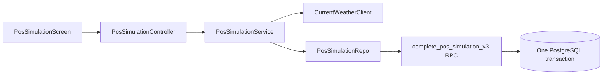

# Module 4: POS Simulation — Detailed Proposed Design

**Design revision - 2026-10-16:** At the user's request, FEFO replaces the report's FIFO policy: eligible batches are consumed by `expiry_date ASC, received_date ASC, id ASC`. The DOCX/report mirror remain unchanged; this is an explicit departure from Sections 4.5.3-4.5.4 and 4.9.3, including BR-INV-05/FR-INV-06. Other report requirements still apply.

Reconciled on 2026-10-11 against the latest `RSW_SooKinMin_Project1 (1).docx`: FR-POS-01–08, NFR-REL-01/04, Sections 4.5.3–4.5.4, 4.7.2, 4.8 and 4.9.3. On 2026-11-12 the local implementation added independent simulation baselines/scenarios, result method snapshots, an administrator form, and normal-ML exclusion of simulated sales. On 2026-11-13 it added backend Current Weather for today and v3 provenance snapshots. These are technical revisions; the FYP report is not edited. Both POS SQL migrations are staged and have not been applied to the live database.

See [module scope](MODULE.md), [inventory plan](../inventory_integration/README.md), [schema](../../database_canonical_design.md), [architecture](../ARCHITECTURE.md), [logical design](../../logical_view_canonical_design.md) and [traceability](../../planning_documents_change_report.md).

## 1. Operational scope and prerequisites

Technical Module 4 delivers POS and Sales Simulation and supplies reporting, prediction history, notification events and leftover allocation inputs. It supports one bakery's Android prototype. Customer ordering, payment processing, delivery, marketplaces, real POS hardware and automatic scheduled simulation are excluded.

Only an ACTIVE BAKERY_MANAGER may start simulation. A SYSTEM_ADMINISTRATOR may view permitted reports/results but cannot run it. Node validates the JWT and stored profile before role checks. Never infer role from email or trust client actor/role/feasibility values.

Default date is today in the configured bakery timezone. Every included category requires:

- A valid stored prediction for exactly the selected date and category.
- An explicit Bakery Manager production decision referencing that prediction.
- A nonnegative confirmed whole quantity, valid recipe and required category/simulation configuration.
- A saved simulation baseline for every active category and valid cached KL public-holiday coverage for the date's year. Missing coverage is a setup error, never an assumed ordinary day.
- No already committed production/result for that decision.
- Sufficient valid ingredients after considering all outstanding commitments for the date.

A confirmed quantity of zero is valid. No recommendation fallback or client production override can replace confirmation. Active categories are configuration-driven; four seed categories/five ingredients are not fixed limits. The reference workload includes 20 active categories.

## 2. Proposed API, contracts and Views

| Method/path | Permission | Contract |
|---|---|---|
| `POST /api/simulations` | Manager | `{ date?: ISODate }`; only the bakery-local current date can run with current weather; weather is resolved by Node, not accepted from the client |
| `GET /api/simulations/today` | Both ACTIVE roles | Current date in the configured bakery timezone |
| `GET /api/simulations/:date` | Both ACTIVE roles, permitted data | Completed daily results, operational-chain references, simulated labels and financial totals |
| `GET /api/simulations/:date/transactions` | Both ACTIVE roles, permitted data | Category/time-slot filters, pagination with at most 50 displayed records/page |
| `GET /api/admin/simulation` | Administrator | Active category baselines and saved simulation scenario |
| `PUT /api/admin/simulation/baselines/:categoryId` | Administrator | Save `{source:'MANUAL',baseDemand}` or `{source:'IMPORTED_HISTORICAL_AVERAGE'}` |
| `PATCH /api/admin/simulation/scenario` | Administrator | Save separate weekday/weather/holiday factors and variation bound; increments version |

The initiation request has no produced quantity, prediction value, user/role, force-replacement or feasibility field. Node derives the trusted categories, decision IDs, actor and operation identifier. Proposed Zod sketch:

```typescript
const SimulateRequest = z.object({
  date: z.string().date().optional(),
}).strict();
```

Unknown fields are rejected. An invalid or missing prerequisite returns a structured validation/conflict response with the missing prediction/decision or ingredient shortage; it creates no completed operation.

| DTO field | Meaning / persistence mapping |
|---|---|
| `date`, `breadCategoryId`, `predictionId`, `productionDecisionId`, `dailyProductionId`, `dailyResultId` | Unique linked category/date operational chain |
| `predictedUnitsSold` | Stored prediction for comparison only; never a demand input |
| `simulatedDemand`, `simulationMethod`, `simulationSnapshot` | Generated demand and source/factor/seed trace; older results remain `PREDICTION_SCALED_V1` or `INDEPENDENT_BASELINE_V2`; current-weather runs are `INDEPENDENT_CURRENT_WEATHER_V3` |
| `predictionMode`, `confidence`, `modelVersionId` | Preserve MODEL numerical confidence/version or COLD_START null/null |
| `produced`, `unitsSold`, `lostSales`, `estimatedDemand`, `leftover` | Nonnegative whole-unit outcomes; maps to canonical SQL fields |
| `salesPredictionError` | Signed `sales_prediction_error` |
| `remainingUnallocatedLeftover` | Initialized to leftover on successful completion |
| `leftoverRatePct`, `grossProfitMarginPct` | Nullable computed percentages; null means Not Applicable |
| `revenue`, `ingredientCost`, `grossProfit` | Snapshot-derived financial reporting; gross profit can be negative |
| `dataOrigin` | Exactly `SIMULATION_GENERATED` for official simulator output |

`PosSimulationScreen` shows selected date, predictions, confirmed quantities, shortages, current-weather loading/error/retry and completed status. Only today's date can start a current-weather run; past results remain viewable. Completed cards distinguish predicted sales, simulated customer demand and fulfilled sales, and show current weather at simulation time with its bakery-local timestamp. `SimulationConfigurationScreen` gives the administrator separate percentage fields and per-category manual/imported-average baseline controls. A request-in-flight button guard improves usability but is not idempotency protection. Completed result links lead to manual leftover allocation and filtered reports; no automatic donation occurs.

## 3. Class boundaries and persistence



The diagram shows class dependencies; the Express route registration module is separate from `PosSimulationController`. Controllers delegate to Services. Services use Repos and existing adapters; no raw database access belongs in Flutter or FastAPI.

`PosSimulationRepo` makes one protected RPC call for the commit. The RPC itself locks and writes the prediction/decision/production/result, inventory/batch/movement, transaction, history and audit tables in one PostgreSQL transaction. Result and transaction reads are separate read-only Repo methods.

The prior `complete_pos_simulation` and v2 RPCs remain as historical migration definitions, but `supabase/migrations/20261113000100_pos_current_weather.sql` revokes direct v2 execution and grants the protected Node service role `complete_pos_simulation_v3`. The v3 function validates weather provenance and bakery-local date, then invokes v2 under one PostgreSQL transaction and adds the v3 snapshot before commit. V2 still revalidates the authenticated actor against the active manager profile. Live SQL execution and failure rollback evidence are still pending.

## 4. Single atomic operation and lock order

Before the transaction, Node uses the backend-only `OPENWEATHER_API_KEY` and `BAKERY_LATITUDE`/`BAKERY_LONGITUDE` to call OpenWeather Current Weather once per operation. Its five-minute cache accepts only observations at most 30 minutes old, with a validated provider timestamp and location within 0.25 degrees of the configured bakery coordinates; request timeout is five seconds. A stale/invalid/API-error response yields retryable `CURRENT_WEATHER_UNAVAILABLE`; no forecast, CLEAR or neutral fallback is inserted. The committed operation reads `simulation_baselines` and `simulation_scenarios` independently of prediction settings. The observed weather category selects a separately configured simulation factor. KL holiday status comes only from valid cached year coverage and current stored KL events. The stored prediction is read for comparison/result linkage and never affects demand.

One transaction covers the entire selected-date simulation, not a separately committed transaction per category:

1. Serialize this production date using the same transaction-level plan lock as `ProductionDecisionService`. Revalidate the ACTIVE manager and current stored predictions, confirmations and configuration.
2. Lock decisions, recipe/configuration rows needed for consistent quantities, inventory snapshots and usable batches in a deterministic order. Shared ingredient locks serialize competing deductions across categories and dates.
3. Reject missing/mismatched date/category links and any already processed decision. A decision is processed only when a committed `daily_production` references its unique decision ID.
4. Recalculate combined requirements for all outstanding decisions for the selected date, including any other commitments relevant to the requested plan. Exclude processed decisions. Reject shortages before deduction.
5. For each selected confirmed decision, deduct valid active batches in ascending `expiry_date`, then `received_date`, then `id`; exclude expired, inactive and future-received batches. Record exact decision-linked movements using one `operation_id` and update batch remainders/status and inventory caches. Category processing is deterministic so movement costs have unambiguous decision owners.
6. Before applying the production fulfilment limit, compute demand from the saved baseline, separately configured weekday/KL-holiday/weather factors and bounded variation. Variation uses a stable date/category/scenario-version seed. Then `units_sold = min(demand, produced)`; time-slot weights distribute the fulfilled sales without changing their total. Selling-price snapshots come from the locked category configuration.
7. Persist one `daily_production` per decision, one `daily_results` per production, all `sales_transactions` and exactly one validated `daily_sales_records` row per category/result with `SIMULATION_GENERATED` origin and `source_daily_result_id`.
8. Verify transaction sums, derived totals, nonnegative quantities, linked records and inventory balances. Record the successful operational audit in the transaction.
9. Commit once and return completed results. Existing recipient notification hooks publish lost-sales/surplus events after commit; provider delivery is independently tracked and is not part of the operational transaction.

Any validation, calculation, deduction, insert or audit failure before commit rolls back **all** attempted batch changes, inventory snapshots, inventory movements, production, sales transactions, results and simulation-origin history. The decision remains unprocessed and stock has no retained deduction. A retry revalidates ingredients and performs FEFO again because the failed attempt committed nothing.

Current orchestration:

```text
PosSimulationService.run(date, authenticatedActor):
  authorize manager using JWT and ACTIVE stored profile
  derive bakery-local date when omitted
CurrentWeatherClient.get() -> validated current observation (outside transaction)
PosSimulationRepo.complete(actor, date, currentWeather)
    -> complete_pos_simulation_v3 RPC (invokes independent-demand v2 logic)
       -> lock, validate, deduct FEFO, simulate, persist and audit
       -> commit everything or roll back everything
```

The RPC owns every operational write. Flutter has no database credentials for these tables.

## 5. Duplicate and concurrent requests

Uniqueness and locking enforce idempotency:

- `production_decisions.prediction_id` is unique.
- `daily_production.production_decision_id` is unique.
- `daily_results.prediction_id` and `daily_production_id` are unique.
- The validated simulation-origin `daily_sales_records.source_daily_result_id` is unique.
- Date/category relationships must match throughout the chain.

An operation UUID groups movements; by itself it does not prevent duplicate production. A second request waits on the relevant plan/decision locks, observes the first completed chain and returns `409 ALREADY_SIMULATED` with a stored-result link. It neither deducts again nor adds partial second-date output. If the first request rolls back, a waiting retry may proceed after fresh validation.

If the server commits but the mobile response is lost, the retry observes the same stored chain. The Flutter View then retrieves the completed result. Push/notification handling remains planned and cannot be used to rerun production.

No `SimulationRun` or `LeftoverRecord` table is introduced. Use the report's existing operational relationships and movement `operation_id`.

## 6. Sales and financial calculations

The prediction and prediction context are comparison data only. An administrator explicitly saves each category's baseline, either manually or as the average of selected validated imported historical sales before the bakery's current date; validated actual sales take priority on overlapping dates. Simulation-generated sales, predictions, production and model metrics never enter the baseline. Saved baselines do not update automatically. The independent scenario has its own weekday, KL-holiday/non-holiday and weather factors, initially neutral; each administrator save creates a new version. These are demo assumptions. The bounded variation defaults to ±10%, seeded by date, category and scenario version. Missing baseline or valid KL coverage blocks simulation. Formula:

```text
seed = md5(date + category_id + scenario_version)
variation_factor = 1 + seeded_variation_pct / 100
simulated_demand = round(saved_base_demand * weekday_factor * holiday_factor * weather_factor * variation_factor)
units_sold = min(simulated_demand, confirmed_produced)
lost_sales = max(0, simulated_demand - confirmed_produced)
estimated_demand = units_sold + lost_sales
leftover = confirmed_produced - units_sold
sales_prediction_error = units_sold - stored_predicted_units_sold
remaining_unallocated_leftover = leftover at simulation completion
```

`daily_results.simulation_method` preserves existing `PREDICTION_SCALED_V1` and `INDEPENDENT_BASELINE_V2` rows without recomputation. New rows use `INDEPENDENT_CURRENT_WEATHER_V3`. The v3 `simulation_snapshot` stores baseline value/source/imported sample metadata, resolved scenario factors, observed current-weather category, provider, provider and fetch timestamps, provider/requested coordinates, holiday event/coverage provenance, variation, seed, scenario version and generated demand. Current weather is an observation at run time, not a full-day history or prediction-time forecast; it does not overwrite `weather_records` or `daily_predictions.context_snapshot`. The old result's generated `estimated_demand` remains its earlier demand value. Time-slot weights allocate nonnegative whole fulfilled units and preserve the total exactly; they are not a second whole-day multiplier. Each transaction has positive quantity, a valid timestamp/slot and a nonnegative captured unit price. Zero sold units produce no sale rows.

On result return/read, Node recomputes V2/V3 demand from the saved numeric snapshot with fixed-point arithmetic and checks the date/category/version seed plus sold/lost/leftover/prediction-error equations and v3 weather provenance. This validation does not replace the database transaction; it detects inconsistent stored or returned results.

Reporting rules:

```text
leftover_rate_pct = leftover / produced * 100, or null when produced = 0
revenue = sum(transaction.quantity * transaction.unit_price)
ingredient_cost = sum(abs(PRODUCTION_DEDUCTION.change_grams) / 1000 * batch.unit_cost)
gross_profit = revenue - ingredient_cost
gross_profit_margin_pct = gross_profit / revenue * 100, or null when revenue = 0
```

The proposed batch cost convention is MYR/kg, with grams converted once by division by 1,000. Cost comes from actual consumed batches and their immutable unit-cost snapshots, not current ingredient master prices or a generic per-unit recipe estimate. Include the cost of all produced bread, whether sold, donated, discarded or unallocated. Each production decision receives only its own movement costs. Round currency at a consistent final precision.

Keep transaction unit-price snapshots so later catalogue price changes cannot rewrite past revenue. Daily totals are verified against transaction detail, and reports use one aggregation level rather than adding both. Financial fields are simulation-labelled reporting estimates; gross profit is not net profit.

Allow signed prediction errors and negative gross profit/margin. UI and CSV/PDF exports show zero-denominator percentages as Not Applicable (null plus appropriate explanatory formatting), not 0%. `leftover_rate_pct` counts unsold units; actual waste is confirmed disposal only. Donation and unallocated leftovers are not waste.

### Illustrative outcomes

| Fixture | Expected proposed outcome |
|---|---|
| Stored prediction 110, independently generated demand 118, confirmed production 100 | Sold 100, lost sales 18, estimated demand 118, leftover 0, signed sales prediction error -10 |
| Confirmed production 0, varied demand 12 | Sold 0, lost sales 12, leftover 0, no sale transactions; leftover rate Not Applicable |
| Produced 10, sold 1 at RM2, actual FEFO ingredient cost RM10 | Revenue RM2, gross profit -RM8, gross-profit margin -400%; valid reporting values |
| Consume 600 g at RM4/kg and 400 g at RM7/kg | Ingredient cost RM5.20, unchanged by a later master-price change |

These are arithmetic examples, not measurements, user study outcomes or proof of improved profitability.

## 7. Provenance, leftovers and notification integration

On successful commit, persist `DailySalesRecord.unitsSold = DailyResult.units_sold`, mark it validated and set `data_origin = SIMULATION_GENERATED` plus its exact source-result ID. Do not create simulation history on initiation, before completion or after a rolled-back attempt.

Node's normal ML preparation selects validated ACTUAL_TRANSACTION before IMPORTED_HISTORICAL per category/day. `SIMULATION_GENERATED` records remain stored and labelled for operational reporting but are excluded from normal training, primary evaluation, prediction lag history and the 30-day eligibility count. There is no current simulation-only experiment endpoint. Existing model artifacts/fingerprints remain untouched; artifacts previously trained on synthetic observations may remain active but cannot be presented as real-world accuracy evidence. A deliberate candidate retrain and common-holdout evaluation using eligible real/imported data is required to replace them; fingerprint checks stay enforced.

Module 5 receives `DailyResult` leftovers and initializes manual allocation workflow. Positive donation/waste allocations require explicit manager confirmation and transactional remaining-balance validation. Category is obtained through the result; maintain `leftover = donated + wasted + remaining_unallocated`. Simulation never allocates leftovers automatically.

Lost-sales, excessive-surplus and external/system-failure events use recipient-specific notifications. `recipient_user_id`, per-type preferences and recipient-owned active FCM tokens determine delivery. Foreground notification events use the report's authenticated recipient-only Supabase Realtime policy; Node owns writes/mark-read. FCM is for eligible background notifications. Delivery states PENDING, SUBMITTED, DELIVERED, FAILED and SKIPPED retain provider evidence; submission is not delivery confirmation. Event deduplication includes recipient and completed-result identity, never one global unread flag.

Report/dashboard endpoints display simulated-data labels and use Module 5's shared report calculations. Manually requested weekly and other CSV/PDF exports preserve selected date/period/category filters and origin labels. A seven-day report has its own 30-second reference requirement.

## 8. Re-simulation, correction and test-only scope

Current operational API rejects replacement of completed simulations. Re-simulation and retrospective corrections are future work until a complete atomic policy resolves:

- Exact restoration of the original batch IDs/movement quantities, including later expiry and subsequent consumption.
- Original price/cost snapshots and deterministic linked transaction/result/history treatment.
- Existing donation/waste allocations and reports/model inputs that refer to the result.
- Concurrent requests, idempotency, audit retention and failure rollback across the replacement.

Do not create correction batches or delete/reinsert linked history as a shortcut. Separately committed reversals cannot provide the required atomic failure rollback.

Pure test-only scenarios may pass fixture production/prediction/random-seed data to isolated calculations. They must not call the operational persistence endpoint with a bypassing quantity or mutate inventory, production, results or training history. The operational API has no override, dry-run-with-writes or force-replacement switch.

## 9. Implementation order and planned verification

Implementation sequence and remaining work:

1. The protected Node route, manager and administrator Views, result/transaction reads, independent demand configuration, joint validation, FEFO batch deduction, batch-cost snapshots, operational writes, notification hooks, reports/exports, audit and history are implemented locally. Backend and Flutter checks pass, without database transaction evidence.
2. Apply the KL holiday migration before `20261112000200_independent_pos_demand.sql`. Configure a baseline for every active category through the administrator form; an imported average is a deliberate save, not a background refresh. Review scenario factors, refresh KL holiday year coverage, and then run the manager's confirmed plan with the chosen demo weather.
3. Verify the real schema, permissions, two concurrent calls, duplicate calls and rollback after injected failures. No live result, provider delivery, UAT or performance outcome is claimed here.

Transactions/rollback are required before exposing operational simulation, not work to add if time remains.

| Planned scenario | Expected evidence |
|---|---|
| Administrator initiation, INACTIVE manager or malformed JWT | Rejected before mutation |
| Missing stored prediction or confirmation; client quantity/actor/role/feasibility fields | Rejected; no inferred production quantity and no writes |
| Default date near UTC/local midnight | Bakery-local current date used consistently |
| Two categories share constrained flour/butter/yeast | Joint commitment validation prevents overspending |
| FEFO receipt order differs from expiry order | Earliest expiry consumed; expired/inactive/unreceived batches excluded; equal expiry uses receipt date then ID |
| Simultaneous duplicate requests and response-lost retry | One committed chain, one deduction; second request links to completed result |
| Failure after first batch update, snapshot update, movement insert, production insert, result insert, transaction insert, history insert or audit | Entire operation restored to pre-attempt state; no completed history and decision remains unprocessed |
| Failure in the last category | Earlier categories also roll back; no per-category partial completion |
| Retry after rollback | Current stock revalidated; exactly one new successful deduction |
| Change only prediction while date/category/scenario/baseline stay fixed | Generated demand and seed unchanged; prediction comparison/error changes |
| Change only confirmed production | Generated demand unchanged; fulfilled sales/lost sales/leftover change by the three formulas |
| Repeat identical scenario on an isolated transaction fixture | Same generated demand; operational duplicate call remains rejected |
| Missing baseline, missing/expired KL coverage, or covered ordinary date | Clear setup error for missing inputs; covered ordinary date uses non-holiday factor |
| Imported average and manual baseline | Only selected validated imported sales before today, excluding overlapping valid actual/simulation rows; manual value saved explicitly |
| Scenario weather and holiday factors changed | Independent demo factors change demand; prediction context snapshot remains untouched |
| Old and new result reads | V1/V2 remain labelled; V3 snapshot explains independent demand and current-weather provenance; no completed result rewritten |
| Zero confirmed production, zero prediction and high demand | Nonnegative results; sold never exceeds confirmation; lost sales retained |
| Sale/slot rounding | Sum of transaction quantities equals result sold; slot totals preserve whole-day total |
| Mixed batch unit costs and later master/catalogue price changes | FEFO cost and transaction revenue snapshots preserved |
| Signed error, negative gross profit/margin and zero denominators | Valid signed values; Not Applicable percentages where undefined |
| Successful/failed simulation history | Exactly one validated simulation source row on success and none on failed attempt |
| Recipient isolation/push opt-out/provider acknowledgement | Personal visibility, no unwanted push; SUBMITTED not mislabelled DELIVERED |
| Export versus View | Identical filters/calculations, simulated labels, no daily/detail double counting |

Reference environment: Android 10+, at least 4 GB RAM, stable network >=10 Mbps, available backend, up to 20 categories, 365 daily records/category and 50 displayed records/list page. Verify a 12-hour simulation within 30 seconds and at least 95% of specified screen requests within 3 seconds. UI covers 360×640–412×915 dp. Module 6 plans >=80% independent UAT completion for login, prediction, production confirmation, simulation and leftover recording, without inventing participant counts or completed results.

## Current-weather setup and deployment (staged 2026-11-13)

Keep OPENWEATHER_API_KEY, BAKERY_LATITUDE and BAKERY_LONGITUDE in the backend environment only. No new Flutter key or prediction setting is needed. Apply the prior independent-demand migration before 20261113000100_pos_current_weather.sql in an isolated database, verify the v3 RPC and same-transaction rollback/duplicate behaviour, then follow the project's normal controlled migration process. Restart the Node backend after applying migrations so its v3 RPC contract is active. Do not rerun completed dates or rewrite saved forecast/weather records. V1/V2 historical results remain readable. Normal model training still excludes SIMULATION_GENERATED history; historical ML context still comes from the original prediction snapshot.

## KL holiday coverage setup for simulation (2026-11-13)

The POS RPC requires a successful, unexpired KUL year row in kl_holiday_syncs and a matching number of current provider events in calendar_events. The migration 20261112000100_kl_holiday_sync.sql supplies these tables/functions; it does not insert holiday data by itself. On 2026-11-13, a read-only live check found the schema present but no 2026 coverage row or current KL events. The provider returned 18 published KUL holidays for 2026. Sign in as SYSTEM_ADMINISTRATOR, open Bakery and Prediction Settings, then KL Public Holidays, select 2026 and tap Retry / Refresh. READY means the year coverage and event count passed the same checks needed by POS. A missing/expired/incomplete year remains blocked; enabling the unverified prediction-calendar fallback does not satisfy POS. The app page also appears on the administrator home screen. Provider or database failure is shown as a retryable error; successful refresh does not run simulation automatically.
