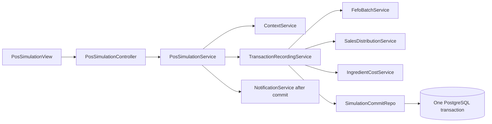

# Module 4: POS Simulation — Detailed Proposed Design

**Design revision - 2026-10-16:** At the user's request, FEFO replaces the report's FIFO policy: eligible batches are consumed by `expiry_date ASC, received_date ASC, id ASC`. The DOCX/report mirror remain unchanged; this is an explicit departure from Sections 4.5.3-4.5.4 and 4.9.3, including BR-INV-05/FR-INV-06. Other report requirements still apply.

Reconciled on 2026-10-11 against the latest `RSW_SooKinMin_Project1 (1).docx`: FR-POS-01–08, NFR-REL-01/04, Sections 4.5.3–4.5.4, 4.7.2, 4.8 and 4.9.3. This is a design and test plan for the Flutter starter repository. No simulation backend, transaction RPC, migration or verification result is claimed to exist.

See [module scope](MODULE.md), [inventory plan](../inventory_integration/README.md), [schema](../../database_canonical_design.md), [architecture](../ARCHITECTURE.md), [logical design](../../logical_view_canonical_design.md) and [traceability](../../planning_documents_change_report.md).

## 1. Operational scope and prerequisites

Technical Module 4 delivers POS and Sales Simulation and supplies reporting, prediction history, notification events and leftover allocation inputs. It supports one bakery's Android prototype. Customer ordering, payment processing, delivery, marketplaces, real POS hardware and automatic scheduled simulation are excluded.

Only an ACTIVE BAKERY_MANAGER may start simulation. A SYSTEM_ADMINISTRATOR may view permitted reports/results but cannot run it. Node validates the JWT and stored profile before role checks. Never infer role from email or trust client actor/role/feasibility values.

Default date is today in the configured bakery timezone. Every included category requires:

- A valid stored prediction for exactly the selected date and category.
- An explicit Bakery Manager production decision referencing that prediction.
- A nonnegative confirmed whole quantity, valid recipe and required category/simulation configuration.
- No already committed production/result for that decision.
- Sufficient valid ingredients after considering all outstanding commitments for the date.

A confirmed quantity of zero is valid. No recommendation fallback or client production override can replace confirmation. Active categories are configuration-driven; four seed categories/five ingredients are not fixed limits. The reference workload includes 20 active categories.

## 2. Proposed API, contracts and Views

| Method/path | Permission | Contract |
|---|---|---|
| `POST /api/simulations` | Manager | `{ date?: ISODate }`; execute the complete selected-date operation |
| `GET /api/simulations/:date` | Both ACTIVE roles, permitted data | Completed daily results, operational-chain references, simulated labels and financial totals |
| `GET /api/simulations/:date/transactions` | Both ACTIVE roles, permitted data | Category/time-slot filters, pagination with at most 50 displayed records/page |

The initiation request has no produced quantity, prediction value, user/role, force-replacement or feasibility field. Node derives the trusted categories, decision IDs, actor and operation identifier. Proposed Zod sketch:

```typescript
const SimulateRequest = z.object({
  date: z.string().date().optional(),
}).strict();
```

Unknown fields are rejected. An invalid or missing prerequisite returns a structured validation/conflict response with the missing prediction/decision or ingredient shortage; it creates no completed operation.

| DTO field | Meaning / persistence mapping |
|---|---|
| `date`, `breadCategoryId`, `predictionId`, `productionDecisionId`, `dailyProductionId`, `dailyResultId` | Unique linked category/date operational chain |
| `predictedUnitsSold` | Stored prediction baseline, never generated inside simulation |
| `predictionMode`, `confidence`, `modelVersionId` | Preserve MODEL numerical confidence/version or COLD_START null/null |
| `produced`, `unitsSold`, `lostSales`, `estimatedDemand`, `leftover` | Nonnegative whole-unit outcomes; maps to canonical SQL fields |
| `salesPredictionError` | Signed `sales_prediction_error` |
| `remainingUnallocatedLeftover` | Initialized to leftover on successful completion |
| `leftoverRatePct`, `grossProfitMarginPct` | Nullable computed percentages; null means Not Applicable |
| `revenue`, `ingredientCost`, `grossProfit` | Snapshot-derived financial reporting; gross profit can be negative |
| `dataOrigin` | Exactly `SIMULATION_GENERATED` for official simulator output |

`PosSimulationView` shows selected date, predictions, confirmed quantities, shortages and completed status. The manager explicitly chooses Run Simulation. Show missing prerequisite actions, understandable errors and retry guidance. A request-in-flight button guard improves usability but is not idempotency protection. Completed result links lead to manual leftover allocation and filtered reports; no automatic donation occurs.

## 3. Class boundaries and persistence



The diagram shows class dependencies; the Express route registration module is separate from `PosSimulationController`. Controllers delegate to Services. Services use Repos and existing adapters; no raw database access belongs in Flutter or FastAPI.

`SimulationCommitRepo` manages a single PostgreSQL connection/transaction and passes its transaction context to `DailyPredictionRepo`, `ProductionDecisionRepo`, `DailyProductionRepo`, `SalesTransactionRepo`, `DailyResultRepo`, `DailySalesRecordRepo`, `InventoryRepo`, `InventoryBatchRepo` and `InventoryLogRepo`. Calls must not silently use a second connection or independent Supabase REST commit.

The equivalent named RPC contract is `complete_pos_simulation`; it is proposed, not an implemented function. Either transaction mechanism must preserve the same row locks, server validation, deduction-before-sales sequence and all-or-nothing writes. No client can invoke the privileged RPC directly. Revoke general execution and permit only the protected Node server role; revalidate its supplied authenticated actor against the active manager profile.

## 4. Single atomic operation and lock order

External weather/holiday/context retrieval happens before acquiring inventory locks. Context for the selected date supports traceability/display and marked fallbacks only. It is never multiplied into the already contextualised baseline again.

One transaction covers the entire selected-date simulation, not a separately committed transaction per category:

1. Serialize this production date using the same transaction-level plan lock as `ProductionDecisionService`. Revalidate the ACTIVE manager and current stored predictions, confirmations and configuration.
2. Lock decisions, recipe/configuration rows needed for consistent quantities, inventory snapshots and usable batches in a deterministic order. Shared ingredient locks serialize competing deductions across categories and dates.
3. Reject missing/mismatched date/category links and any already processed decision. A decision is processed only when a committed `daily_production` references its unique decision ID.
4. Recalculate combined requirements for all outstanding decisions for the selected date, including any other commitments relevant to the requested plan. Exclude processed decisions. Reject shortages before deduction.
5. For each selected confirmed decision, deduct valid active batches in ascending `expiry_date`, then `received_date`, then `id`; exclude expired, inactive and future-received batches. Record exact decision-linked movements using one `operation_id` and update batch remainders/status and inventory caches. Category processing is deterministic so movement costs have unambiguous decision owners.
6. Only after deduction, process simulated sales from stored predictions and configured stochastic/time-slot variations. Selling-price snapshots are captured from the validated category configuration.
7. Persist one `daily_production` per decision, one `daily_results` per production, all `sales_transactions` and exactly one validated `daily_sales_records` row per category/result with `SIMULATION_GENERATED` origin and `source_daily_result_id`.
8. Verify transaction sums, derived totals, nonnegative quantities, linked records and inventory balances. Record the successful operational audit in the transaction.
9. Commit once. Return completed results. Only then dispatch recipient events through `NotificationService`.

Any validation, calculation, deduction, insert or audit failure before commit rolls back **all** attempted batch changes, inventory snapshots, inventory movements, production, sales transactions, results and simulation-origin history. The decision remains unprocessed and stock has no retained deduction. A retry revalidates ingredients and performs FEFO again because the failed attempt committed nothing.

Illustrative orchestration pseudocode, not an implemented backend file:

```text
PosSimulationService.run(date, authenticatedActor):
  authorize manager using JWT and ACTIVE stored profile
  context = ContextService.getForTraceability(date)
  completed = TransactionRecordingService.complete(
    SimulationCommitRepo.withTransaction(tx):
      lockPlanDate(tx, date)
      revalidateActorAndStoredPlan(tx, date, authenticatedActor)
      rejectAnyProcessedDecision(tx)
      lockSharedInventoryAndRecipes(tx)
      validateAllOutstandingRequirements(tx, date)
      movements = FefoBatchService.consumeWithinTransaction(tx)
      outcomes = processStoredPredictionSalesAfterDeduction(tx, context)
      costs = IngredientCostService.calculateFromMovements(movements, batchSnapshots)
      persistProductionTransactionsResultsAndHistory(tx, outcomes, costs)
      verifyTotalsAndAudit(tx)
  )  # commit or total rollback
  NotificationService.emitForCommittedResults(completed)
  return completed
```

The code-shaped sketch describes a Service/Repo transaction contract; it does not authorize independent service commits or database credentials in Services.

## 5. Duplicate and concurrent requests

Uniqueness and locking enforce idempotency:

- `production_decisions.prediction_id` is unique.
- `daily_production.production_decision_id` is unique.
- `daily_results.prediction_id` and `daily_production_id` are unique.
- The validated simulation-origin `daily_sales_records.source_daily_result_id` is unique.
- Date/category relationships must match throughout the chain.

An operation UUID groups movements; by itself it does not prevent duplicate production. A second request waits on the relevant plan/decision locks, observes the first completed chain and returns `409 ALREADY_SIMULATED` with a stored-result link. It neither deducts again nor adds partial second-date output. If the first request rolls back, a waiting retry may proceed after fresh validation.

If the server commits but the mobile response is lost, the retry observes the same stored chain. UI then retrieves the completed result. Push/notification failure is reported separately and never causes production to run again.

No `SimulationRun` or `LeftoverRecord` table is introduced. Use the report's existing operational relationships and movement `operation_id`.

## 6. Sales and financial calculations

The stored prediction already reflects weather, holiday, weekday and monsoon context. The simulator adds only configured stochastic/time-slot variation:

```text
simulated_demand = max(0, round(stored_predicted_units_sold * stochastic_factor))
units_sold = min(simulated_demand, confirmed_produced)
lost_sales = max(0, simulated_demand - confirmed_produced)
estimated_demand = units_sold + lost_sales
leftover = confirmed_produced - units_sold
sales_prediction_error = units_sold - stored_predicted_units_sold
remaining_unallocated_leftover = leftover at simulation completion
```

Time-slot weights/noise allocate nonnegative whole units and preserve the total exactly; apply them as temporal distribution, not a second whole-day multiplier. Validate configured weights and quantity bounds. Morning/afternoon/evening and a 12-hour opening day can be example configuration; they are not a hard-coded category count or guaranteed transaction count. Each transaction has positive quantity, a valid timestamp/slot and a nonnegative captured unit price. Zero sold units produce no sale rows.

Reporting rules:

```text
leftover_rate_pct = leftover / produced * 100, or null when produced = 0
revenue = sum(transaction.quantity * transaction.unit_price)
ingredient_cost = sum(abs(PRODUCTION_DEDUCTION.change_grams) / 1000 * batch.unit_cost)
gross_profit = revenue - ingredient_cost
gross_profit_margin_pct = gross_profit / revenue * 100, or null when revenue = 0
```

The proposed batch cost convention is MYR/kg, with grams converted once by division by 1,000. Cost comes from actual consumed batches and their immutable unit-cost snapshots, not current ingredient master prices or a generic per-unit recipe estimate. Include the cost of all produced bread, whether sold, donated, discarded or unallocated. Each production decision receives only its own movement costs. Round currency at a consistent final precision.

Keep transaction unit-price snapshots so later catalogue price changes cannot rewrite past revenue. Daily totals are verified against transaction detail, and reports use one aggregation level rather than adding both. Financial fields are simulation-labelled reporting estimates; gross profit is not net profit.

Allow signed prediction errors and negative gross profit/margin. UI and CSV/PDF exports show zero-denominator percentages as Not Applicable (null plus appropriate explanatory formatting), not 0%. `leftover_rate_pct` counts unsold units; actual waste is confirmed disposal only. Donation and unallocated leftovers are not waste.

### Illustrative outcomes

| Fixture | Expected proposed outcome |
|---|---|
| Stored prediction 110, confirmed production 100, varied demand 118 | Sold 100, lost sales 18, estimated demand 118, leftover 0, signed sales prediction error -10 |
| Confirmed production 0, varied demand 12 | Sold 0, lost sales 12, leftover 0, no sale transactions; leftover rate Not Applicable |
| Produced 10, sold 1 at RM2, actual FEFO ingredient cost RM10 | Revenue RM2, gross profit -RM8, gross-profit margin -400%; valid reporting values |
| Consume 600 g at RM4/kg and 400 g at RM7/kg | Ingredient cost RM5.20, unchanged by a later master-price change |

These are arithmetic examples, not measurements, user study outcomes or proof of improved profitability.

## 7. Provenance, leftovers and notification integration

On successful commit, persist `DailySalesRecord.unitsSold = DailyResult.units_sold`, mark it validated and set `data_origin = SIMULATION_GENERATED` plus its exact source-result ID. Do not create simulation history on initiation, before completion or after a rolled-back attempt.

Node's subsequent ML data preparation selects one validated category/day record in ACTUAL_TRANSACTION → IMPORTED_HISTORICAL → SIMULATION_GENERATED priority order. Never overwrite higher-priority actual/imported history when saving a simulation. Simulation-based evaluations retain their label; `estimatedDemand` remains analytical rather than a training target.

Module 5 receives `DailyResult` leftovers and initializes manual allocation workflow. Positive donation/waste allocations require explicit manager confirmation and transactional remaining-balance validation. Category is obtained through the result; maintain `leftover = donated + wasted + remaining_unallocated`. Simulation never allocates leftovers automatically.

Lost-sales, excessive-surplus and external/system-failure events use recipient-specific notifications. `recipient_user_id`, per-type preferences and recipient-owned active FCM tokens determine delivery. Foreground notification events use the report's authenticated recipient-only Supabase Realtime policy; Node owns writes/mark-read. FCM is for eligible background notifications. Delivery states PENDING, SUBMITTED, DELIVERED, FAILED and SKIPPED retain provider evidence; submission is not delivery confirmation. Event deduplication includes recipient and completed-result identity, never one global unread flag.

Report/dashboard endpoints display simulated-data labels and use Module 5's shared report calculations. Manually requested weekly and other CSV/PDF exports preserve selected date/period/category filters and origin labels. A seven-day report has its own 30-second reference requirement.

## 8. Re-simulation, correction and test-only scope

Current operational API rejects replacement of completed simulations. Re-simulation and retrospective corrections are future work until a complete atomic policy resolves:

- Exact restoration of the original batch IDs/movement quantities, including later expiry and subsequent consumption.
- Original price/cost snapshots and deterministic linked transaction/result/history treatment.
- Existing donation/waste allocations and reports/model inputs that refer to the result.
- Concurrent requests, idempotency, audit retention and failure rollback across the replacement.

Do not create correction batches or delete/reinsert linked history as a shortcut. Separately committed reversals cannot provide the required atomic failure rollback.

Pure test-only scenarios may pass fixture production/prediction/random-seed data to isolated calculations. They must not call the operational persistence endpoint with a bypassing quantity or mutate inventory, production, results or training history. The operational API has no override, dry-run-with-writes or force-replacement switch.

## 9. Implementation order and planned verification

Future implementation sequence:

1. Align canonical DTOs, source references and unique operational-chain constraints with Module 0.
2. Implement `SimulationCommitRepo` transaction/lock context and the protected transaction/RPC boundary.
3. Integrate Module 3 joint feasibility, FEFO movement ownership and cost snapshots.
4. Implement pure sales/time-slot calculations and deterministic fixture support for verification.
5. Integrate all operational writes, history creation, total validation and audit into the single transaction.
6. Add manager Controller/View flow and post-commit recipient events.
7. Add permitted result/transaction reads, reports and the checks below.

Transactions/rollback are required before exposing operational simulation, not work to add if time remains.

| Planned scenario | Expected evidence |
|---|---|
| Administrator initiation, INACTIVE manager or malformed JWT | Rejected before mutation |
| Missing stored prediction or confirmation; client quantity/actor/role/feasibility fields | Rejected; no inferred production quantity and no writes |
| Default date near UTC/local midnight | Bakery-local current date used consistently |
| Two categories share constrained flour/butter/yeast | Joint commitment validation prevents overspending |
| FEFO receipt order differs from expiry order | Earliest expiry consumed; expired/inactive/unreceived batches excluded; equal expiry uses receipt date then ID |
| Simultaneous duplicate requests and response-lost retry | One committed chain, one deduction; second request links to completed result |
| Failure after first batch update, snapshot update, movement insert, production insert, result insert, transaction insert, history insert or audit | Entire operation restored to pre-attempt state; no completed history and decision remains unprocessed |
| Failure in the last category | Earlier categories also roll back; no per-category partial completion |
| Retry after rollback | Current stock revalidated; exactly one new successful deduction |
| Weather/holiday inputs varied for display with same stored baseline and stochastic fixture | No second overall context multiplier |
| Zero confirmed production, zero prediction and high demand | Nonnegative results; sold never exceeds confirmation; lost sales retained |
| Sale/slot rounding | Sum of transaction quantities equals result sold; slot totals preserve whole-day total |
| Mixed batch unit costs and later master/catalogue price changes | FEFO cost and transaction revenue snapshots preserved |
| Signed error, negative gross profit/margin and zero denominators | Valid signed values; Not Applicable percentages where undefined |
| Successful/failed simulation history | Exactly one validated simulation source row on success and none on failed attempt |
| Recipient isolation/push opt-out/provider acknowledgement | Personal visibility, no unwanted push; SUBMITTED not mislabelled DELIVERED |
| Export versus View | Identical filters/calculations, simulated labels, no daily/detail double counting |

Reference environment: Android 10+, at least 4 GB RAM, stable network >=10 Mbps, available backend, up to 20 categories, 365 daily records/category and 50 displayed records/list page. Verify a 12-hour simulation within 30 seconds and at least 95% of specified screen requests within 3 seconds. UI covers 360×640–412×915 dp. Module 6 plans >=80% independent UAT completion for login, prediction, production confirmation, simulation and leftover recording, without inventing participant counts or completed results.
