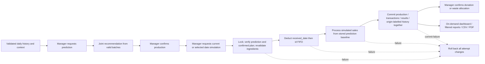

# Smart Bakery functional structure chart

Current planning revision: 2026-10-11. The previous July 2026 chart is a historical planning snapshot, not current approval. Source: [latest report](../RSW_SooKinMin_Project1.docx.md), Sections 1.1, 1.4.2, 4.2, 4.5, 4.7-4.9 and Table 4.27; DOCX takes precedence. Every branch below is proposed.

## Eight functional modules

```mermaid
flowchart TD
  S[Smart Bakery: one bakery / Android] --> U[1 User and Access Management]
  S --> P[2 Demand Prediction]
  S --> I[3 Inventory and Smart Production Recommendation]
  S --> X[4 POS and Sales Simulation]
  S --> L[5 Leftover, Donation and Waste Management]
  S --> R[6 Reporting and Dashboard]
  S --> N[7 Alerts and Notifications]
  S --> A[8 System Administration]
  U --> U1[Supabase Auth; own profile; active stored role]
  P --> P1[Manager requests next-day prediction]
  P --> P2[Validated units-sold history; RF or null-confidence cold start]
  P --> P3[Admin candidate training; holdout evaluation; explicit activation/restoration]
  I --> I1[Admin ingredients / batches / categories / recipes]
  I --> I2[Joint temporary balance; confirmed commitments; display-order allocation]
  I --> I3[Manager confirms feasible quantity and override reason]
  X --> X1[Selected-date prediction and confirmed decision required]
  X --> X2[Atomic receipt-order FIFO; sales; results; validated simulation history]
  L --> L1[Manager-confirmed positive donation or waste]
  L --> L2[Active charity / disposal reason; locked remaining balance]
  L --> L3[Donation status and audit; cancellation policy open]
  R --> R1[Permitted dashboards; date / period / category filters]
  R --> R2[Weekly reports; manual CSV / PDF; shared formulas and simulation labels]
  N --> N1[Recipient-scoped foreground Supabase Realtime]
  N --> N2[Opt-in recipient FCM and delivery tracking]
  N --> N3[Pending indicators on open / refresh; event alerts]
  A --> A1[Users / single roles / active status; preserve final administrator]
  A --> A2[Singleton bakery and typed system settings; external connection configuration]
  A --> A3[Charity records; model lifecycle; audit review]
```

## Roles and operational sequence

Managers generate predictions, review/confirm production, run simulation and allocate leftovers. Administrators manage master data, charity partners, accounts, settings and models; they have no implicit manager permissions. Both roles manage their own profile/notifications and view permitted reports. Authenticate JWT, load ACTIVE profile, then check permission. Charity partners do not log in.

Confirmation does not deduct stock. Temporary recommendations reserve each allocation before considering the next category. Already processed decisions are not outstanding commitments. Simulation has no produced override, recommendation fallback, repeated contextual multiplier, correction-batch recovery or current re-simulation endpoint. Duplicate requests return HTTP 409 ALREADY_SIMULATED with a stored-result link and no further deduction. No automatic donation or scheduled daily workflow is planned.

## Mapping to technical build modules

| Build module | Folder | Functional coverage |
|---|---|---|
| 0 Data Foundation | [data_foundation](data_foundation/MODULE.md) | 1-8 persistence and contracts |
| 1 Node.js Middleware | [nodejs_middleware](nodejs_middleware/MODULE.md) | 1-8 authorization, Controllers/Services/Repos/adapters |
| 2 ML Prediction | [ml_prediction](ml_prediction/MODULE.md) | 2; 8 model governance |
| 3 Inventory Integration | [inventory_integration](inventory_integration/MODULE.md) | 3; 4 FIFO; 7 stock/expiry events |
| 4 POS Simulation | [pos_simulation](pos_simulation/MODULE.md) | 4; 2 validated simulation history; 6; 7 |
| 5 Donation Dashboard | [donation_dashboard](donation_dashboard/MODULE.md) | 5; 6; role-specific UI for 1-8 |
| 6 Operation Reminders and Testing | [operation_reminders_testing](operation_reminders_testing/MODULE.md) | 7 request-derived pending indicators; planned verification of 1-8 |

Four seed categories/five ingredients are illustrative. All operations use configured active categories, including the reference workload of 20. Exclusions: customer ordering/payment, delivery/marketplace, real POS hardware, multi-branch operation and automatic background scheduling. The four objectives remain prediction, inventory-aware recommendation, POS simulation and leftover/donation management.

See [architecture](ARCHITECTURE.md), [canonical class diagrams](../logical_view_canonical_design.md) and [requirement traceability](../planning_documents_change_report.md#requirements-traceability-matrix). Functional branches are not UML classes; route modules are also excluded from class diagrams.
