# Smart Bakery Database Canonical Design

**Status:** PLANNED CANONICAL DESIGN — NOT IMPLEMENTED  
**Design date:** 31 July 2026  
**Chapter target:** Chapter 4.5.2 Entity-Relationship Diagram  
**Primary input:** `database_schema_verification.md`  
**Implementation scope:** Design only; this document is not a migration and does not modify application code

## 1. Approval statement

This document is the final approved relational design for the proposed Smart Bakery Food Waste Reduction System. It resolves the database-verification issues while retaining the project's architecture:

- Supabase Auth owns identities and credentials.
- Node.js/Express owns all application-table access through Repos.
- FastAPI never reads or writes Supabase.
- Flutter accesses application data only through the authenticated Node.js boundary.
- Historical operational records are retained; master data is deactivated rather than cascade-deleted.
- The POS completion workflow is one Node-owned PostgreSQL transaction/RPC.

No table in this document is implementation-verified. The complete design remains **PLANNED** until migrations, generated database types and application Repos exist.

## 2. Canonical conventions

| Area | Approved convention |
|---|---|
| Identifiers | UUID primary keys generated with `gen_random_uuid()`, except `notification_preferences`, which uses its natural composite key |
| Time | `timestamptz` for instants; business dates use `date`; bakery-local opening/sale times use `time` |
| Naming | PostgreSQL `snake_case`; application mappings may use language-standard casing |
| Controlled values | `text` plus named CHECK constraints; canonical values are uppercase |
| Money | `numeric(12,2)` and non-negative unless the value may legitimately be negative, such as gross profit |
| Quantities | `integer` for bread units; `numeric(14,3)` for ingredient grams |
| Deletion | `ON DELETE RESTRICT` for retained domain/history links; deactivate categories, ingredients, partners, profiles and device tokens |
| Updated timestamps | A shared `set_updated_at()` BEFORE UPDATE trigger on tables containing `updated_at` |
| RLS | Enabled on every `public` table; no direct `authenticated` table policies; Node server credentials are the sole application-data boundary |
| Secrets | Never stored in PostgreSQL, Flutter, or the repository; use protected server environment variables or a secret manager |

## 3. Controlled values

In the planned canonical schema, these values are represented by CHECK constraints rather than lookup tables.

| Field/domain | Allowed values |
|---|---|
| User role | `BAKERY_MANAGER`, `SYSTEM_ADMINISTRATOR` |
| Account status | `ACTIVE`, `INACTIVE` |
| Setting data type | `BOOLEAN`, `INTEGER`, `NUMERIC`, `TEXT`, `JSON` |
| Data origin | `ACTUAL_TRANSACTION`, `IMPORTED_HISTORICAL`, `SIMULATION_GENERATED` |
| Ingredient unit | `G`, `KG` |
| Inventory batch status | `ACTIVE`, `DEPLETED`, `EXPIRED`, `DISCARDED` |
| Inventory movement reason | `RESTOCK`, `PRODUCTION_DEDUCTION`, `PRODUCTION_REVERSAL`, `DISCARD`, `CORRECTION` |
| Weather condition | `CLEAR`, `CLOUDY`, `RAIN`, `STORM`, `OTHER` |
| Calendar-event type | `PUBLIC_HOLIDAY`, `SCHOOL_HOLIDAY`, `LOCAL_EVENT`, `RELIGIOUS_HOLIDAY` |
| Model type | `RANDOM_FOREST`, `LINEAR_REGRESSION` |
| Model lifecycle | `CANDIDATE`, `ACTIVE`, `INACTIVE`, `REJECTED` |
| Evaluation label | `ACTUAL_ONLY`, `IMPORTED_HISTORICAL_ONLY`, `SIMULATION_BASED`, `MIXED_NON_SIMULATION` |
| Prediction mode | `MODEL`, `COLD_START` |
| Production option | `FULL_PREDICTION`, `REDUCED_DUE_CONSTRAINT`, `MANUAL_OVERRIDE` |
| Sales time slot | `MORNING`, `AFTERNOON`, `EVENING` |
| Donation status | `RECORDED`, `PICKED_UP`, `DELIVERED` |
| Notification severity | `INFO`, `WARNING`, `CRITICAL` |
| Notification type | `LOW_STOCK`, `LOW_CONFIDENCE`, `LOST_SALES`, `EXCESSIVE_LEFTOVER`, `PREDICTION_REMINDER`, `SIMULATION_REMINDER`, `DONATION_STATUS`, `MODEL_OPERATION_FAILURE`, `EXTERNAL_SERVICE_FAILURE`, `SYSTEM_FAILURE`, `ADMINISTRATIVE_EVENT` |
| Push status | `PENDING`, `SUBMITTED`, `DELIVERED`, `FAILED`, `SKIPPED` |
| Audit outcome | `SUCCESS`, `FAILURE` |
| Audit severity | `INFO`, `WARNING`, `ERROR`, `CRITICAL` |

`disposal_reason`, `location_type`, notification messages and audit event types remain validated non-blank text where a closed business list would be unnecessarily restrictive. `location_type` is free text because no complete bakery-location taxonomy has been approved.

## 4. Final table catalogue

| Package | Table | Purpose |
|---|---|---|
| Supabase Auth | `auth.users` | Supabase-managed identity and credentials; only `id` is referenced by the application schema |
| Access | `user_profiles` | Application name, role and active/inactive account status |
| Configuration | `bakery_settings` | Singleton bakery identity, hours, location type and timezone |
| Configuration | `system_settings` | Validated non-secret key/value system parameters |
| Catalogue | `bread_categories` | Soft-deactivatable bread-category master |
| Catalogue | `ingredients` | Soft-deactivatable ingredient master and current reporting cost |
| Catalogue | `recipes` | Bread-category/ingredient junction with grams per unit |
| Inventory | `inventory` | Cached current ingredient quantity |
| Inventory | `inventory_batches` | FIFO/expiry lots and received unit-cost snapshot |
| Inventory | `inventory_log` | Batch-level stock movements grouped by an operation UUID |
| Context | `weather_records` | Normalized daily weather cache |
| Context | `calendar_events` | Normalized holiday/event cache |
| ML history | `daily_sales_records` | Validated units-sold observations with exact source provenance |
| ML governance | `ml_model_versions` | Retained model candidate/active/inactive/rejected metadata |
| ML governance | `model_evaluations` | Origin-labelled chronological-holdout metrics |
| ML governance | `feature_importance` | Ranked features for a model version |
| Prediction | `daily_predictions` | Stored category/day units-sold prediction |
| Prediction | `prediction_calendar_events` | Prediction/calendar-event junction for reproducibility |
| Production | `production_decisions` | Manager-confirmed production authorization |
| Production | `daily_production` | At-most-one production record authorized by a decision |
| POS | `daily_results` | At-most-one completed result for a production record |
| POS | `sales_transactions` | Raw simulated sales belonging to a completed daily result |
| Surplus | `charity_partners` | Soft-deactivatable donation recipient master |
| Surplus | `donations` | Manager-confirmed allocation from a daily result to a charity |
| Surplus | `waste_records` | Manager-confirmed disposal allocation from a daily result |
| Notifications | `notifications` | One in-application notification/event record per recipient |
| Notifications | `notification_preferences` | Per-user/per-type in-app and push choices |
| Notifications | `fcm_tokens` | Per-user device registrations |
| Notifications | `notification_deliveries` | Per-notification/device push state and provider outcome |
| Audit | `system_logs` | Structured actor/action/entity/outcome audit and operational events |

`sales_by_timeslot` remains a computed PostgreSQL view, not a base table.

## 5. Final columns, keys and constraints

All tables below are **PLANNED CANONICAL DESIGN**.

### 5.1 Access and configuration

#### `auth.users`

This is a Supabase-managed table, not a Smart Bakery migration table. The application schema relies only on:

| Column | PostgreSQL type | Null/default | Key and constraints |
|---|---|---|---|
| `id` | `uuid` | Supabase-managed | PK referenced by `user_profiles.user_id` |

All other Auth columns, indexes, RLS and credential handling remain under Supabase Auth. They are intentionally not duplicated in the `public` schema or expanded in the Chapter 4 application ERD beyond the referenced identity key.

#### `user_profiles`

| Column | PostgreSQL type | Null/default | Key and constraints |
|---|---|---|---|
| `user_id` | `uuid` | NOT NULL | PK; FK → `auth.users.id` ON DELETE RESTRICT |
| `full_name` | `text` | NOT NULL | CHECK non-blank |
| `role` | `text` | NOT NULL | CHECK `BAKERY_MANAGER` or `SYSTEM_ADMINISTRATOR` |
| `account_status` | `text` | NOT NULL; default `ACTIVE` | CHECK `ACTIVE` or `INACTIVE` |
| `created_at` | `timestamptz` | NOT NULL; default `now()` | — |
| `updated_at` | `timestamptz` | NOT NULL; default `now()` | Updated-at trigger |

Passwords, password hashes, access tokens, refresh tokens and authentication credentials are explicitly excluded.

#### `bakery_settings`

| Column | PostgreSQL type | Null/default | Key and constraints |
|---|---|---|---|
| `id` | `uuid` | NOT NULL; default `gen_random_uuid()` | PK |
| `singleton_guard` | `boolean` | NOT NULL; default `true` | UNIQUE; CHECK `singleton_guard = true`, enforcing at most one row |
| `name` | `text` | NOT NULL | CHECK non-blank |
| `location_type` | `text` | NOT NULL | CHECK non-blank |
| `opens_at` | `time` | NOT NULL | CHECK `opens_at < closes_at` |
| `closes_at` | `time` | NOT NULL | Participates in time check |
| `timezone` | `text` | NOT NULL; default `Asia/Kuala_Lumpur` | CHECK non-blank |
| `created_at` | `timestamptz` | NOT NULL; default `now()` | — |
| `updated_at` | `timestamptz` | NOT NULL; default `now()` | Updated-at trigger |

The seed/installation transaction must create the one required row. The database constraint enforces at most one; application health validation enforces exactly one.

#### `system_settings`

| Column | PostgreSQL type | Null/default | Key and constraints |
|---|---|---|---|
| `id` | `uuid` | NOT NULL; default `gen_random_uuid()` | PK |
| `setting_key` | `text` | NOT NULL | UNIQUE; CHECK matches `^[a-z][a-z0-9_.]*$` |
| `setting_value` | `jsonb` | NOT NULL | Must match `data_type` |
| `data_type` | `text` | NOT NULL | CHECK in `BOOLEAN`, `INTEGER`, `NUMERIC`, `TEXT`, `JSON` |
| `description` | `text` | NOT NULL | CHECK non-blank |
| `updated_by` | `uuid` | NOT NULL | FK → `user_profiles.user_id` ON DELETE RESTRICT |
| `updated_at` | `timestamptz` | NOT NULL; default `now()` | Updated-at trigger |

Value/type CHECK:

- `BOOLEAN` requires `jsonb_typeof(setting_value) = 'boolean'`;
- `INTEGER` requires JSON number text matching `^-?[0-9]+$`;
- `NUMERIC` requires `jsonb_typeof(setting_value) = 'number'`;
- `TEXT` requires `jsonb_typeof(setting_value) = 'string'`; and
- `JSON` requires `jsonb_typeof(setting_value)` in `object`, `array`.

Only approved non-secret keys may be stored. Weather, calendar and FCM credentials remain in protected Node server environment variables or a secret manager. Non-secret endpoints, locations, enablement flags and thresholds may use this table.

### 5.2 Catalogue and inventory

#### `bread_categories`

| Column | PostgreSQL type | Null/default | Key and constraints |
|---|---|---|---|
| `id` | `uuid` | NOT NULL; default `gen_random_uuid()` | PK |
| `name` | `text` | NOT NULL | UNIQUE; CHECK non-blank |
| `description` | `text` | NULL | If present, CHECK non-blank |
| `display_order` | `integer` | NOT NULL | UNIQUE; CHECK `display_order >= 0` |
| `shelf_life_hours` | `integer` | NOT NULL; default `24` | CHECK `shelf_life_hours > 0` |
| `selling_price` | `numeric(12,2)` | NOT NULL; default `0` | CHECK `selling_price >= 0`; reporting only |
| `is_active` | `boolean` | NOT NULL; default `true` | Soft deactivation |

#### `ingredients`

| Column | PostgreSQL type | Null/default | Key and constraints |
|---|---|---|---|
| `id` | `uuid` | NOT NULL; default `gen_random_uuid()` | PK |
| `name` | `text` | NOT NULL | UNIQUE; CHECK non-blank |
| `unit` | `text` | NOT NULL; default `G` | CHECK `G` or `KG` |
| `unit_cost` | `numeric(12,2)` | NOT NULL; default `0` | CHECK `unit_cost >= 0`; current reporting cost |
| `reorder_threshold` | `numeric(14,3)` | NOT NULL; default `0` | CHECK `reorder_threshold >= 0` |
| `is_active` | `boolean` | NOT NULL; default `true` | Soft deactivation |

Recipes and inventory are stored in grams. `unit` describes commercial purchasing/cost display and is normalized before operational calculations.

#### `recipes`

| Column | PostgreSQL type | Null/default | Key and constraints |
|---|---|---|---|
| `id` | `uuid` | NOT NULL; default `gen_random_uuid()` | PK |
| `bread_category_id` | `uuid` | NOT NULL | FK → `bread_categories.id` ON DELETE RESTRICT |
| `ingredient_id` | `uuid` | NOT NULL | FK → `ingredients.id` ON DELETE RESTRICT |
| `grams_per_unit` | `numeric(14,3)` | NOT NULL | CHECK `grams_per_unit > 0` |

UNIQUE (`bread_category_id`, `ingredient_id`). This is the category/ingredient junction table.

#### `inventory`

| Column | PostgreSQL type | Null/default | Key and constraints |
|---|---|---|---|
| `id` | `uuid` | NOT NULL; default `gen_random_uuid()` | PK |
| `ingredient_id` | `uuid` | NOT NULL | UNIQUE; FK → `ingredients.id` ON DELETE RESTRICT |
| `quantity_grams` | `numeric(14,3)` | NOT NULL; default `0` | CHECK `quantity_grams >= 0`; cached batch total |
| `updated_by` | `uuid` | NULL | FK → `user_profiles.user_id` ON DELETE RESTRICT; NULL for system RPC |
| `updated_at` | `timestamptz` | NOT NULL; default `now()` | Updated-at trigger |

#### `inventory_batches`

| Column | PostgreSQL type | Null/default | Key and constraints |
|---|---|---|---|
| `id` | `uuid` | NOT NULL; default `gen_random_uuid()` | PK |
| `ingredient_id` | `uuid` | NOT NULL | FK → `ingredients.id` ON DELETE RESTRICT |
| `received_date` | `date` | NOT NULL | CHECK `expiry_date > received_date` |
| `expiry_date` | `date` | NOT NULL | Participates in date check |
| `initial_quantity_grams` | `numeric(14,3)` | NOT NULL | CHECK `> 0` |
| `remaining_quantity_grams` | `numeric(14,3)` | NOT NULL | CHECK `>= 0` and `<= initial_quantity_grams` |
| `unit_cost` | `numeric(12,2)` | NOT NULL | CHECK `unit_cost >= 0`; restock cost snapshot |
| `source` | `text` | NULL | If present, CHECK non-blank |
| `status` | `text` | NOT NULL; default `ACTIVE` | CHECK `ACTIVE`, `DEPLETED`, `EXPIRED`, `DISCARDED` |
| `created_at` | `timestamptz` | NOT NULL; default `now()` | — |

Status consistency:

- `DEPLETED` requires `remaining_quantity_grams = 0`;
- `ACTIVE` requires `remaining_quantity_grams > 0`; and
- expired/discarded rows cannot be selected by the production-deduction RPC.

#### `inventory_log`

| Column | PostgreSQL type | Null/default | Key and constraints |
|---|---|---|---|
| `id` | `uuid` | NOT NULL; default `gen_random_uuid()` | PK |
| `operation_id` | `uuid` | NOT NULL | Idempotency/transaction grouping key; not a `SimulationRun` entity |
| `inventory_id` | `uuid` | NOT NULL | FK → `inventory.id` ON DELETE RESTRICT |
| `batch_id` | `uuid` | NOT NULL | FK → `inventory_batches.id` ON DELETE RESTRICT |
| `production_decision_id` | `uuid` | NULL | FK → `production_decisions.id` ON DELETE RESTRICT |
| `change_grams` | `numeric(14,3)` | NOT NULL | CHECK `change_grams <> 0` |
| `reason` | `text` | NOT NULL | CHECK approved movement reasons |
| `effective_date` | `date` | NOT NULL | — |
| `created_at` | `timestamptz` | NOT NULL; default `now()` | — |

`PRODUCTION_DEDUCTION` and `PRODUCTION_REVERSAL` require a non-null `production_decision_id`. Deduction values are negative; reversal/restock values are positive. `operation_id` groups multiple batch movements without creating a run table.

### 5.3 Context, sales history and ML governance

#### `weather_records`

| Column | PostgreSQL type | Null/default | Key and constraints |
|---|---|---|---|
| `id` | `uuid` | NOT NULL; default `gen_random_uuid()` | PK |
| `weather_date` | `date` | NOT NULL | UNIQUE |
| `condition` | `text` | NOT NULL | CHECK `CLEAR`, `CLOUDY`, `RAIN`, `STORM`, `OTHER` |
| `temp_high_c` | `numeric(5,2)` | NULL | If both temperatures exist, CHECK `temp_low_c <= temp_high_c` |
| `temp_low_c` | `numeric(5,2)` | NULL | Participates in temperature check |
| `humidity_pct` | `numeric(5,2)` | NULL | CHECK NULL or `0 <= humidity_pct <= 100` |
| `fetched_at` | `timestamptz` | NOT NULL; default `now()` | — |

#### `calendar_events`

| Column | PostgreSQL type | Null/default | Key and constraints |
|---|---|---|---|
| `id` | `uuid` | NOT NULL; default `gen_random_uuid()` | PK |
| `event_date` | `date` | NOT NULL | Part of UNIQUE |
| `event_type` | `text` | NOT NULL | CHECK approved event types; part of UNIQUE |
| `event_name` | `text` | NOT NULL | CHECK non-blank; part of UNIQUE |
| `demand_multiplier` | `numeric(6,3)` | NULL | CHECK NULL or `demand_multiplier > 0` |
| `fetched_at` | `timestamptz` | NOT NULL; default `now()` | — |

UNIQUE (`event_date`, `event_type`, `event_name`) permits multiple named events of the same type/date without duplication.

#### `daily_sales_records`

| Column | PostgreSQL type | Null/default | Key and constraints |
|---|---|---|---|
| `id` | `uuid` | NOT NULL; default `gen_random_uuid()` | PK |
| `sales_date` | `date` | NOT NULL | — |
| `bread_category_id` | `uuid` | NOT NULL | FK → `bread_categories.id` ON DELETE RESTRICT |
| `units_sold` | `integer` | NOT NULL | CHECK `units_sold >= 0` |
| `data_origin` | `text` | NOT NULL | CHECK exact `DataOrigin` values |
| `is_validated` | `boolean` | NOT NULL; default `false` | Simulation-generated rows must be true |
| `source_daily_result_id` | `uuid` | NULL | FK → `daily_results.id` ON DELETE RESTRICT; simulation source only |
| `external_source_reference` | `text` | NULL | Non-blank source identifier for actual/imported rows |
| `validation_notes` | `text` | NULL | — |
| `created_at` | `timestamptz` | NOT NULL; default `now()` | — |

Origin CHECK:

- `SIMULATION_GENERATED`: `source_daily_result_id IS NOT NULL`, `external_source_reference IS NULL`, and `is_validated = true`;
- `ACTUAL_TRANSACTION` or `IMPORTED_HISTORICAL`: `source_daily_result_id IS NULL` and `external_source_reference` is non-null/non-blank.

Uniqueness:

- UNIQUE (`sales_date`, `bread_category_id`, `data_origin`) so each origin contributes at most one canonical category/day observation;
- partial UNIQUE (`source_daily_result_id`) where origin is `SIMULATION_GENERATED`;
- partial UNIQUE (`data_origin`, `external_source_reference`) where origin is actual/imported; and
- the POS completion RPC guarantees one simulation-generated row for every completed `daily_results` row before commit.

If more than one origin exists for the same category/day, prediction/training selection uses one validated observation in priority order `ACTUAL_TRANSACTION`, then `IMPORTED_HISTORICAL`, then `SIMULATION_GENERATED`; it never counts multiple origins for the same category/day as separate demand observations.

A composite FK (`source_daily_result_id`, `sales_date`, `bread_category_id`) references the corresponding unique key on `daily_results` so a generated history row cannot use a different date/category.

#### `ml_model_versions`

| Column | PostgreSQL type | Null/default | Key and constraints |
|---|---|---|---|
| `id` | `uuid` | NOT NULL; default `gen_random_uuid()` | PK |
| `version` | `integer` | NOT NULL | CHECK `version > 0`; UNIQUE with category |
| `bread_category_id` | `uuid` | NOT NULL | FK → `bread_categories.id` ON DELETE RESTRICT |
| `model_type` | `text` | NOT NULL | CHECK `RANDOM_FOREST`, `LINEAR_REGRESSION` |
| `artifact_key` | `text` | NOT NULL | CHECK non-blank; reference to FastAPI-managed file artifact |
| `training_start` | `date` | NOT NULL | CHECK `training_start <= training_end` |
| `training_end` | `date` | NOT NULL | Participates in date check |
| `lifecycle_status` | `text` | NOT NULL; default `CANDIDATE` | CHECK canonical lifecycle values |
| `activated_by` | `uuid` | NULL | FK → `user_profiles.user_id` ON DELETE RESTRICT |
| `activated_at` | `timestamptz` | NULL | Activation metadata |
| `created_at` | `timestamptz` | NOT NULL; default `now()` | — |

Constraints:

- UNIQUE (`bread_category_id`, `version`);
- partial UNIQUE (`bread_category_id`) where `lifecycle_status = 'ACTIVE'`;
- `CANDIDATE`/`REJECTED` require activation fields NULL; and
- `ACTIVE`/`INACTIVE` require activation fields non-null, retaining previous activation metadata.

Retraining inserts a new candidate. Evaluation does not activate it. Administrator activation changes the previous active row to `INACTIVE` and the selected evaluated candidate to `ACTIVE` in one transaction. Restoration reactivates a retained valid inactive row; rows and artifacts are not overwritten.

#### `model_evaluations`

| Column | PostgreSQL type | Null/default | Key and constraints |
|---|---|---|---|
| `id` | `uuid` | NOT NULL; default `gen_random_uuid()` | PK |
| `model_version_id` | `uuid` | NOT NULL | FK → `ml_model_versions.id` ON DELETE RESTRICT |
| `holdout_start` | `date` | NOT NULL | CHECK `holdout_start <= holdout_end` |
| `holdout_end` | `date` | NOT NULL | Participates in date check |
| `data_origins` | `text[]` | NOT NULL | Non-empty; members limited to exact `DataOrigin` values |
| `evaluation_label` | `text` | NOT NULL | CHECK canonical labels |
| `mae` | `numeric(14,4)` | NOT NULL | CHECK `mae >= 0` |
| `rmse` | `numeric(14,4)` | NOT NULL | CHECK `rmse >= 0` and `rmse >= mae` |
| `mape` | `numeric(14,4)` | NULL | CHECK NULL or `mape >= 0` |
| `r_squared` | `numeric(14,6)` | NULL | CHECK NULL or `r_squared <= 1`; may be negative |
| `sample_count` | `integer` | NOT NULL | CHECK `sample_count > 0` |
| `mape_sample_count` | `integer` | NOT NULL | CHECK `0 <= mape_sample_count <= sample_count` |
| `evaluated_at` | `timestamptz` | NOT NULL; default `now()` | — |

Additional checks:

- `data_origins` is stored sorted/distinct and must equal one of the seven non-empty combinations of the three approved origins;
- `mape IS NULL` exactly when `mape_sample_count = 0`;
- if `SIMULATION_GENERATED` occurs in `data_origins`, label is `SIMULATION_BASED`;
- `ACTUAL_ONLY` contains only `ACTUAL_TRANSACTION`;
- `IMPORTED_HISTORICAL_ONLY` contains only `IMPORTED_HISTORICAL`; and
- `MIXED_NON_SIMULATION` contains actual and imported origins, never simulation.

Node validates that the holdout is chronologically later than the referenced model's training period before calling FastAPI and before persisting the returned result.

#### `feature_importance`

| Column | PostgreSQL type | Null/default | Key and constraints |
|---|---|---|---|
| `id` | `uuid` | NOT NULL; default `gen_random_uuid()` | PK |
| `model_version_id` | `uuid` | NOT NULL | FK → `ml_model_versions.id` ON DELETE RESTRICT |
| `feature_name` | `text` | NOT NULL | CHECK non-blank |
| `importance_score` | `numeric(10,8)` | NOT NULL | CHECK `0 <= importance_score <= 1` |
| `rank` | `integer` | NOT NULL | CHECK `rank > 0` |

UNIQUE (`model_version_id`, `feature_name`) and UNIQUE (`model_version_id`, `rank`).

#### `daily_predictions`

| Column | PostgreSQL type | Null/default | Key and constraints |
|---|---|---|---|
| `id` | `uuid` | NOT NULL; default `gen_random_uuid()` | PK |
| `target_date` | `date` | NOT NULL | UNIQUE with category |
| `bread_category_id` | `uuid` | NOT NULL | FK → `bread_categories.id` ON DELETE RESTRICT |
| `predicted_units_sold` | `integer` | NOT NULL | CHECK `predicted_units_sold >= 0` |
| `confidence` | `numeric(5,2)` | NOT NULL | CHECK `0 <= confidence <= 100` |
| `prediction_mode` | `text` | NOT NULL | CHECK `MODEL`, `COLD_START` |
| `model_version_id` | `uuid` | NULL | FK → `ml_model_versions.id` ON DELETE RESTRICT |
| `weather_record_id` | `uuid` | NULL | FK → `weather_records.id` ON DELETE RESTRICT |
| `created_at` | `timestamptz` | NOT NULL; default `now()` | — |

UNIQUE (`target_date`, `bread_category_id`). `MODEL` requires `model_version_id`; `COLD_START` requires it to be NULL. Context has already been applied to `predicted_units_sold` and is not multiplied again during POS simulation.

#### `prediction_calendar_events`

| Column | PostgreSQL type | Null/default | Key and constraints |
|---|---|---|---|
| `daily_prediction_id` | `uuid` | NOT NULL | PK part; FK → `daily_predictions.id` ON DELETE RESTRICT |
| `calendar_event_id` | `uuid` | NOT NULL | PK part; FK → `calendar_events.id` ON DELETE RESTRICT |

Composite PK (`daily_prediction_id`, `calendar_event_id`). This is a pure traceability junction; contextual multipliers are not reapplied by POS simulation.

### 5.4 Production, POS and surplus

#### `production_decisions`

| Column | PostgreSQL type | Null/default | Key and constraints |
|---|---|---|---|
| `id` | `uuid` | NOT NULL; default `gen_random_uuid()` | PK |
| `target_date` | `date` | NOT NULL | UNIQUE with category |
| `bread_category_id` | `uuid` | NOT NULL | FK → `bread_categories.id` ON DELETE RESTRICT |
| `prediction_id` | `uuid` | NOT NULL | UNIQUE; FK → `daily_predictions.id` ON DELETE RESTRICT |
| `predicted_units_sold` | `integer` | NOT NULL | CHECK `>= 0`; immutable prediction snapshot |
| `recommended_production` | `integer` | NOT NULL | CHECK `>= 0` |
| `max_producible` | `integer` | NOT NULL | CHECK `>= 0` |
| `final_selected_qty` | `integer` | NOT NULL | CHECK `0 <= final_selected_qty <= max_producible` |
| `selected_option` | `text` | NOT NULL | CHECK canonical production options |
| `decision_reason` | `text` | NULL | Required non-blank for reduced/override |
| `confirmed_by` | `uuid` | NOT NULL | FK → `user_profiles.user_id` ON DELETE RESTRICT |
| `confirmed_at` | `timestamptz` | NOT NULL; default `now()` | — |
| `created_at` | `timestamptz` | NOT NULL; default `now()` | — |
| `updated_at` | `timestamptz` | NOT NULL; default `now()` | Updated-at trigger |

UNIQUE (`target_date`, `bread_category_id`). A composite FK (`prediction_id`, `target_date`, `bread_category_id`) references the corresponding unique key on `daily_predictions`.

Option checks:

- `FULL_PREDICTION`: final quantity equals recommended production and reason is NULL;
- `REDUCED_DUE_CONSTRAINT`: final quantity is below recommended production and reason is non-blank; and
- `MANUAL_OVERRIDE`: reason is non-blank and final quantity remains within `max_producible`.

Confirmation stores authorization only; it does not deduct inventory.

#### `daily_production`

| Column | PostgreSQL type | Null/default | Key and constraints |
|---|---|---|---|
| `id` | `uuid` | NOT NULL; default `gen_random_uuid()` | PK |
| `production_date` | `date` | NOT NULL | UNIQUE with category |
| `bread_category_id` | `uuid` | NOT NULL | FK → `bread_categories.id` ON DELETE RESTRICT |
| `production_decision_id` | `uuid` | NOT NULL | UNIQUE; FK → `production_decisions.id` ON DELETE RESTRICT |
| `recommended_qty` | `integer` | NOT NULL | CHECK `recommended_qty >= 0` |
| `actual_produced` | `integer` | NOT NULL | CHECK `actual_produced >= 0` |
| `adjustment_reason` | `text` | NULL | Required non-blank when actual differs from recommended |
| `created_at` | `timestamptz` | NOT NULL; default `now()` | — |

UNIQUE (`production_date`, `bread_category_id`) and UNIQUE (`id`, `production_date`, `bread_category_id`). A composite FK to the production decision ensures the decision, date and category match. The unique `production_decision_id` means one decision authorizes at most one production row.

#### `daily_results`

| Column | PostgreSQL type | Null/default | Key and constraints |
|---|---|---|---|
| `id` | `uuid` | NOT NULL; default `gen_random_uuid()` | PK |
| `result_date` | `date` | NOT NULL | UNIQUE with category |
| `bread_category_id` | `uuid` | NOT NULL | FK → `bread_categories.id` ON DELETE RESTRICT |
| `prediction_id` | `uuid` | NOT NULL | UNIQUE; FK → `daily_predictions.id` ON DELETE RESTRICT |
| `daily_production_id` | `uuid` | NOT NULL | UNIQUE; FK → `daily_production.id` ON DELETE RESTRICT |
| `predicted_units_sold` | `integer` | NOT NULL | CHECK `>= 0`; immutable prediction snapshot |
| `produced` | `integer` | NOT NULL | CHECK `produced >= 0` |
| `units_sold` | `integer` | NOT NULL | CHECK `0 <= units_sold <= produced` |
| `lost_sales` | `integer` | NOT NULL; default `0` | CHECK `lost_sales >= 0` |
| `estimated_demand` | `integer` | Generated/stored | `units_sold + lost_sales` |
| `leftover` | `integer` | Generated/stored | `produced - units_sold` |
| `remaining_unallocated_leftover` | `integer` | NOT NULL | CHECK `0 <= value <= produced - units_sold`; supplied/maintained transactionally |
| `leftover_rate_pct` | `numeric(7,4)` | Generated/stored; nullable | When produced > 0: `(produced - units_sold) / produced * 100`; otherwise NULL |
| `error_units` | `integer` | Generated/stored | `(units_sold + lost_sales) - predicted_units_sold` |
| `notes` | `text` | NULL | — |
| `revenue` | `numeric(14,2)` | NOT NULL; default `0` | CHECK `revenue >= 0`; transactionally verified sales subtotal cache |
| `ingredient_cost` | `numeric(14,2)` | NOT NULL; default `0` | CHECK `ingredient_cost >= 0`; reporting only |
| `gross_profit` | `numeric(14,2)` | Generated/stored | `revenue - ingredient_cost`; may be negative |
| `created_at` | `timestamptz` | NOT NULL; default `now()` | — |

UNIQUE (`result_date`, `bread_category_id`) and UNIQUE (`id`, `result_date`, `bread_category_id`). Composite FKs ensure the linked prediction and production have the same date/category. One production produces at most one daily result because `daily_production_id` is unique.

The ambiguous `error_pct` is removed. Percentage error for reports remains a computed DTO using a clearly selected denominator. `waste_rate_pct` is replaced by `leftover_rate_pct`; confirmed disposal remains in `waste_records`.

#### `sales_transactions`

| Column | PostgreSQL type | Null/default | Key and constraints |
|---|---|---|---|
| `id` | `uuid` | NOT NULL; default `gen_random_uuid()` | PK |
| `daily_result_id` | `uuid` | NOT NULL | FK → `daily_results.id` ON DELETE RESTRICT |
| `sale_time` | `time` | NOT NULL | — |
| `time_slot` | `text` | NOT NULL | CHECK `MORNING`, `AFTERNOON`, `EVENING` |
| `quantity` | `integer` | NOT NULL | CHECK `quantity > 0` |
| `unit_price` | `numeric(12,2)` | NOT NULL | CHECK `unit_price >= 0`; transaction-time snapshot |
| `subtotal` | `numeric(14,2)` | Generated/stored | `quantity * unit_price` |
| `created_at` | `timestamptz` | NOT NULL; default `now()` | — |

`sale_date` and `bread_category_id` are derived through `daily_result_id` and are not duplicated. This prevents a transaction from claiming a different category/date than its completed result.

#### `charity_partners`

| Column | PostgreSQL type | Null/default | Key and constraints |
|---|---|---|---|
| `id` | `uuid` | NOT NULL; default `gen_random_uuid()` | PK |
| `name` | `text` | NOT NULL | CHECK non-blank |
| `contact_info` | `text` | NULL | — |
| `is_active` | `boolean` | NOT NULL; default `true` | Soft deactivation |
| `created_at` | `timestamptz` | NOT NULL; default `now()` | — |
| `updated_at` | `timestamptz` | NOT NULL; default `now()` | Updated-at trigger |

A partial unique index on normalized lower-case `name` where `is_active = true` prevents duplicate active partners while permitting retained inactive history.

#### `donations`

| Column | PostgreSQL type | Null/default | Key and constraints |
|---|---|---|---|
| `id` | `uuid` | NOT NULL; default `gen_random_uuid()` | PK |
| `daily_result_id` | `uuid` | NOT NULL | FK → `daily_results.id` ON DELETE RESTRICT |
| `charity_partner_id` | `uuid` | NOT NULL | FK → `charity_partners.id` ON DELETE RESTRICT |
| `donation_date` | `date` | NOT NULL | CHECK `donation_date >= daily result date` in allocation RPC |
| `quantity` | `integer` | NOT NULL | CHECK `quantity > 0` |
| `status` | `text` | NOT NULL; default `RECORDED` | CHECK `RECORDED`, `PICKED_UP`, `DELIVERED` |
| `confirmed_by` | `uuid` | NOT NULL | FK → `user_profiles.user_id` ON DELETE RESTRICT |
| `notes` | `text` | NULL | — |
| `created_at` | `timestamptz` | NOT NULL; default `now()` | — |
| `updated_at` | `timestamptz` | NOT NULL; default `now()` | Updated-at trigger |

Bread category is derived from `daily_results` and is not duplicated.

#### `waste_records`

| Column | PostgreSQL type | Null/default | Key and constraints |
|---|---|---|---|
| `id` | `uuid` | NOT NULL; default `gen_random_uuid()` | PK |
| `daily_result_id` | `uuid` | NOT NULL | FK → `daily_results.id` ON DELETE RESTRICT |
| `waste_date` | `date` | NOT NULL | CHECK `waste_date >= daily result date` in allocation RPC |
| `quantity` | `integer` | NOT NULL | CHECK `quantity > 0` |
| `disposal_reason` | `text` | NOT NULL | CHECK non-blank; deliberately free text |
| `confirmed_by` | `uuid` | NOT NULL | FK → `user_profiles.user_id` ON DELETE RESTRICT |
| `created_at` | `timestamptz` | NOT NULL; default `now()` | — |

Bread category is derived from `daily_results` and is not duplicated. Donation quantity plus waste quantity for a result is enforced transactionally and cannot exceed its leftover.

#### `sales_by_timeslot` view

The view joins `sales_transactions` to `daily_results`, then groups by `daily_results.result_date`, `sales_transactions.time_slot`, and `daily_results.bread_category_id`. It returns `sale_date`, `time_slot`, `bread_category_id`, and `SUM(quantity) AS total_sold`. It has no independent PK or lifecycle.

### 5.5 Notifications and audit

#### `notifications`

| Column | PostgreSQL type | Null/default | Key and constraints |
|---|---|---|---|
| `id` | `uuid` | NOT NULL; default `gen_random_uuid()` | PK |
| `recipient_user_id` | `uuid` | NOT NULL | FK → `user_profiles.user_id` ON DELETE RESTRICT |
| `notification_type` | `text` | NOT NULL | CHECK canonical notification types |
| `severity` | `text` | NOT NULL | CHECK `INFO`, `WARNING`, `CRITICAL` |
| `title` | `text` | NOT NULL | CHECK non-blank |
| `message` | `text` | NOT NULL | CHECK non-blank |
| `related_entity_type` | `text` | NULL | Must be paired with related ID; CHECK non-blank if present |
| `related_entity_id` | `uuid` | NULL | Polymorphic navigation identifier, not an FK |
| `is_read` | `boolean` | NOT NULL; default `false` | — |
| `read_at` | `timestamptz` | NULL | NULL when unread; non-null when read |
| `created_at` | `timestamptz` | NOT NULL; default `now()` | — |

Checks require both related-entity fields to be NULL or both non-null, and require `is_read = false` exactly when `read_at IS NULL`.

#### `notification_preferences`

| Column | PostgreSQL type | Null/default | Key and constraints |
|---|---|---|---|
| `user_id` | `uuid` | NOT NULL | Composite PK; FK → `user_profiles.user_id` ON DELETE RESTRICT |
| `notification_type` | `text` | NOT NULL | Composite PK; CHECK canonical notification types |
| `in_app_enabled` | `boolean` | NOT NULL; default `true` | — |
| `push_enabled` | `boolean` | NOT NULL; default `true` | — |
| `updated_at` | `timestamptz` | NOT NULL; default `now()` | Updated-at trigger |

One row controls one user's preference for one notification type. Missing rows use application defaults of enabled/enabled until the row is created.

#### `fcm_tokens`

| Column | PostgreSQL type | Null/default | Key and constraints |
|---|---|---|---|
| `id` | `uuid` | NOT NULL; default `gen_random_uuid()` | PK |
| `user_id` | `uuid` | NOT NULL | FK → `user_profiles.user_id` ON DELETE RESTRICT |
| `token` | `text` | NOT NULL | UNIQUE; CHECK non-blank |
| `device_info` | `text` | NULL | — |
| `is_active` | `boolean` | NOT NULL; default `true` | Soft unregister/invalid-token handling |
| `created_at` | `timestamptz` | NOT NULL; default `now()` | — |
| `updated_at` | `timestamptz` | NOT NULL; default `now()` | Updated-at trigger |

One user may register multiple devices. Historical delivery rows retain their token registration reference; token rotation deactivates the old row and inserts/updates the new token.

#### `notification_deliveries`

This is the smallest normalized structure that records delivery per recipient device while supporting a tokenless `SKIPPED` outcome.

| Column | PostgreSQL type | Null/default | Key and constraints |
|---|---|---|---|
| `id` | `uuid` | NOT NULL; default `gen_random_uuid()` | PK |
| `notification_id` | `uuid` | NOT NULL | FK → `notifications.id` ON DELETE RESTRICT |
| `fcm_token_id` | `uuid` | NULL | FK → `fcm_tokens.id` ON DELETE RESTRICT; NULL only for `SKIPPED` |
| `attempt_number` | `integer` | NOT NULL; default `1` | CHECK `attempt_number > 0` |
| `push_status` | `text` | NOT NULL; default `PENDING` | CHECK canonical push statuses |
| `provider_message_id` | `text` | NULL | Provider return identifier |
| `attempted_at` | `timestamptz` | NULL | Time submission was attempted |
| `delivered_at` | `timestamptz` | NULL | Time delivery was confirmed, where supported |
| `failure_reason` | `text` | NULL | Required non-blank for `FAILED`; NULL otherwise |
| `created_at` | `timestamptz` | NOT NULL; default `now()` | — |
| `updated_at` | `timestamptz` | NOT NULL; default `now()` | Updated-at trigger |

Status checks:

- `PENDING`: token non-null; attempt, delivery, provider ID and failure reason are NULL;
- `SUBMITTED`: token, `attempted_at` and provider message ID are non-null; delivery/failure are NULL;
- `DELIVERED`: token, attempt time, provider message ID and delivery time are non-null; failure is NULL;
- `FAILED`: token and attempt time are non-null; delivery is NULL; failure reason is non-blank; provider ID may be NULL; and
- `SKIPPED`: token may be NULL; provider ID, attempt and delivery times are NULL; failure reason is NULL.

If both timestamps exist, `delivered_at >= attempted_at`. A partial unique index permits one row per (`notification_id`, `fcm_token_id`, `attempt_number`) when the token is non-null. A second partial unique index permits at most one tokenless `SKIPPED` row per notification.

#### `system_logs`

| Column | PostgreSQL type | Null/default | Key and constraints |
|---|---|---|---|
| `id` | `uuid` | NOT NULL; default `gen_random_uuid()` | PK |
| `actor_user_id` | `uuid` | NULL | FK → `user_profiles.user_id` ON DELETE RESTRICT; NULL for system actor |
| `event_type` | `text` | NOT NULL | CHECK non-blank |
| `entity_type` | `text` | NULL | Paired with entity ID; CHECK non-blank if present |
| `entity_id` | `uuid` | NULL | Polymorphic audit reference, not an FK |
| `outcome` | `text` | NOT NULL | CHECK `SUCCESS`, `FAILURE` |
| `severity` | `text` | NOT NULL; default `INFO` | CHECK `INFO`, `WARNING`, `ERROR`, `CRITICAL` |
| `payload` | `jsonb` | NOT NULL; default `{}` | Structured non-secret context |
| `created_at` | `timestamptz` | NOT NULL; default `now()` | Immutable event time |

Entity type/ID must be both NULL or both non-null. Logs are append-only through application permissions. Payloads must not contain credentials, access tokens or provider secrets.

## 6. Exact cardinalities

| Parent | Child | Parent → child | Child → parent | Enforced by |
|---|---|---|---|---|
| `auth.users` | `user_profiles` | `1 → 0..1` | exactly `1` | Profile PK/FK |
| `user_profiles` | `system_settings` | `1 → 0..*` updates | exactly `1` updater | NOT NULL FK |
| `user_profiles` | `inventory` | `1 → 0..*` updates | `0..1` updater | Nullable FK |
| `user_profiles` | `ml_model_versions` | `1 → 0..*` activations | `0..1` actor for candidate; exactly `1` for active/inactive | FK + lifecycle CHECK |
| `user_profiles` | `production_decisions` | `1 → 0..*` confirmations | exactly `1` | NOT NULL FK |
| `user_profiles` | `donations` | `1 → 0..*` confirmations | exactly `1` | NOT NULL FK |
| `user_profiles` | `waste_records` | `1 → 0..*` confirmations | exactly `1` | NOT NULL FK |
| `user_profiles` | `notifications` | `1 → 0..*` notifications | exactly `1` recipient | NOT NULL FK |
| `user_profiles` | `notification_preferences` | `1 → 0..*` type preferences | exactly `1` | Composite PK/FK |
| `user_profiles` | `fcm_tokens` | `1 → 0..*` devices | exactly `1` | NOT NULL FK |
| `user_profiles` | `system_logs` | `1 → 0..*` events | `0..1` actor | Nullable FK |
| `bread_categories` | `recipes` | `1 → 0..*` recipe rows | exactly `1` | NOT NULL FK |
| `ingredients` | `recipes` | `1 → 0..*` recipe rows | exactly `1` | NOT NULL FK |
| `ingredients` | `inventory` | `1 → 0..1` snapshot | exactly `1` | UNIQUE NOT NULL FK |
| `ingredients` | `inventory_batches` | `1 → 0..*` batches | exactly `1` | NOT NULL FK |
| `inventory` | `inventory_log` | `1 → 0..*` movements | exactly `1` | NOT NULL FK |
| `inventory_batches` | `inventory_log` | `1 → 0..*` movements | exactly `1` | NOT NULL FK |
| `bread_categories` | `daily_sales_records` | `1 → 0..*` observations | exactly `1` | NOT NULL FK |
| `bread_categories` | `ml_model_versions` | `1 → 0..*` versions | exactly `1` | NOT NULL FK |
| `ml_model_versions` | `model_evaluations` | `1 → 0..*` evaluations | exactly `1` | NOT NULL FK |
| `ml_model_versions` | `feature_importance` | `1 → 0..*` feature rows | exactly `1` | NOT NULL FK |
| `bread_categories` | `daily_predictions` | `1 → 0..*` predictions | exactly `1` | NOT NULL FK |
| `ml_model_versions` | `daily_predictions` | `1 → 0..*` model predictions | `0..1` version | Nullable FK + mode CHECK |
| `weather_records` | `daily_predictions` | `1 → 0..*` predictions | `0..1` weather row | Nullable FK |
| `daily_predictions` | `calendar_events` | `0..* ↔ 0..*` | `0..* ↔ 0..*` | `prediction_calendar_events` junction |
| `daily_predictions` | `production_decisions` | `1 → 0..1` decision | exactly `1` prediction | UNIQUE NOT NULL FK |
| `production_decisions` | `daily_production` | `1 → 0..1` production | exactly `1` decision | UNIQUE NOT NULL FK |
| `daily_production` | `daily_results` | `1 → 0..1` result | exactly `1` production | UNIQUE NOT NULL FK |
| `daily_predictions` | `daily_results` | `1 → 0..1` result | exactly `1` prediction | UNIQUE NOT NULL FK |
| `daily_results` | `sales_transactions` | `1 → 0..*` sales | exactly `1` result | NOT NULL FK |
| `daily_results` | `daily_sales_records` | completed result → exactly `1` simulation record after commit | simulation record → exactly `1` result | Partial UNIQUE FK + completion RPC |
| `daily_results` | `donations` | `1 → 0..*` donations | exactly `1` result | NOT NULL FK |
| `charity_partners` | `donations` | `1 → 0..*` donations | exactly `1` partner | NOT NULL FK |
| `daily_results` | `waste_records` | `1 → 0..*` waste allocations | exactly `1` result | NOT NULL FK |
| `notifications` | `notification_deliveries` | `1 → 0..*` device/skip rows | exactly `1` notification | NOT NULL FK |
| `fcm_tokens` | `notification_deliveries` | `1 → 0..*` delivery rows | `0..1` token | Nullable FK + status CHECK |

`bakery_settings`, `calendar_events`, `charity_partners`, `notifications` and `system_logs` may be roots in particular workflows. `operation_id` groups inventory movements but is not an entity and creates no ER relationship.

## 7. Canonical indexes

PK and UNIQUE constraints create implicit unique indexes. The following additional/partial indexes are approved.

| Table | Canonical indexes |
|---|---|
| `auth.users` | Supabase-managed indexes; only the referenced PK on `id` is part of this design |
| `user_profiles` | PK (`user_id`); `idx_user_profiles_role_status(role, account_status)` |
| `bakery_settings` | PK; UNIQUE (`singleton_guard`) |
| `system_settings` | PK; UNIQUE (`setting_key`); `idx_system_settings_updated_at(updated_at)` |
| `bread_categories` | PK; UNIQUE (`name`); UNIQUE (`display_order`); `idx_bread_categories_active(is_active, display_order)` |
| `ingredients` | PK; UNIQUE (`name`); `idx_ingredients_active(is_active, name)` |
| `recipes` | PK; UNIQUE (`bread_category_id`, `ingredient_id`); `idx_recipes_ingredient(ingredient_id)` |
| `inventory` | PK; UNIQUE (`ingredient_id`) |
| `inventory_batches` | PK; `idx_inventory_batches_fifo(ingredient_id, status, expiry_date, received_date, id)`; `idx_inventory_batches_expiry(status, expiry_date)` |
| `inventory_log` | PK; `idx_inventory_log_operation(operation_id)`; `idx_inventory_log_inventory_date(inventory_id, effective_date)`; `idx_inventory_log_batch(batch_id)`; `idx_inventory_log_decision(production_decision_id)` |
| `weather_records` | PK; UNIQUE (`weather_date`)—no redundant second date index |
| `calendar_events` | PK; UNIQUE (`event_date`, `event_type`, `event_name`); `idx_calendar_events_date(event_date)` |
| `daily_sales_records` | PK; UNIQUE (`sales_date`, `bread_category_id`, `data_origin`); `idx_daily_sales_history(bread_category_id, sales_date, data_origin)`; partial UNIQUE source-result index; partial UNIQUE external-source index |
| `ml_model_versions` | PK; UNIQUE (`bread_category_id`, `version`); partial UNIQUE (`bread_category_id`) WHERE `lifecycle_status = 'ACTIVE'`; `idx_model_versions_category_status(bread_category_id, lifecycle_status)` |
| `model_evaluations` | PK; `idx_model_evaluations_version_time(model_version_id, evaluated_at DESC)` |
| `feature_importance` | PK; UNIQUE (`model_version_id`, `feature_name`); UNIQUE (`model_version_id`, `rank`) |
| `daily_predictions` | PK; UNIQUE (`target_date`, `bread_category_id`); UNIQUE composite key (`id`, `target_date`, `bread_category_id`); `idx_predictions_model(model_version_id)` |
| `prediction_calendar_events` | Composite PK (`daily_prediction_id`, `calendar_event_id`); `idx_prediction_calendar_event(calendar_event_id)` |
| `production_decisions` | PK; UNIQUE (`target_date`, `bread_category_id`); UNIQUE (`prediction_id`); UNIQUE composite key (`id`, `target_date`, `bread_category_id`); `idx_decisions_confirmed_by(confirmed_by, confirmed_at DESC)` |
| `daily_production` | PK; UNIQUE (`production_date`, `bread_category_id`); UNIQUE (`production_decision_id`); UNIQUE composite key (`id`, `production_date`, `bread_category_id`) |
| `daily_results` | PK; UNIQUE (`result_date`, `bread_category_id`); UNIQUE (`prediction_id`); UNIQUE (`daily_production_id`); UNIQUE composite key (`id`, `result_date`, `bread_category_id`) |
| `sales_transactions` | PK; `idx_sales_result_slot(daily_result_id, time_slot, sale_time)` |
| `charity_partners` | PK; partial UNIQUE (`lower(name)`) WHERE active; `idx_charity_partners_active(is_active, name)` |
| `donations` | PK; `idx_donations_result_date(daily_result_id, donation_date)`; `idx_donations_partner_status(charity_partner_id, status)` |
| `waste_records` | PK; `idx_waste_result_date(daily_result_id, waste_date)` |
| `notifications` | PK; `idx_notifications_recipient_unread(recipient_user_id, is_read, created_at DESC)`; partial unread-related dedupe UNIQUE; partial unread-unrelated-type dedupe UNIQUE |
| `notification_preferences` | Composite PK (`user_id`, `notification_type`) |
| `fcm_tokens` | PK; UNIQUE (`token`); `idx_fcm_tokens_user_active(user_id, is_active)` |
| `notification_deliveries` | PK; partial UNIQUE (`notification_id`, `fcm_token_id`, `attempt_number`) where token non-null; partial UNIQUE (`notification_id`) where token null; `idx_delivery_status(push_status, updated_at)` |
| `system_logs` | PK; `idx_system_logs_created(created_at DESC)`; `idx_system_logs_event(event_type, created_at DESC)`; `idx_system_logs_actor(actor_user_id, created_at DESC)`; `idx_system_logs_entity(entity_type, entity_id, created_at DESC)` |

The unread dedupe indexes use (`recipient_user_id`, `notification_type`, `related_entity_type`, `related_entity_id`) for related notifications and (`recipient_user_id`, `notification_type`) for notification rows without a related entity, both WHERE `is_read = false`.

### 7.1 Updated-at triggers

One shared `set_updated_at()` BEFORE UPDATE trigger function sets `NEW.updated_at = now()`. A row-level trigger uses it on:

- `user_profiles`;
- `bakery_settings`;
- `system_settings`;
- `inventory`;
- `production_decisions`;
- `charity_partners`;
- `donations`;
- `notification_preferences`;
- `fcm_tokens`; and
- `notification_deliveries`.

Generated/stored calculation columns use PostgreSQL generation expressions, not triggers. `system_logs` and operational event/history rows are append-only or immutable except through the approved transaction contracts.

## 8. RLS and access design

### 8.1 Ownership boundary

- Enable RLS on every `public` table in Section 4.
- Do not create general `authenticated` SELECT/INSERT/UPDATE/DELETE policies.
- Flutter may use Supabase Auth for sign-in/session issuance, but it does not query `public` tables.
- Node validates the Supabase JWT, loads `user_profiles`, enforces role/status, and performs database operations through Repos using protected server credentials.
- FastAPI receives versioned DTOs from Node and has no Supabase URL, key, client, Repo or table model.
- FCM, weather and calendar credentials remain outside PostgreSQL.

### 8.2 Table policy matrix

| Table group | RLS | Direct client policies | Write authority |
|---|---|---|---|
| `user_profiles`, settings and catalogue | Enabled | None | Node administration/profile Services through Repos/RPCs |
| Inventory and recipes | Enabled | None | Node Inventory/Recommendation Services through Repos/RPCs |
| Context caches | Enabled | None | Node `ContextService` through Repos |
| Sales history, prediction and ML metadata | Enabled | None | Node prediction/model Services; FastAPI returns DTOs only |
| Production, POS, donation and waste | Enabled | None | Node transactional Services/RPCs |
| Notifications, tokens, preferences and deliveries | Enabled | None | Node Notification Service/Repos; FCM adapter never accesses tables directly |
| `system_logs` | Enabled | None | Node append-only audit service and approved RPCs |
| `auth.users` | Supabase-managed | Supabase-managed | Supabase Auth only |

### 8.3 RPC permissions

Transaction functions are not callable by Flutter or FastAPI. Revoke execution from `PUBLIC`, `anon` and `authenticated`; grant only to the protected Node server database role. Functions validate the supplied actor against `user_profiles.account_status = 'ACTIVE'` and the required role before mutation, and write an audit event.

The `sales_by_timeslot` view uses security-invoker behaviour and remains accessible only through Node's authorized reporting path.

## 9. Transaction and consistency rules

### 9.1 POS completion/FIFO RPC

The canonical Node-owned PostgreSQL transaction/RPC is `complete_pos_simulation`. The name specifies a design contract, not an implemented function.

One call covers the selected business date and all included categories so the simulation is all-or-nothing:

1. Node authenticates the Bakery Manager and supplies a unique `operation_id`, target date, calculated sale events and approved inputs.
2. The RPC validates the active manager profile, stored `daily_predictions`, confirmed `production_decisions`, matching category/date values and absence of an existing production/result for those decisions.
3. It locks the relevant decisions, inventory snapshots and usable batches using row locks.
4. It recalculates required ingredient grams from canonical recipes and selected production quantities.
5. It rejects expired/inactive batches and validates enough usable stock before writing anything.
6. It deducts batches exactly once in `expiry_date`, `received_date`, `id` order; updates `inventory`; and inserts negative `inventory_log` rows with the shared `operation_id` and decision ID.
7. It inserts one `daily_production` per decision and one `daily_results` per production, initializing remaining unallocated leftover to generated leftover.
8. It inserts all `sales_transactions` under their `daily_result_id` and verifies each result's `units_sold` and revenue against those transactions.
9. It inserts exactly one validated `daily_sales_records` row per result with `data_origin = 'SIMULATION_GENERATED'` and the matching `source_daily_result_id`.
10. It writes success audit events and verifies `inventory.quantity_grams` equals the total usable batch remainder.
11. It commits once. Any validation, deduction, insert, calculation or audit failure raises an exception and PostgreSQL rolls back inventory batches, inventory snapshots, logs, production, sales, results and generated sales history together.

The RPC performs no weather, calendar, FCM or FastAPI call. Context is traceability-only during POS simulation; the stored prediction is not multiplied again.

`operation_id` provides idempotency/reversal grouping without a `SimulationRun` table. An authorized replacement/re-simulation is a separate Node-owned transaction that locks the original `operation_id` movements, creates opposite `PRODUCTION_REVERSAL` log entries against the exact batches, removes/replaces permitted dependent operational rows, and commits the reversal/replacement atomically. Historical deletion remains restricted outside this controlled operation.

### 9.2 Leftover allocation RPC

Donation/waste mutation uses a Node-only `allocate_leftover` transaction/RPC:

1. Validate an active `BAKERY_MANAGER` actor and one positive allocation command.
2. Lock the target `daily_results` row.
3. Recalculate confirmed donation total and waste total from child rows.
4. Reject when current donation + current waste + requested quantity exceeds `leftover`.
5. Insert either one donation or one waste row—never both implicitly.
6. Set `remaining_unallocated_leftover = leftover - donation total - waste total`.
7. Write the audit event and commit together.

The recommendation operation performs no write. A manager must confirm each allocation.

### 9.3 Model activation/restoration transaction

Node's model-management transaction locks all versions for a category, verifies a persisted valid evaluation for the selected candidate/inactive version, changes the current active version to `INACTIVE`, changes the selected row to `ACTIVE`, records administrator/time, and commits atomically. The partial unique active-version index prevents concurrent double activation. FastAPI never performs activation or database persistence.

### 9.4 Settings and audit transactions

- Settings updates validate key allowlisting, JSON type and non-secret policy before write and append a `system_logs` event in the same transaction.
- Profile role/status changes are administrator-only, preserve the final active administrator, and are audited transactionally.
- Master records referenced by history are deactivated; ordinary CRUD cannot hard-delete them.

### 9.5 Notification persistence and delivery transitions

For each intended recipient, Node inserts one `notifications` row and evaluates that user's type-specific preference:

- when push is disabled or no active token exists, insert one tokenless `notification_deliveries` row with `SKIPPED`;
- otherwise insert one `PENDING` delivery for every active token belonging to that recipient;
- the FCM adapter changes `PENDING` to `SUBMITTED` or `FAILED`; and
- a supported provider callback may change `SUBMITTED` to `DELIVERED` or `FAILED`.

`DELIVERED`, `FAILED` and `SKIPPED` are terminal for that row. A later explicit retry inserts a new delivery row for the same notification/token with the next `attempt_number`, retaining earlier attempt evidence. Node verifies that every non-null token belongs to the notification recipient. The foreground API applies `in_app_enabled`; notification rows remain retained for audit even when not displayed.

## 10. DTO, computed and file-artifact exclusions

The following are not tables:

| Excluded item | Final treatment |
|---|---|
| `DailyContext` | Request-time DTO composed from weather/calendar records |
| `ProductionRecommendation` | Computed service DTO; confirmed choice persists as `production_decisions` |
| `PredictionCategoryInput`, `PredictionRequest`, `PredictionResult`, `PredictionResponse` | Node/FastAPI transport DTOs |
| `TrainingObservation`, `TrainingRequest`, `TrainingResult` | Node/FastAPI transport DTOs; persisted history remains `daily_sales_records` |
| `EvaluationRequest`, `EvaluationResult`, `ModelMetrics` | Transport/computed DTOs; approved summaries persist in `model_evaluations` |
| Weekly reports/dashboard summaries | Query/service output DTOs generated from source tables |
| PDF/CSV payload | Export adapter output |
| `CategoryPredictor`, Random Forest and Linear Regression artifacts | FastAPI-managed files; only `artifact_key` and metadata persist |
| Cold-start output | Prediction DTO/result stored only as `daily_predictions` |
| FIFO calculation/deduction response | RPC/service result; movements persist in `inventory_log` |
| `SimulationRun` | Excluded; `operation_id` is only an idempotency/grouping value |
| `LeftoverRecord` | Excluded; leftover state belongs to `daily_results` |
| `sales_by_timeslot` | Computed PostgreSQL view, not a base table |

Generated/cached columns are also not separate entities: subtotal, estimated demand, leftover, remaining allocation, leftover rate, error units, revenue, ingredient cost and gross profit.

## 11. Final Mermaid ERD

```mermaid
erDiagram
    AUTH_USERS {
        uuid id PK
    }

    USER_PROFILES {
        uuid user_id PK, FK
        text full_name
        text role
        text account_status
        timestamptz created_at
        timestamptz updated_at
    }

    BAKERY_SETTINGS {
        uuid id PK
        boolean singleton_guard UK
        text name
        text location_type
        time opens_at
        time closes_at
        text timezone
        timestamptz created_at
        timestamptz updated_at
    }

    SYSTEM_SETTINGS {
        uuid id PK
        text setting_key UK
        jsonb setting_value
        text data_type
        text description
        uuid updated_by FK
        timestamptz updated_at
    }

    BREAD_CATEGORIES {
        uuid id PK
        text name UK
        text description
        int display_order UK
        int shelf_life_hours
        numeric selling_price
        boolean is_active
    }

    INGREDIENTS {
        uuid id PK
        text name UK
        text unit
        numeric unit_cost
        numeric reorder_threshold
        boolean is_active
    }

    RECIPES {
        uuid id PK
        uuid bread_category_id FK
        uuid ingredient_id FK
        numeric grams_per_unit
    }

    INVENTORY {
        uuid id PK
        uuid ingredient_id FK, UK
        numeric quantity_grams
        uuid updated_by FK
        timestamptz updated_at
    }

    INVENTORY_BATCHES {
        uuid id PK
        uuid ingredient_id FK
        date received_date
        date expiry_date
        numeric initial_quantity_grams
        numeric remaining_quantity_grams
        numeric unit_cost
        text source
        text status
        timestamptz created_at
    }

    INVENTORY_LOG {
        uuid id PK
        uuid operation_id
        uuid inventory_id FK
        uuid batch_id FK
        uuid production_decision_id FK
        numeric change_grams
        text reason
        date effective_date
        timestamptz created_at
    }

    WEATHER_RECORDS {
        uuid id PK
        date weather_date UK
        text condition
        numeric temp_high_c
        numeric temp_low_c
        numeric humidity_pct
        timestamptz fetched_at
    }

    CALENDAR_EVENTS {
        uuid id PK
        date event_date
        text event_type
        text event_name
        numeric demand_multiplier
        timestamptz fetched_at
    }

    DAILY_SALES_RECORDS {
        uuid id PK
        date sales_date
        uuid bread_category_id FK
        int units_sold
        text data_origin
        boolean is_validated
        uuid source_daily_result_id FK
        text external_source_reference
        text validation_notes
        timestamptz created_at
    }

    ML_MODEL_VERSIONS {
        uuid id PK
        int version
        uuid bread_category_id FK
        text model_type
        text artifact_key
        date training_start
        date training_end
        text lifecycle_status
        uuid activated_by FK
        timestamptz activated_at
        timestamptz created_at
    }

    MODEL_EVALUATIONS {
        uuid id PK
        uuid model_version_id FK
        date holdout_start
        date holdout_end
        text_array data_origins
        text evaluation_label
        numeric mae
        numeric rmse
        numeric mape
        numeric r_squared
        int sample_count
        int mape_sample_count
        timestamptz evaluated_at
    }

    FEATURE_IMPORTANCE {
        uuid id PK
        uuid model_version_id FK
        text feature_name
        numeric importance_score
        int rank
    }

    DAILY_PREDICTIONS {
        uuid id PK
        date target_date
        uuid bread_category_id FK
        int predicted_units_sold
        numeric confidence
        text prediction_mode
        uuid model_version_id FK
        uuid weather_record_id FK
        timestamptz created_at
    }

    PREDICTION_CALENDAR_EVENTS {
        uuid daily_prediction_id PK, FK
        uuid calendar_event_id PK, FK
    }

    PRODUCTION_DECISIONS {
        uuid id PK
        date target_date
        uuid bread_category_id FK
        uuid prediction_id FK, UK
        int predicted_units_sold
        int recommended_production
        int max_producible
        int final_selected_qty
        text selected_option
        text decision_reason
        uuid confirmed_by FK
        timestamptz confirmed_at
        timestamptz created_at
        timestamptz updated_at
    }

    DAILY_PRODUCTION {
        uuid id PK
        date production_date
        uuid bread_category_id FK
        uuid production_decision_id FK, UK
        int recommended_qty
        int actual_produced
        text adjustment_reason
        timestamptz created_at
    }

    DAILY_RESULTS {
        uuid id PK
        date result_date
        uuid bread_category_id FK
        uuid prediction_id FK, UK
        uuid daily_production_id FK, UK
        int predicted_units_sold
        int produced
        int units_sold
        int lost_sales
        int estimated_demand
        int leftover
        int remaining_unallocated_leftover
        numeric leftover_rate_pct
        int error_units
        text notes
        numeric revenue
        numeric ingredient_cost
        numeric gross_profit
        timestamptz created_at
    }

    SALES_TRANSACTIONS {
        uuid id PK
        uuid daily_result_id FK
        time sale_time
        text time_slot
        int quantity
        numeric unit_price
        numeric subtotal
        timestamptz created_at
    }

    CHARITY_PARTNERS {
        uuid id PK
        text name
        text contact_info
        boolean is_active
        timestamptz created_at
        timestamptz updated_at
    }

    DONATIONS {
        uuid id PK
        uuid daily_result_id FK
        uuid charity_partner_id FK
        date donation_date
        int quantity
        text status
        uuid confirmed_by FK
        text notes
        timestamptz created_at
        timestamptz updated_at
    }

    WASTE_RECORDS {
        uuid id PK
        uuid daily_result_id FK
        date waste_date
        int quantity
        text disposal_reason
        uuid confirmed_by FK
        timestamptz created_at
    }

    NOTIFICATIONS {
        uuid id PK
        uuid recipient_user_id FK
        text notification_type
        text severity
        text title
        text message
        text related_entity_type
        uuid related_entity_id
        boolean is_read
        timestamptz read_at
        timestamptz created_at
    }

    NOTIFICATION_PREFERENCES {
        uuid user_id PK, FK
        text notification_type PK
        boolean in_app_enabled
        boolean push_enabled
        timestamptz updated_at
    }

    FCM_TOKENS {
        uuid id PK
        uuid user_id FK
        text token UK
        text device_info
        boolean is_active
        timestamptz created_at
        timestamptz updated_at
    }

    NOTIFICATION_DELIVERIES {
        uuid id PK
        uuid notification_id FK
        uuid fcm_token_id FK
        int attempt_number
        text push_status
        text provider_message_id
        timestamptz attempted_at
        timestamptz delivered_at
        text failure_reason
        timestamptz created_at
        timestamptz updated_at
    }

    SYSTEM_LOGS {
        uuid id PK
        uuid actor_user_id FK
        text event_type
        text entity_type
        uuid entity_id
        text outcome
        text severity
        jsonb payload
        timestamptz created_at
    }

    AUTH_USERS ||--o| USER_PROFILES : has_profile
    USER_PROFILES ||--o{ SYSTEM_SETTINGS : updates
    USER_PROFILES o|--o{ INVENTORY : updates
    USER_PROFILES o|--o{ ML_MODEL_VERSIONS : activates
    USER_PROFILES ||--o{ PRODUCTION_DECISIONS : confirms
    USER_PROFILES ||--o{ DONATIONS : confirms
    USER_PROFILES ||--o{ WASTE_RECORDS : confirms
    USER_PROFILES ||--o{ NOTIFICATIONS : receives
    USER_PROFILES ||--o{ NOTIFICATION_PREFERENCES : configures
    USER_PROFILES ||--o{ FCM_TOKENS : registers
    USER_PROFILES o|--o{ SYSTEM_LOGS : acts_in

    BREAD_CATEGORIES ||--o{ RECIPES : defines
    INGREDIENTS ||--o{ RECIPES : required_by
    INGREDIENTS ||--o| INVENTORY : has_snapshot
    INGREDIENTS ||--o{ INVENTORY_BATCHES : has_batches
    INVENTORY ||--o{ INVENTORY_LOG : records
    INVENTORY_BATCHES ||--o{ INVENTORY_LOG : moved_in
    PRODUCTION_DECISIONS o|--o{ INVENTORY_LOG : causes

    BREAD_CATEGORIES ||--o{ DAILY_SALES_RECORDS : has_history
    BREAD_CATEGORIES ||--o{ ML_MODEL_VERSIONS : has_versions
    ML_MODEL_VERSIONS ||--o{ MODEL_EVALUATIONS : has_evaluations
    ML_MODEL_VERSIONS ||--o{ FEATURE_IMPORTANCE : has_features
    BREAD_CATEGORIES ||--o{ DAILY_PREDICTIONS : receives
    ML_MODEL_VERSIONS o|--o{ DAILY_PREDICTIONS : generates
    WEATHER_RECORDS o|--o{ DAILY_PREDICTIONS : contextualizes
    DAILY_PREDICTIONS ||--o{ PREDICTION_CALENDAR_EVENTS : traces
    CALENDAR_EVENTS ||--o{ PREDICTION_CALENDAR_EVENTS : used_by

    DAILY_PREDICTIONS ||--o| PRODUCTION_DECISIONS : informs
    BREAD_CATEGORIES ||--o{ PRODUCTION_DECISIONS : has_decisions
    PRODUCTION_DECISIONS ||--o| DAILY_PRODUCTION : authorizes
    BREAD_CATEGORIES ||--o{ DAILY_PRODUCTION : has_production
    DAILY_PRODUCTION ||--o| DAILY_RESULTS : produces
    DAILY_PREDICTIONS ||--o| DAILY_RESULTS : compared_in
    BREAD_CATEGORIES ||--o{ DAILY_RESULTS : has_results
    DAILY_RESULTS ||--o{ SALES_TRANSACTIONS : contains
    DAILY_RESULTS o|--o| DAILY_SALES_RECORDS : creates_simulation_history

    DAILY_RESULTS ||--o{ DONATIONS : allocates_to
    CHARITY_PARTNERS ||--o{ DONATIONS : receives
    DAILY_RESULTS ||--o{ WASTE_RECORDS : allocates_to

    NOTIFICATIONS ||--o{ NOTIFICATION_DELIVERIES : has_delivery
    FCM_TOKENS o|--o{ NOTIFICATION_DELIVERIES : targets
```

`BAKERY_SETTINGS` is an intentional singleton root. Polymorphic related-entity and audit entity identifiers are not FK lines. `SYSTEM_LOGS` may have a system actor, and `NOTIFICATION_DELIVERIES` may have no token only when status is `SKIPPED`.

## 12. Decision-resolution change report

| Verification decision/gap | Final approved resolution |
|---|---|
| 1. User profile, role, permission and status storage | Added `user_profiles` keyed one-to-zero/one from `auth.users`; two role values and active/inactive status. Credentials remain exclusively in Supabase Auth. Role-based permissions are enforced by Node from the role value; no extra permission tables are required for the two-role scope. |
| 2. `system_settings` definition | Added validated JSONB key/value settings with explicit data type, key format, description, updater and update time. The database validates JSON shape against the declared type. |
| 3. External-service configuration and secrets | No secrets table. Approved non-secret endpoints, locations, feature flags and thresholds may use `system_settings`; credentials use protected Node environment variables or a secret manager. |
| 4. Notification targeting, preferences and delivery persistence | Added recipient to `notifications`, composite `notification_preferences`, per-user `fcm_tokens`, and normalized per-device `notification_deliveries` with the five required statuses and provider/timestamp/failure details. |
| 5. Sales source-reference semantics | Replaced the overloaded UUID with `source_daily_result_id` and `external_source_reference`; added origin-specific CHECKs, partial uniqueness and matching date/category composite FK. |
| 6. Prediction/calendar reproducibility | Added `prediction_calendar_events` as the exact many-to-many junction. |
| 7. Node/Supabase transaction mechanism | Approved a Node-only PostgreSQL RPC contract, `complete_pos_simulation`, with service-role-only execution and one database transaction. |
| 8. Inventory reversal traceability | Added non-entity `operation_id` grouping and decision reference to `inventory_log`; original failures roll back, while an authorized later replacement uses an exact-batch reversal transaction. No `SimulationRun` table is added. |
| 9. Error and leftover-rate semantics | `error_units = estimated_demand - predicted_units_sold`; ambiguous `error_pct` removed; `waste_rate_pct` renamed to `leftover_rate_pct` and generated only when produced > 0. |
| 10. Allowed values and ranges | Approved the controlled values in Section 3, non-blank free text for disposal/location descriptions, and explicit quantity/date/confidence/evaluation checks. |
| 11. Historical deletion behaviour | Replaced historical CASCADE paths with `ON DELETE RESTRICT`; added/retained `is_active` or account status for users, categories, ingredients, partners and tokens. |
| 12. Audit structure | Expanded `system_logs` to actor, event, entity, outcome, severity, payload and time with indexes and append-only Node access. |
| 13. Computed/cache consistency | Made row-local expressions generated/stored; the POS RPC verifies cross-table sales/revenue and maintains allocation/inventory caches transactionally. |
| Missing category/ingredient/restock fields | Added category description, ingredient active status and inventory-batch unit-cost snapshot. |
| Missing operational FKs | Added and constrained prediction → decision → production → result, result → sales, and result → simulation-generated history relationships with at-most-one rules. |
| One active model | Added the partial unique active-version index and atomic administrator activation/restoration transaction. |
| FastAPI database boundary | Retained DTO-only FastAPI input/output; Node alone persists Supabase data. |

All database decisions needed to draw Chapter 4.5.2 are resolved. SQL function bodies, migration ordering, generated TypeScript types and performance tuning remain later implementation work and do not change this ER design.

## 13. Final classification

- **PLANNED CANONICAL DESIGN:** all 29 `public` tables, the external `auth.users` relationship, constraints, RLS, indexes and transaction contracts in this document.
- **NOT IMPLEMENTED:** no migration, generated database type, TypeScript Repo, RPC or application integration currently exists in the repository.
- **COMPUTED/DTO/FILE ONLY:** Section 10 items and the `sales_by_timeslot` view.
- **FORBIDDEN AS DATABASE DATA:** passwords, password hashes, refresh/access tokens, API keys, FCM server credentials and other secrets.
