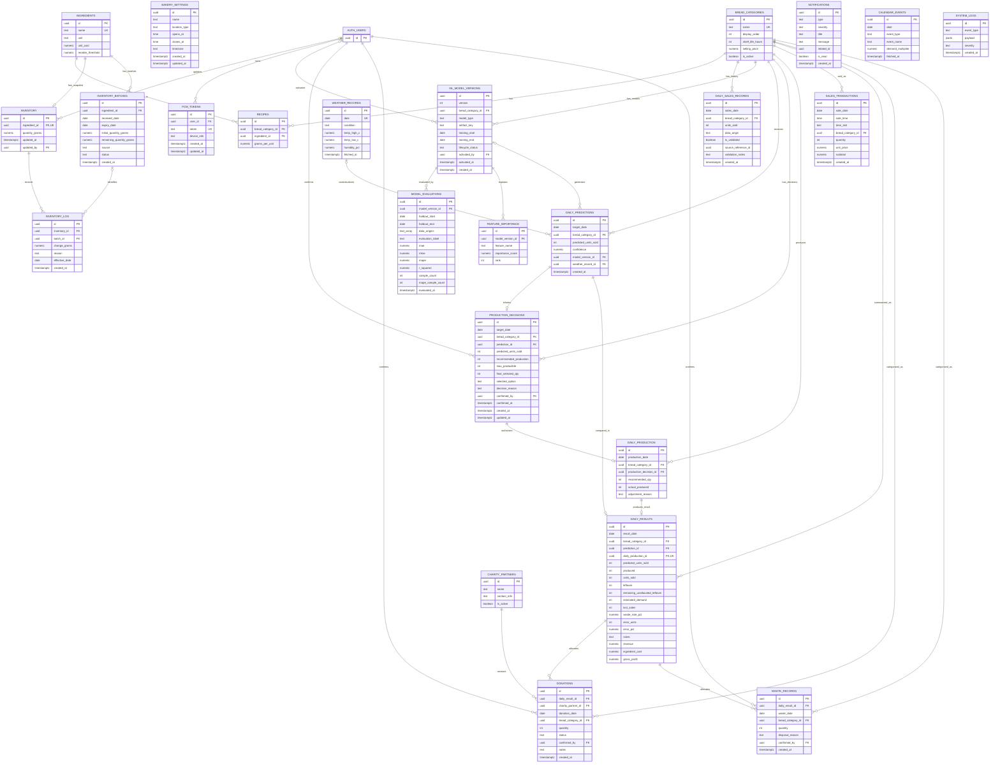

# Smart Bakery Database Schema Verification

**Verification date:** 31 July 2026  
**Purpose:** Pre-design verification for Chapter 4.5.2 Entity-Relationship Diagram  
**Repository:** Smart Bakery Food Waste Reduction System  
**Change scope:** This verification file only; no existing source code or planning document was modified

## 1. Verification result

The Smart Bakery application database is **not implemented in this repository**.

The repository contains:

- a default Flutter counter application in `lib/main.dart`;
- no `supabase/` directory;
- no SQL migration or deployable schema file;
- no generated Supabase database types;
- no Node.js/Express TypeScript backend;
- no TypeScript Repo, domain-model or service implementation;
- no Python/FastAPI service or DTO implementation; and
- planning documents containing proposed SQL and design specifications.

Consequently:

- **IMPLEMENTED:** no Smart Bakery application tables, relationships, RLS policies, indexes or triggers can be implementation-verified;
- **PLANNED:** the tables and view documented below;
- **RECOMMENDED:** the reconciled schema corrections in Section 11; and
- **COMPUTED/DTO ONLY:** the items in Section 8, which should not become tables without a new persistence requirement.

`auth.users` is a planned dependency on the Supabase-managed Auth schema. Its deployment is not verifiable locally because the repository has no Supabase project configuration or generated types.

## 2. Authority inspection

| Authority | Repository evidence | Verification result |
|---|---|---|
| 1. Supabase migrations and schema files | None found | No implemented schema |
| 2. Generated Supabase database types | None found | No implemented table/type contract |
| 3. TypeScript Repos, models and services | No TypeScript/Node backend found | Planned class/file names only |
| 4. Python/FastAPI DTOs and model code | No Python ML application found | Planned DTOs/services only |
| 5. Planning documents | Detailed SQL sketches in `Final Year Project/data_foundation/README.md`; table specifications in `MODULE.md`; cross-module rules in the report and canonical Logical View | Sole available database-design evidence |

The detailed SQL sketch is used for exact PostgreSQL syntax where it exists. The newer revision baseline and canonical planning decisions override explicitly retired examples.

## 3. Status definitions

| Label | Meaning in this report |
|---|---|
| **IMPLEMENTED** | Present in a deployable migration/schema and corroborated by generated types or application code |
| **PLANNED** | Explicitly specified in planning material but absent from deployable source |
| **RECOMMENDED** | Proposed reconciliation needed before creating the migration and Chapter 4.5.2 ERD |
| **COMPUTED/DTO ONLY** | Derived value, API contract, service result, view or file artifact; not a database table |

## 4. Complete table and view catalogue

| Name | Kind | Status | Purpose | Definition completeness |
|---|---|---|---|---|
| `auth.users` | Supabase-managed table | **PLANNED external dependency** | Authentication identities and credentials | Only referenced key `id` is evidenced; Supabase-managed columns are not present locally |
| `bakery_settings` | Application table | **PLANNED** | Single-bakery name, location, hours and timezone | Detailed SQL sketch |
| `bread_categories` | Application table | **PLANNED** | Bread/product categories | Detailed SQL sketch |
| `ingredients` | Application table | **PLANNED** | Ingredient master data and reporting cost | Detailed SQL sketch |
| `recipes` | Application table/junction entity | **PLANNED** | Ingredient quantity required per unit of a bread category | Detailed SQL sketch |
| `inventory` | Application table | **PLANNED** | Cached current ingredient totals | Detailed SQL sketch |
| `inventory_batches` | Application table | **PLANNED** | FIFO/expiry ingredient lots; deduction source of truth | Detailed SQL sketch |
| `inventory_log` | Application table/dependent entity | **PLANNED** | Ingredient stock movements | Detailed SQL sketch |
| `notifications` | Application table | **PLANNED** | In-application operational/administrative alerts | Module column specification only; absent from SQL sketch |
| `fcm_tokens` | Application table/dependent entity | **PLANNED** | Per-user device tokens for background push | Module column specification only; absent from SQL sketch |
| `daily_sales_records` | Application table | **PLANNED** | Validated category/day ML history with provenance | Detailed SQL sketch |
| `weather_records` | Application table | **PLANNED** | Cached daily weather context | Detailed SQL sketch |
| `calendar_events` | Application table | **PLANNED** | Cached holiday/event context | Detailed SQL sketch |
| `ml_model_versions` | Application table | **PLANNED** | Candidate, active, inactive and rejected model metadata | Detailed SQL sketch |
| `model_evaluations` | Application table/dependent entity | **PLANNED** | Origin-labelled chronological-holdout metrics | Detailed SQL sketch |
| `daily_predictions` | Application table | **PLANNED** | Stored category/day predicted units sold | Detailed SQL sketch |
| `production_decisions` | Application table | **PLANNED** | Bakery Manager's confirmed production choice | Detailed SQL sketch |
| `daily_production` | Application table | **PLANNED** | Actual category/day production | Detailed SQL sketch |
| `sales_transactions` | Application table | **PLANNED** | Individual simulated sales | Detailed SQL sketch |
| `daily_results` | Application table | **PLANNED** | Detailed completed category/day POS result | Detailed SQL sketch |
| `charity_partners` | Application table | **PLANNED** | Approved recipient organisations | Detailed SQL sketch |
| `donations` | Application table/dependent entity | **PLANNED** | Manager-confirmed leftover donation allocation | Detailed SQL sketch |
| `waste_records` | Application table/dependent entity | **PLANNED** | Manager-confirmed leftover disposal allocation | Detailed SQL sketch |
| `feature_importance` | Application table/dependent entity | **PLANNED** | Per-model feature importance | Detailed SQL sketch |
| `system_logs` | Application table | **PLANNED** | Operational log/audit payloads | Detailed SQL sketch |
| `system_settings` | Application table | **PLANNED but undefined** | System parameters mentioned in planning | No columns, keys or constraints specified |
| `sales_by_timeslot` | PostgreSQL view | **COMPUTED/DTO ONLY** | Aggregate transaction quantities by date, time slot and category | Detailed view query; not a base table |

The SQL plan describes itself as “19 tables,” but its `CREATE TABLE` blocks actually define **22** tables. Adding the separately specified `notifications` and `fcm_tokens` produces **24 defined application-table concepts**. `system_settings` is a twenty-fifth named application-table concept, but it is not sufficiently defined for migration or ERD use.

## 5. Planned column definitions

All definitions in this section are **PLANNED**, not implemented.

### 5.1 `auth.users`

Purpose: Supabase-managed identities and credentials.

| Column | PostgreSQL type | Nullability/default/key |
|---|---|---|
| `id` | `uuid` | Referenced primary identifier; exact local definition unavailable |
| Other Supabase Auth columns | Not available in repository | Do not reproduce or invent them in the application migration |

Primary key, Auth indexes, Auth RLS, Auth triggers and credential columns are owned by Supabase and cannot be verified from this repository.

### 5.2 `bakery_settings`

| Column | Type | Nullability | Default | Key/constraint |
|---|---|---|---|---|
| `id` | `uuid` | NOT NULL | `gen_random_uuid()` | PK |
| `name` | `text` | NOT NULL | — | — |
| `location_type` | `text` | NOT NULL | — | Allowed values not specified |
| `opens_at` | `time` | NOT NULL | — | — |
| `closes_at` | `time` | NOT NULL | — | — |
| `timezone` | `text` | NOT NULL | `'Asia/Kuala_Lumpur'` | — |
| `created_at` | `timestamptz` | NOT NULL | `now()` | — |
| `updated_at` | `timestamptz` | NOT NULL | `now()` | Updated by trigger |

The “one row only” rule is documented but not enforced by the planned SQL.

### 5.3 `bread_categories`

| Column | Type | Nullability | Default | Key/constraint |
|---|---|---|---|---|
| `id` | `uuid` | NOT NULL | `gen_random_uuid()` | PK |
| `name` | `text` | NOT NULL | — | UNIQUE |
| `display_order` | `int` | NOT NULL | — | — |
| `shelf_life_hours` | `int` | NOT NULL | `24` | No positivity check |
| `selling_price` | `numeric` | NOT NULL | `0` | Reporting only; no non-negative check |
| `is_active` | `boolean` | NOT NULL | `true` | — |

### 5.4 `ingredients`

| Column | Type | Nullability | Default | Key/constraint |
|---|---|---|---|---|
| `id` | `uuid` | NOT NULL | `gen_random_uuid()` | PK |
| `name` | `text` | NOT NULL | — | UNIQUE |
| `unit` | `text` | NOT NULL | `'g'` | Allowed values not constrained |
| `unit_cost` | `numeric` | NOT NULL | `0` | Reporting only; no non-negative check |
| `reorder_threshold` | `numeric` | NULL | — | No non-negative check |

### 5.5 `recipes`

Purpose: associative/junction entity resolving the many-to-many relationship between bread categories and ingredients.

| Column | Type | Nullability | Default | Key/constraint |
|---|---|---|---|---|
| `id` | `uuid` | NOT NULL | `gen_random_uuid()` | PK |
| `bread_category_id` | `uuid` | NOT NULL | — | FK → `bread_categories.id`, ON DELETE CASCADE |
| `ingredient_id` | `uuid` | NOT NULL | — | FK → `ingredients.id`, ON DELETE CASCADE |
| `grams_per_unit` | `numeric` | NOT NULL | — | No positive-value check |

Unique constraint: (`bread_category_id`, `ingredient_id`).

### 5.6 `inventory`

| Column | Type | Nullability | Default | Key/constraint |
|---|---|---|---|---|
| `id` | `uuid` | NOT NULL | `gen_random_uuid()` | PK |
| `ingredient_id` | `uuid` | NOT NULL | — | UNIQUE; FK → `ingredients.id`, ON DELETE CASCADE |
| `quantity_grams` | `numeric` | NOT NULL | `0` | Cached total; no non-negative check |
| `updated_at` | `timestamptz` | NOT NULL | `now()` | Updated by trigger |
| `updated_by` | `uuid` | NULL | — | FK → `auth.users.id` |

### 5.7 `inventory_batches`

| Column | Type | Nullability | Default | Key/constraint or allowed values |
|---|---|---|---|---|
| `id` | `uuid` | NOT NULL | `gen_random_uuid()` | PK |
| `ingredient_id` | `uuid` | NOT NULL | — | FK → `ingredients.id`, ON DELETE CASCADE |
| `received_date` | `date` | NOT NULL | — | — |
| `expiry_date` | `date` | NOT NULL | — | No `expiry_date > received_date` check |
| `initial_quantity_grams` | `numeric` | NOT NULL | — | CHECK `> 0` |
| `remaining_quantity_grams` | `numeric` | NOT NULL | — | CHECK `>= 0`; no `<= initial_quantity_grams` check |
| `source` | `text` | NULL | — | — |
| `status` | `text` | NOT NULL | `'active'` | CHECK in `active`, `depleted`, `expired`, `discarded` |
| `created_at` | `timestamptz` | NOT NULL | `now()` | — |

### 5.8 `inventory_log`

| Column | Type | Nullability | Default | Key/constraint |
|---|---|---|---|---|
| `id` | `uuid` | NOT NULL | `gen_random_uuid()` | PK |
| `inventory_id` | `uuid` | NOT NULL | — | FK → `inventory.id`, ON DELETE CASCADE |
| `batch_id` | `uuid` | NULL | — | FK → `inventory_batches.id`, ON DELETE SET NULL |
| `change_grams` | `numeric` | NOT NULL | — | Positive restock / negative deduction; non-zero not enforced |
| `reason` | `text` | NOT NULL | — | Examples only: `daily_production`, `manual_restock`, `spoilage` |
| `effective_date` | `date` | NOT NULL | — | — |
| `created_at` | `timestamptz` | NOT NULL | `now()` | — |

No production decision, production record or simulation-operation key is defined, despite the planned need to identify linked deductions for reversal.

### 5.9 `notifications`

This table is specified in `data_foundation/MODULE.md` but omitted from the detailed `CREATE TABLE` SQL.

| Column | Type | Nullability | Default | Key/constraint or allowed values |
|---|---|---|---|---|
| `id` | `uuid` | NOT NULL | `gen_random_uuid()` | PK |
| `type` | `text` | NOT NULL | — | `stock_out`, `low_stock`, `low_confidence`, `prediction_reminder`, `simulation_reminder`, `donation_completed` |
| `severity` | `text` | NOT NULL | — | `info`, `warning`, `critical` |
| `title` | `text` | NOT NULL | — | — |
| `message` | `text` | NOT NULL | — | — |
| `related_id` | `uuid` | NULL | — | Polymorphic identifier; not an enforceable FK |
| `is_read` | `boolean` | NOT NULL | `false` | — |
| `created_at` | `timestamptz` | NOT NULL | `now()` | — |

The planned columns do not identify a recipient/user/role and do not record FCM submission/delivery status, although Chapter 3 requires relevant-user filtering and delivery status where supported.

### 5.10 `fcm_tokens`

This table is specified in `data_foundation/MODULE.md` but omitted from the detailed `CREATE TABLE` SQL.

| Column | Type | Nullability | Default | Key/constraint |
|---|---|---|---|---|
| `id` | `uuid` | NOT NULL | `gen_random_uuid()` | PK |
| `user_id` | `uuid` | NOT NULL | — | FK → `auth.users.id` |
| `token` | `text` | NOT NULL | — | UNIQUE |
| `device_info` | `text` | NULL | — | — |
| `created_at` | `timestamptz` | NOT NULL | `now()` | — |
| `updated_at` | `timestamptz` | NOT NULL | `now()` | No trigger specified |

### 5.11 `daily_sales_records`

| Column | Type | Nullability | Default | Key/constraint or allowed values |
|---|---|---|---|---|
| `id` | `uuid` | NOT NULL | `gen_random_uuid()` | PK |
| `sales_date` | `date` | NOT NULL | — | — |
| `bread_category_id` | `uuid` | NOT NULL | — | FK → `bread_categories.id`, ON DELETE CASCADE |
| `units_sold` | `int` | NOT NULL | — | CHECK `units_sold >= 0` |
| `data_origin` | `text` | NOT NULL | — | CHECK in `ACTUAL_TRANSACTION`, `IMPORTED_HISTORICAL`, `SIMULATION_GENERATED` |
| `is_validated` | `boolean` | NOT NULL | `false` | — |
| `source_reference_id` | `uuid` | NULL | — | No FK |
| `validation_notes` | `text` | NULL | — | — |
| `created_at` | `timestamptz` | NOT NULL | `now()` | — |

The module specification names a unique constraint on (`sales_date`, `bread_category_id`, `data_origin`, `source_reference_id`), but the SQL sketch does not create it. Even if added normally, PostgreSQL permits multiple rows where `source_reference_id` is NULL.

### 5.12 `weather_records`

| Column | Type | Nullability | Default | Key/constraint |
|---|---|---|---|---|
| `id` | `uuid` | NOT NULL | `gen_random_uuid()` | PK |
| `date` | `date` | NOT NULL | — | UNIQUE |
| `condition` | `text` | NOT NULL | — | Example values only; no CHECK |
| `temp_high_c` | `numeric` | NULL | — | — |
| `temp_low_c` | `numeric` | NULL | — | — |
| `humidity_pct` | `numeric` | NULL | — | No range check |
| `fetched_at` | `timestamptz` | NOT NULL | `now()` | — |

### 5.13 `calendar_events`

| Column | Type | Nullability | Default | Key/constraint |
|---|---|---|---|---|
| `id` | `uuid` | NOT NULL | `gen_random_uuid()` | PK |
| `date` | `date` | NOT NULL | — | Part of UNIQUE |
| `event_type` | `text` | NOT NULL | — | Part of UNIQUE; example values only |
| `event_name` | `text` | NULL | — | — |
| `demand_multiplier` | `numeric` | NULL | — | No range check |
| `fetched_at` | `timestamptz` | NOT NULL | `now()` | — |

Unique constraint: (`date`, `event_type`).

### 5.14 `ml_model_versions`

| Column | Type | Nullability | Default | Key/constraint or allowed values |
|---|---|---|---|---|
| `id` | `uuid` | NOT NULL | `gen_random_uuid()` | PK |
| `version` | `int` | NOT NULL | — | Part of UNIQUE; described as auto-increment in the module but no SQL default/identity exists |
| `bread_category_id` | `uuid` | NOT NULL | — | FK → `bread_categories.id`, ON DELETE CASCADE; part of UNIQUE |
| `model_type` | `text` | NOT NULL | — | Planned values include `random_forest`, `linear_regression`; no CHECK |
| `file_path` | `text` | NOT NULL | — | Canonical Logical View instead calls this `artifactKey` |
| `training_start` | `date` | NULL | — | — |
| `training_end` | `date` | NULL | — | — |
| `lifecycle_status` | `text` | NOT NULL | `'candidate'` | CHECK in `candidate`, `active`, `inactive`, `rejected` |
| `activated_by` | `uuid` | NULL | — | FK → `auth.users.id` |
| `activated_at` | `timestamptz` | NULL | — | — |
| `created_at` | `timestamptz` | NOT NULL | `now()` | — |

Unique constraint: (`version`, `bread_category_id`). The rule “at most one active version per category” is not enforced by a database constraint/index.

### 5.15 `model_evaluations`

| Column | Type | Nullability | Default | Key/constraint |
|---|---|---|---|---|
| `id` | `uuid` | NOT NULL | `gen_random_uuid()` | PK |
| `model_version_id` | `uuid` | NOT NULL | — | FK → `ml_model_versions.id`, ON DELETE CASCADE |
| `holdout_start` | `date` | NOT NULL | — | — |
| `holdout_end` | `date` | NOT NULL | — | — |
| `data_origins` | `text[]` | NOT NULL | — | Array members not constrained to `DataOrigin` values |
| `evaluation_label` | `text` | NOT NULL | — | Allowed labels not specified |
| `mae` | `numeric` | NOT NULL | — | — |
| `rmse` | `numeric` | NOT NULL | — | — |
| `mape` | `numeric` | NULL | — | NULL permitted when no non-zero actuals |
| `r_squared` | `numeric` | NULL | — | NULL permitted for undefined cases |
| `sample_count` | `int` | NOT NULL | — | No positivity check |
| `mape_sample_count` | `int` | NOT NULL | — | No range check against `sample_count` |
| `evaluated_at` | `timestamptz` | NOT NULL | `now()` | — |

### 5.16 `daily_predictions`

| Column | Type | Nullability | Default | Key/constraint |
|---|---|---|---|---|
| `id` | `uuid` | NOT NULL | `gen_random_uuid()` | PK |
| `target_date` | `date` | NOT NULL | — | Part of UNIQUE |
| `bread_category_id` | `uuid` | NOT NULL | — | FK → `bread_categories.id`, ON DELETE CASCADE; part of UNIQUE |
| `predicted_units_sold` | `int` | NOT NULL | — | No non-negative check |
| `confidence` | `numeric` | NOT NULL | — | CHECK `0 <= confidence <= 100` |
| `model_version_id` | `uuid` | NULL | — | FK → `ml_model_versions.id` |
| `weather_record_id` | `uuid` | NULL | — | FK → `weather_records.id` |
| `created_at` | `timestamptz` | NOT NULL | `now()` | — |

Unique constraint: (`target_date`, `bread_category_id`). Calendar events used for prediction are not linked for persistence-level traceability.

### 5.17 `production_decisions`

| Column | Type | Nullability | Default | Key/constraint |
|---|---|---|---|---|
| `id` | `uuid` | NOT NULL | `gen_random_uuid()` | PK |
| `target_date` | `date` | NOT NULL | — | Part of UNIQUE |
| `bread_category_id` | `uuid` | NOT NULL | — | FK → `bread_categories.id`, ON DELETE CASCADE; part of UNIQUE |
| `prediction_id` | `uuid` | NULL | — | FK → `daily_predictions.id` |
| `predicted_units_sold` | `int` | NOT NULL | — | Snapshot; no non-negative check |
| `recommended_production` | `int` | NOT NULL | — | No non-negative check |
| `max_producible` | `int` | NOT NULL | — | No independent non-negative check |
| `final_selected_qty` | `int` | NOT NULL | — | CHECK `>= 0`; CHECK `<= max_producible` |
| `selected_option` | `text` | NOT NULL | — | CHECK in `full_prediction`, `reduced_due_constraint`, `manual_override` |
| `decision_reason` | `text` | NULL | — | Required by CHECK unless option is `full_prediction` |
| `confirmed_by` | `uuid` | NULL | — | FK → `auth.users.id` |
| `confirmed_at` | `timestamptz` | NOT NULL | `now()` | — |
| `created_at` | `timestamptz` | NOT NULL | `now()` | — |
| `updated_at` | `timestamptz` | NOT NULL | `now()` | Updated by trigger |

Additional checks:

- `full_prediction` requires `final_selected_qty = recommended_production`;
- `reduced_due_constraint` requires `final_selected_qty < recommended_production`; and
- non-`full_prediction` decisions require a non-blank reason.

Unique constraint: (`target_date`, `bread_category_id`).

### 5.18 `daily_production`

| Column | Type | Nullability | Default | Key/constraint |
|---|---|---|---|---|
| `id` | `uuid` | NOT NULL | `gen_random_uuid()` | PK |
| `production_date` | `date` | NOT NULL | — | Part of UNIQUE |
| `bread_category_id` | `uuid` | NOT NULL | — | FK → `bread_categories.id`, ON DELETE CASCADE; part of UNIQUE |
| `production_decision_id` | `uuid` | NULL | — | FK → `production_decisions.id` |
| `recommended_qty` | `int` | NOT NULL | — | No non-negative check |
| `actual_produced` | `int` | NOT NULL | — | No non-negative check |
| `adjustment_reason` | `text` | NULL | — | — |

Unique constraint: (`production_date`, `bread_category_id`).

### 5.19 `sales_transactions`

| Column | Type | Nullability | Default | Key/constraint |
|---|---|---|---|---|
| `id` | `uuid` | NOT NULL | `gen_random_uuid()` | PK |
| `sale_date` | `date` | NOT NULL | — | — |
| `sale_time` | `time` | NOT NULL | — | — |
| `time_slot` | `text` | NOT NULL | — | CHECK in `morning`, `afternoon`, `evening` |
| `bread_category_id` | `uuid` | NOT NULL | — | FK → `bread_categories.id`, ON DELETE CASCADE |
| `quantity` | `int` | NOT NULL | — | No positive-value check |
| `unit_price` | `numeric` | NOT NULL | `0` | Historical reporting snapshot |
| `subtotal` | `numeric` | NOT NULL | `0` | Intended `quantity * unit_price`; not checked/generated |
| `created_at` | `timestamptz` | NOT NULL | `now()` | — |

### 5.20 `daily_results`

| Column | Type | Nullability | Default | Key/constraint |
|---|---|---|---|---|
| `id` | `uuid` | NOT NULL | `gen_random_uuid()` | PK |
| `result_date` | `date` | NOT NULL | — | Part of UNIQUE |
| `bread_category_id` | `uuid` | NOT NULL | — | FK → `bread_categories.id`, ON DELETE CASCADE; part of UNIQUE |
| `prediction_id` | `uuid` | NULL | — | FK → `daily_predictions.id` |
| `predicted_units_sold` | `int` | NOT NULL | — | SQL name; module table still says `predicted` |
| `produced` | `int` | NOT NULL | — | No non-negative check |
| `units_sold` | `int` | NOT NULL | — | No non-negative/check against produced |
| `leftover` | `int` | NOT NULL | — | Intended `produced - units_sold`; not checked/generated |
| `remaining_unallocated_leftover` | `int` | NOT NULL | — | Service-maintained; no range check |
| `estimated_demand` | `int` | NULL | — | Analysis only; intended `units_sold + lost_sales` |
| `lost_sales` | `int` | NULL | `0` | No non-negative check |
| `waste_rate_pct` | `numeric` | NULL | — | Computed/cache semantics |
| `error_units` | `int` | NULL | — | Meaning is inconsistent across planning text |
| `error_pct` | `numeric` | NULL | — | Computed/cache semantics |
| `notes` | `text` | NULL | — | — |
| `revenue` | `numeric` | NOT NULL | `0` | Reporting cache |
| `ingredient_cost` | `numeric` | NOT NULL | `0` | Reporting cache |
| `gross_profit` | `numeric` | NOT NULL | `0` | Reporting cache |

Unique constraint: (`result_date`, `bread_category_id`). The canonical Logical View requires an association to exactly one `DailyProduction`, but the SQL has no `daily_production_id`.

### 5.21 `charity_partners`

| Column | Type | Nullability | Default | Key/constraint |
|---|---|---|---|---|
| `id` | `uuid` | NOT NULL | `gen_random_uuid()` | PK |
| `name` | `text` | NOT NULL | — | No unique constraint |
| `contact_info` | `text` | NULL | — | — |
| `is_active` | `boolean` | NOT NULL | `true` | — |

### 5.22 `donations`

| Column | Type | Nullability | Default | Key/constraint or allowed values |
|---|---|---|---|---|
| `id` | `uuid` | NOT NULL | `gen_random_uuid()` | PK |
| `daily_result_id` | `uuid` | NOT NULL | — | FK → `daily_results.id`, ON DELETE CASCADE |
| `charity_partner_id` | `uuid` | NOT NULL | — | FK → `charity_partners.id`, ON DELETE CASCADE |
| `donation_date` | `date` | NOT NULL | — | — |
| `bread_category_id` | `uuid` | NOT NULL | — | FK → `bread_categories.id` |
| `quantity` | `int` | NOT NULL | — | CHECK `quantity > 0` |
| `status` | `text` | NOT NULL | `'recorded'` | Module values: `recorded`, `picked_up`, `delivered`; no SQL CHECK |
| `confirmed_by` | `uuid` | NOT NULL | — | FK → `auth.users.id` |
| `notes` | `text` | NULL | — | — |
| `created_at` | `timestamptz` | NOT NULL | `now()` | — |

### 5.23 `waste_records`

| Column | Type | Nullability | Default | Key/constraint |
|---|---|---|---|---|
| `id` | `uuid` | NOT NULL | `gen_random_uuid()` | PK |
| `daily_result_id` | `uuid` | NOT NULL | — | FK → `daily_results.id`, ON DELETE CASCADE |
| `waste_date` | `date` | NOT NULL | — | — |
| `bread_category_id` | `uuid` | NOT NULL | — | FK → `bread_categories.id` |
| `quantity` | `int` | NOT NULL | — | CHECK `quantity > 0` |
| `disposal_reason` | `text` | NOT NULL | — | Allowed values not specified |
| `confirmed_by` | `uuid` | NOT NULL | — | FK → `auth.users.id` |
| `created_at` | `timestamptz` | NOT NULL | `now()` | — |

### 5.24 `feature_importance`

| Column | Type | Nullability | Default | Key/constraint |
|---|---|---|---|---|
| `id` | `uuid` | NOT NULL | `gen_random_uuid()` | PK |
| `model_version_id` | `uuid` | NOT NULL | — | FK → `ml_model_versions.id`, ON DELETE CASCADE |
| `feature_name` | `text` | NOT NULL | — | No per-model unique constraint |
| `importance_score` | `numeric` | NOT NULL | — | Planned 0–1 meaning; no CHECK |
| `rank` | `int` | NOT NULL | — | No positive-value/unique check |

### 5.25 `system_logs`

| Column | Type | Nullability | Default | Key/constraint |
|---|---|---|---|---|
| `id` | `uuid` | NOT NULL | `gen_random_uuid()` | PK |
| `event_type` | `text` | NOT NULL | — | Allowed values not constrained |
| `payload` | `jsonb` | NULL | — | Holds unstructured actor/record details where supplied |
| `severity` | `text` | NOT NULL | `'info'` | Module examples: `info`, `warn`, `error`; no CHECK |
| `created_at` | `timestamptz` | NOT NULL | `now()` | — |

The Chapter 3 audit requirement calls for actor, action, affected record, time and outcome. Only event type, JSON payload, severity and time are currently specified.

### 5.26 `system_settings`

Status: **PLANNED but undefined**.

The name appears in the planning change report and Chapter 3 requires configurable system parameters, but the repository provides no columns, PostgreSQL types, PK, FK, nullability, defaults, unique/check constraints, indexes, RLS or triggers. It must not be drawn as a resolved ERD entity until those details are approved.

### 5.27 `sales_by_timeslot` view

Status: **COMPUTED/DTO ONLY**.

| Output column | Type | Derivation |
|---|---|---|
| `sale_date` | `date` | `sales_transactions.sale_date` |
| `time_slot` | `text` | `sales_transactions.time_slot` |
| `bread_category_id` | `uuid` | `sales_transactions.bread_category_id` |
| `total_sold` | Aggregate integer/numeric result | `SUM(sales_transactions.quantity)` |

It has no table PK or FK. Its relationship to `sales_transactions` is derivation, not entity ownership.

## 6. Indexes, RLS policies and triggers

### 6.1 Index registry

Every planned UUID primary key and every planned UNIQUE constraint would create an implicit PostgreSQL unique index. The table below lists additional explicit indexes and important omissions.

| Table | Explicit planned indexes | Implicit unique indexes | Verification/issue |
|---|---|---|---|
| `bakery_settings` | None | PK | Singleton rule not indexed or constrained |
| `bread_categories` | None | PK; `name` | — |
| `ingredients` | None | PK; `name` | — |
| `recipes` | None | PK; (`bread_category_id`, `ingredient_id`) | Composite unique also supports category-leading lookups; no ingredient-leading FK index |
| `inventory` | None | PK; `ingredient_id` | — |
| `inventory_batches` | `idx_inventory_batches_fifo(ingredient_id, status, expiry_date, received_date)`; `idx_inventory_batches_expiry(status, expiry_date)` | PK | Matches planned FIFO lookup |
| `inventory_log` | `idx_inventory_log_inv(inventory_id)`; `idx_inventory_log_effective(effective_date, inventory_id)` | PK | No `batch_id` index or simulation-operation index |
| `notifications` | Module specifies (`is_read`, `created_at DESC`) | PK | No SQL/index statement exists |
| `fcm_tokens` | None specified | PK; `token` | A `user_id` index is not explicitly specified |
| `daily_sales_records` | `idx_daily_sales_history(bread_category_id, sales_date, data_origin)` | PK | Module-only uniqueness is absent from SQL |
| `weather_records` | `idx_weather_date(date)` | PK; `date` | Explicit date index is redundant with UNIQUE |
| `calendar_events` | None | PK; (`date`, `event_type`) | — |
| `ml_model_versions` | None | PK; (`version`, `bread_category_id`) | Missing partial unique index for one active version per category |
| `model_evaluations` | `idx_model_evaluations_version(model_version_id, evaluated_at)` | PK | — |
| `daily_predictions` | `idx_predictions_target(target_date)` | PK; (`target_date`, `bread_category_id`) | — |
| `production_decisions` | `idx_production_decisions_date(target_date)` | PK; (`target_date`, `bread_category_id`) | — |
| `daily_production` | None | PK; (`production_date`, `bread_category_id`) | `production_decision_id` is not unique/indexed |
| `sales_transactions` | `idx_sales_date_slot(sale_date, time_slot)`; `idx_sales_category(sale_date, bread_category_id)` | PK | — |
| `daily_results` | `idx_daily_results_date(result_date)` | PK; (`result_date`, `bread_category_id`) | `prediction_id` is not unique/indexed |
| `charity_partners` | None | PK | Active-name duplicate prevention absent |
| `donations` | None | PK | FK/date/status lookup indexes absent |
| `waste_records` | None | PK | FK/date lookup indexes absent |
| `feature_importance` | None | PK | Model-version FK/feature/rank indexes absent |
| `system_logs` | None | PK | Date/event/actor filtering indexes absent |
| `system_settings` | Unknown | Unknown | Definition unavailable |
| `auth.users` | Supabase-managed, unavailable locally | Supabase-managed | Cannot verify |

### 6.2 RLS registry

The planning SQL enables RLS on these 22 tables:

`bakery_settings`, `bread_categories`, `ingredients`, `recipes`, `inventory`, `inventory_batches`, `inventory_log`, `weather_records`, `calendar_events`, `daily_sales_records`, `daily_predictions`, `production_decisions`, `daily_production`, `sales_transactions`, `daily_results`, `charity_partners`, `donations`, `waste_records`, `ml_model_versions`, `model_evaluations`, `feature_importance`, and `system_logs`.

No `CREATE POLICY` statement exists. The intended result is:

- Node.js/Express uses protected server credentials through TypeScript Repos;
- Flutter receives no direct table CRUD policy; and
- FastAPI has no Supabase credentials.

| Table group | Planned RLS | Planned policies | Issue |
|---|---|---|---|
| 22 tables listed above | ENABLED | None | Consistent with Node-only database access, assuming only trusted server credentials are used |
| `notifications` | Module originally mentions Realtime publication, but no RLS SQL | None specified | Conflicts with the revised Node-only foreground-notification boundary |
| `fcm_tokens` | Not specified | None specified | Must be protected because tokens are sensitive device identifiers |
| `system_settings` | Not specified | None specified | Cannot verify |
| `auth.users` | Supabase-managed | Supabase-managed | Must not be replaced by an application password table |

RLS and Realtime publication are separate PostgreSQL/Supabase controls. Enabling publication would not by itself authorise reads, but the revised architecture does not permit Flutter to subscribe to application-table changes directly.

### 6.3 Trigger registry

| Trigger/function | Table | Event | Purpose | Status |
|---|---|---|---|---|
| `set_updated_at()` | Shared function | Before row update | Set `NEW.updated_at = now()` | **PLANNED** |
| `trg_bakery_settings_updated` | `bakery_settings` | BEFORE UPDATE, each row | Refresh `updated_at` | **PLANNED** |
| `trg_inventory_updated` | `inventory` | BEFORE UPDATE, each row | Refresh `updated_at` | **PLANNED** |
| `trg_production_decisions_updated` | `production_decisions` | BEFORE UPDATE, each row | Refresh `updated_at` | **PLANNED** |

No trigger is specified for `fcm_tokens.updated_at`. No database trigger/constraint is specified for singleton bakery settings, one active model per category, computed result consistency, or the combined donation/waste allocation limit.

## 7. Exact planned FK relationships and cardinalities

These are database cardinalities implied by the planned SQL, not the stronger business cardinalities described in UML.

| Parent | Child FK | Parent-to-child cardinality | Child-to-parent cardinality | Delete action |
|---|---|---|---|---|
| `auth.users` | `inventory.updated_by` | One user → `0..*` inventory rows | One inventory row → `0..1` updating user | Default NO ACTION |
| `auth.users` | `fcm_tokens.user_id` | One user → `0..*` tokens | One token → exactly `1` user | Not specified |
| `auth.users` | `ml_model_versions.activated_by` | One user → `0..*` activated versions | One version → `0..1` activating user | Default NO ACTION |
| `auth.users` | `production_decisions.confirmed_by` | One user → `0..*` decisions | One decision → `0..1` confirming user | Default NO ACTION |
| `auth.users` | `donations.confirmed_by` | One user → `0..*` donations | One donation → exactly `1` user | Default NO ACTION |
| `auth.users` | `waste_records.confirmed_by` | One user → `0..*` waste records | One waste record → exactly `1` user | Default NO ACTION |
| `bread_categories` | `recipes.bread_category_id` | One category → `0..*` recipe rows | One recipe row → exactly `1` category | CASCADE |
| `ingredients` | `recipes.ingredient_id` | One ingredient → `0..*` recipe rows | One recipe row → exactly `1` ingredient | CASCADE |
| `ingredients` | `inventory.ingredient_id` | One ingredient → `0..1` inventory snapshot | One snapshot → exactly `1` ingredient | CASCADE |
| `ingredients` | `inventory_batches.ingredient_id` | One ingredient → `0..*` batches | One batch → exactly `1` ingredient | CASCADE |
| `inventory` | `inventory_log.inventory_id` | One snapshot → `0..*` movements | One movement → exactly `1` snapshot | CASCADE |
| `inventory_batches` | `inventory_log.batch_id` | One batch → `0..*` movements | One movement → `0..1` batch | SET NULL |
| `bread_categories` | `daily_sales_records.bread_category_id` | One category → `0..*` sales-history rows | One row → exactly `1` category | CASCADE |
| `bread_categories` | `ml_model_versions.bread_category_id` | One category → `0..*` model versions | One version → exactly `1` category | CASCADE |
| `ml_model_versions` | `model_evaluations.model_version_id` | One version → `0..*` evaluations | One evaluation → exactly `1` version | CASCADE |
| `bread_categories` | `daily_predictions.bread_category_id` | One category → `0..*` predictions | One prediction → exactly `1` category | CASCADE |
| `ml_model_versions` | `daily_predictions.model_version_id` | One version → `0..*` predictions | One prediction → `0..1` version | Default NO ACTION |
| `weather_records` | `daily_predictions.weather_record_id` | One weather row → `0..*` predictions | One prediction → `0..1` weather row | Default NO ACTION |
| `bread_categories` | `production_decisions.bread_category_id` | One category → `0..*` decisions | One decision → exactly `1` category | CASCADE |
| `daily_predictions` | `production_decisions.prediction_id` | One prediction → `0..*` decisions in SQL | One decision → `0..1` prediction | Default NO ACTION |
| `bread_categories` | `daily_production.bread_category_id` | One category → `0..*` production rows | One production row → exactly `1` category | CASCADE |
| `production_decisions` | `daily_production.production_decision_id` | One decision → `0..*` production rows in SQL | One production row → `0..1` decision | Default NO ACTION |
| `bread_categories` | `sales_transactions.bread_category_id` | One category → `0..*` sales | One sale → exactly `1` category | CASCADE |
| `bread_categories` | `daily_results.bread_category_id` | One category → `0..*` daily results | One result → exactly `1` category | CASCADE |
| `daily_predictions` | `daily_results.prediction_id` | One prediction → `0..*` results in SQL | One result → `0..1` prediction | Default NO ACTION |
| `daily_results` | `donations.daily_result_id` | One result → `0..*` donations | One donation → exactly `1` result | CASCADE |
| `charity_partners` | `donations.charity_partner_id` | One partner → `0..*` donations | One donation → exactly `1` partner | CASCADE |
| `bread_categories` | `donations.bread_category_id` | One category → `0..*` donations | One donation → exactly `1` category | Default NO ACTION |
| `daily_results` | `waste_records.daily_result_id` | One result → `0..*` waste records | One waste record → exactly `1` result | CASCADE |
| `bread_categories` | `waste_records.bread_category_id` | One category → `0..*` waste records | One waste record → exactly `1` category | Default NO ACTION |
| `ml_model_versions` | `feature_importance.model_version_id` | One version → `0..*` feature rows | One feature row → exactly `1` version | CASCADE |

### Logical relationships not enforced by an FK

| Intended relationship | Planned cardinality | Why it is not exact in the SQL |
|---|---|---|
| `daily_results` → `daily_sales_records` | Successful result → exactly `1` `SIMULATION_GENERATED` record | `source_reference_id` has no FK and also represents imported/actual provenance |
| `daily_production` → `daily_results` | Production → `0..1` result; result → exactly `1` production | `daily_results` has no `daily_production_id` |
| `sales_transactions` → `daily_results` | Result aggregates `0..*` sales for its category/date | Linked only by `sale_date`/`result_date` and category |
| `calendar_events` → `daily_predictions` | Prediction uses `0..*` events | No junction or persisted traceability link |
| `notifications.related_id` → several entity types | Notification → `0..1` related record | Polymorphic UUID cannot be a conventional FK |
| `daily_results` → donation/waste total | Result → `0..*` allocations, sum not above leftover | Individual FKs exist, but the cross-table aggregate constraint does not |

## 8. Junction tables, dependent entities and non-table data

### 8.1 Junction/associative entities

| Entity | Classification | Explanation |
|---|---|---|
| `recipes` | Junction/associative table | Resolves category ↔ ingredient many-to-many and stores `grams_per_unit` |
| `donations` | Associative dependent entity | Connects a `daily_result` to a `charity_partner` and records quantity/status/manager |

No prediction-to-calendar-event junction table is defined.

### 8.2 Dependent entities

| Dependent table | Owner/reference |
|---|---|
| `inventory` | One cached snapshot per `ingredients` row |
| `inventory_batches` | Belongs to an ingredient |
| `inventory_log` | Belongs to inventory; optionally identifies a batch |
| `fcm_tokens` | Belongs to a Supabase Auth user |
| `daily_sales_records` | Belongs to a bread category |
| `ml_model_versions` | Belongs to a bread category |
| `model_evaluations` | Belongs to a model version |
| `daily_predictions` | Belongs to a bread category; optionally a model/weather record |
| `production_decisions` | Belongs to a category; optionally a prediction/user |
| `daily_production` | Belongs to a category; optionally a decision in current SQL |
| `sales_transactions` | Belongs to a category |
| `daily_results` | Belongs to a category; optionally a prediction in current SQL |
| `waste_records` | Belongs to a daily result/category and confirming user |
| `feature_importance` | Belongs to a model version |

### 8.3 COMPUTED/DTO ONLY — do not make tables

| Item | Classification | Reason |
|---|---|---|
| `sales_by_timeslot` | Computed PostgreSQL view | Derived from raw `sales_transactions` |
| `ProductionRecommendation` | DTO | Calculated from prediction, recipe and inventory; no identity/lifecycle |
| `DailyContext` | DTO | Combines cached weather and calendar events for one request |
| `PredictionCategoryInput` | ML boundary DTO | Validated sales history/context sent to FastAPI |
| `PredictionRequest`, `PredictionResult`, `PredictionResponse` | ML boundary DTOs | Cross-process request/response contracts |
| `TrainingObservation`, `TrainingRequest`, `TrainingResult` | ML boundary DTOs | Training transport contracts; observations derive from `daily_sales_records` and context |
| `EvaluationRequest`, `EvaluationResult`, `ModelMetrics` | ML boundary DTOs | Evaluation transport/calculation results; persisted summary belongs in `model_evaluations` |
| Weekly report and dashboard summaries | Computed DTOs | Aggregations over operational tables |
| PDF/CSV `BinaryPayload` | Adapter result | Exported file content, not a relational entity |
| `CategoryPredictor` and serialized estimator | Model/file artifact | Artifact is stored by FastAPI's proposed `ModelArtifactStore`; only metadata belongs in PostgreSQL |
| Cold-start/config calculation result | DTO/computed result | Prediction mode/result, not a standalone entity |
| FIFO requirement/deduction calculation result | DTO/service result | Movement persistence belongs in `inventory_log` |
| `SimulationRun` | Excluded concept | The canonical design uses `daily_production`, `sales_transactions` and `daily_results` |
| `LeftoverRecord` | Excluded concept | Leftover and remaining allocation are columns on `daily_results` |
| Separate `Report` table | Not required | Weekly reports are generated from source records; no persistence requirement exists |
| Separate `NotificationDelivery` table | Not yet justified | Delivery status is required, but no approved table/column design exists |

Stored computed/cache columns that remain columns rather than tables are:

- `sales_transactions.subtotal`;
- `daily_results.leftover`;
- `daily_results.remaining_unallocated_leftover`;
- `daily_results.estimated_demand`;
- `daily_results.waste_rate_pct`;
- `daily_results.error_units`;
- `daily_results.error_pct`;
- `daily_results.revenue`;
- `daily_results.ingredient_cost`; and
- `daily_results.gross_profit`.

## 9. Rule verification

| Project rule | Verification status | Evidence-based conclusion |
|---|---|---|
| FastAPI does not directly access Supabase | **PLANNED; no implementation to verify** | Architecture and canonical plans prohibit it. No Python/FastAPI code or Supabase client exists in the repository |
| Sales records retain `ACTUAL_TRANSACTION`, `IMPORTED_HISTORICAL` or `SIMULATION_GENERATED` origin | **PLANNED and schema-supported** | `daily_sales_records.data_origin` has the exact SQL CHECK values |
| FIFO inventory deduction uses inventory batches | **PLANNED and schema-supported in part** | `inventory_batches` stores received/expiry/remaining quantities and has a FIFO lookup index; no service code exists |
| Ingredient deduction occurs when POS simulation starts | **PLANNED workflow only** | Revised plans say validate, deduct FIFO exactly once before simulated sales, then persist results. No transaction/service implementation exists |
| Failed simulation transactions roll back inventory deduction | **PLANNED but not schema-verifiable** | Business/service plan requires rollback/reversal. `inventory_log` lacks a simulation/production operation reference for a later compensating reversal |
| Donation and waste allocations cannot exceed remaining leftovers | **PLANNED service rule only** | Individual rows reference `daily_results`, but no SQL constraint/trigger enforces the cross-table total |
| Candidate and previous model-version metadata are retained | **PLANNED and schema-supported in part** | `ml_model_versions.lifecycle_status` preserves candidate/active/inactive/rejected rows; evaluation rows are retained. One-active-version rule is not DB-enforced |
| Authentication credentials remain in Supabase Auth | **PLANNED; no local credentials found** | Application rows reference `auth.users.id`; no application password table or secrets were found. Supabase Auth deployment itself is not present locally |

## 10. Inconsistencies and gaps

| Area | Inconsistency/gap | Impact |
|---|---|---|
| Implementation status | Planning says files such as `backend/supabase/schema/001_initial.sql` will exist, but none exists | Nothing is implementation-verified |
| Table count | Detailed README says 19 tables; it contains 22 `CREATE TABLE` blocks | Chapter 4 table count would be wrong |
| Missing DDL | `notifications` and `fcm_tokens` have module specifications but no `CREATE TABLE`, RLS or trigger SQL | Migration plan is incomplete |
| Undefined named table | `system_settings` is preserved by planning, but no schema exists | Must not be shown as resolved in ERD |
| User/access data | Chapter 3 requires profiles, roles, permissions and account status, but only `auth.users` is referenced | Authorisation storage cannot be modelled yet |
| External-service configuration | Chapter 3 requires endpoints/status/protected credential references, but no table/columns are defined | Administration schema is incomplete |
| Ingredient lifecycle | Chapter 3 allows ingredient deactivation, but `ingredients` has no `is_active` column | Required soft-deactivation cannot be stored |
| Bread-category detail | Chapter 3 asks for a category description, but `bread_categories` has no `description` column | Administration contract and schema disagree |
| Restock cost | Chapter 3 captures unit cost during batch restock, but `inventory_batches` has no batch cost column; only the ingredient master has `unit_cost` | Historical ingredient-cost accuracy is unresolved |
| Notification targeting | `notifications` has no user/role/recipient column | Cannot enforce “relevant notifications” per authenticated user |
| Notification delivery | Requirements mention submitted/delivered/failed/skipped status; schema has no fields/table for it | Delivery audit cannot be represented |
| Notification types | The module CHECK/value list omits several Chapter 3 cases such as excessive leftovers, model/service failures and administrative events | A closed CHECK based on the current list would reject required events |
| Notification architecture | Old module text says direct Flutter Realtime; revised architecture requires Node polling/SSE/WebSocket | RLS/publication design must follow the revised Node boundary |
| `daily_sales_records` uniqueness | Module specifies a composite unique constraint; SQL omits it, and NULL source references weaken it | Duplicate history rows are possible |
| Simulation history link | `source_reference_id` is described as a `daily_results` reference but has no FK and also serves unrelated external provenance | Relationship is ambiguous |
| Daily result/production link | Canonical model says every result associates with a production row; SQL has no `daily_production_id` | Core simulation relationship is absent from ERD/DB |
| Transaction/result link | Sales are aggregated by date/category only | Referential link to the completed result is not enforced |
| Prediction context traceability | Prediction links one weather row but no calendar events | Cannot reproduce all persisted context associations |
| Model artifact naming | SQL uses `file_path`; canonical design uses `artifactKey` | Storage abstraction/name is inconsistent |
| Model version numbering | Module says auto-increment; SQL defines plain `int NOT NULL` | Version allocation is unspecified |
| Active model rule | “At most one active per category” has no partial unique index | Concurrent activation could create multiple active versions |
| Data-origin arrays | `model_evaluations.data_origins` has no allowed-value constraint | Invalid labels can be stored |
| Confirmation nullability | `production_decisions.confirmed_by` is nullable despite a manager-confirmation workflow | Decision can lack its actor |
| POS relationship nullability | `prediction_id` and `production_decision_id` are nullable although the revised workflow requires a stored prediction and confirmed decision | Incomplete operational chains can be stored |
| Sales schema drift | The module column table omits `unit_price` and `subtotal`, while the more detailed SQL includes them | Generated types must follow the accepted SQL, not the older summary |
| Quantity integrity | Several quantity/cost fields lack non-negative/positive checks | Invalid operational data can enter the database |
| Result equations | Result/cache equations are documented but not database-enforced | `produced`, sold, leftover and financial caches can disagree |
| Allocation integrity | `remaining_unallocated_leftover` is denormalized and service-maintained with no locking/constraint design | Concurrent donation/waste writes can over-allocate |
| Category duplication | Donation/waste rows separately store category and result ID without ensuring both refer to the same category | Cross-category allocation inconsistency is possible |
| Delete behaviour | Many category/ingredient/partner FKs use CASCADE, but Chapter 3 requires deactivation and historical retention | A deletion could erase historical records |
| Charity uniqueness | Requirement rejects duplicate active partners; schema has no matching constraint | Duplicate active partners remain possible |
| Audit structure | `system_logs` relies on `payload` for actor/action/record/outcome | Required audit filtering/integrity is weak and unspecified |
| `error_units` | Described as `produced - sold` in one plan but prediction error elsewhere | Meaning must be decided before migration |
| Waste-rate meaning | `waste_rate_pct` is calculated from all leftover, while confirmed waste is stored separately | Name may mean surplus rate rather than disposal rate |
| RLS completeness | RLS is planned for 22 tables with no client policies; two additional defined tables are omitted | Security plan is incomplete but direction is correct |
| Generated types | None exist | SQL/type drift cannot yet be detected automatically |

## 11. Recommended canonical schema

This section is **RECOMMENDED**, not implemented.

### 11.1 Canonical base

Use the 24 sufficiently defined application tables as the migration baseline:

`bakery_settings`, `bread_categories`, `ingredients`, `recipes`, `inventory`, `inventory_batches`, `inventory_log`, `notifications`, `fcm_tokens`, `daily_sales_records`, `weather_records`, `calendar_events`, `ml_model_versions`, `model_evaluations`, `daily_predictions`, `production_decisions`, `daily_production`, `sales_transactions`, `daily_results`, `charity_partners`, `donations`, `waste_records`, `feature_importance`, and `system_logs`.

Use `auth.users` only as the Supabase-managed identity parent. Do not create a public password/credential table.

Do not add `system_settings`, profile/role/access tables, external-service-configuration tables or notification-delivery tables to the final ERD until their names, columns and security rules are explicitly approved.

### 11.2 Required reconciliations before migration

| Priority | Recommendation | Evidence basis |
|---|---|---|
| Required | Use `predicted_units_sold` consistently; retire `predicted`/`predicted_demand` database names | Revised SQL and canonical Logical View |
| Required | Add `daily_results.daily_production_id uuid NOT NULL REFERENCES daily_production(id)` and make it UNIQUE if one production produces at most one completed result | Canonical Logical View's exact production/result association |
| Required | Require `production_decisions.prediction_id`, `production_decisions.confirmed_by`, and `daily_production.production_decision_id` for the revised operational flow, unless a separately documented import/manual exception is approved | Stored-prediction and manager-confirmation rules |
| Required | Add a partial unique index on `ml_model_versions(bread_category_id)` where `lifecycle_status = 'active'` | Explicit one-active-version rule |
| Required | Add SQL checks for non-negative predictions/production/results/costs, positive sales quantity/recipe grams, valid date ordering and evaluation sample-count relationships | Chapter 3 data-validation rules |
| Required | Constrain donation status and model-evaluation origin values to documented allowed values | Existing enumerated planning values |
| Required | Execute FIFO deduction, production, sales, result and simulation-history writes in one Node-owned database transaction so an exception rolls back all writes | POS rollback rule; avoids inventing an unsupported run table |
| Required | Lock the relevant `daily_results` allocation row and validate donation sum + waste sum + new allocation ≤ `leftover` in the same transaction; then update `remaining_unallocated_leftover` | Explicit leftover-allocation rule |
| Required | Replace destructive CASCADE behaviour for historical category/ingredient/charity relationships with retention-compatible delete rules and soft deactivation where Chapter 3 requires it | Chapter 3 historical-retention rules |
| Required | Add DDL and RLS for `notifications` and `fcm_tokens`; expose notifications only through Node's authenticated boundary | Revised architecture and existing module fields |
| Required | Rename `ml_model_versions.file_path` to `artifact_key`, or explicitly decide that all artifacts are local filesystem paths | Canonical `ModelArtifactStore` abstraction |
| Required | Generate Supabase TypeScript types from the accepted migration and treat them as the second authority for future verification | Requested authority chain |
| Decide first | Reconcile Chapter 3's ingredient active status, bread-category description and per-restock unit cost with the master/batch tables | These required fields are absent from the SQL sketch |
| Decide first | Define actual/imported source-reference semantics and then select enforceable uniqueness/FK rules for `daily_sales_records` | Current `source_reference_id` is overloaded |
| Decide first | Define recipient targeting and delivery-status persistence for notifications | Current columns cannot satisfy Chapter 3 completely |
| Decide first | Define application profile, role, permission, account-status and settings schema | Required functions exist but tables/columns do not |
| Decide first | Define exact compensating-reversal traceability if reversals must occur after a committed transaction | Current `inventory_log` lacks an operation reference |

### 11.3 Canonical relationship policy

- Treat `recipes` as the only pure junction table.
- Treat donations, waste records, evaluations, feature importance, batches, movements and tokens as dependent entities.
- Keep `sales_by_timeslot` as a view, not a table.
- Do not create `SimulationRun`, `LeftoverRecord`, `ProductionRecommendation`, ML request/response, report or model-artifact tables.
- Use `daily_sales_records` as the only persisted historical ML observation table.
- Use `daily_results` only as the detailed POS result.
- Preserve candidate and inactive model-version rows; activation changes status and never overwrites the previous row.

## 12. Mermaid ERD — verified recommended core

The diagram below uses only:

- columns already present in a detailed plan;
- the recommended `daily_results.daily_production_id` supported by the canonical Logical View; and
- `artifact_key` as the recommended canonical name for the already-planned artifact locator.

Undefined `system_settings`, role/profile/access and external-service configuration entities are deliberately excluded. The computed `sales_by_timeslot` view and DTO-only items are also excluded.

Relationships that remain logical rather than enforceable—simulation result to historical sales record, result to raw transactions, and prediction to calendar events—are intentionally not drawn as FK lines.

## 13. Unresolved decisions

1. Define the application user-profile, role, permission and account-status schema while leaving credentials in Supabase Auth.
2. Define `system_settings`, including whether typed settings use columns, validated key/value rows or another approved structure.
3. Define secure external-service configuration persistence and ensure credentials are references/secrets, not plaintext mobile/database values.
4. Decide notification recipient targeting, user preferences and delivery-status persistence.
5. Decide whether `daily_sales_records.source_reference_id` is exclusively a `daily_results` FK or a generic external reference; then define enforceable uniqueness.
6. Decide how calendar events used for a prediction are persisted for reproducibility.
7. Decide whether the Node/Supabase transaction is implemented through a PostgreSQL function/RPC or another server-side transaction mechanism.
8. Decide whether compensating inventory reversal can occur only within the original transaction or requires a durable operation/production reference.
9. Resolve `daily_results.error_units` and `waste_rate_pct` semantics before creating checks/generated values.
10. Decide allowed lists/ranges for location type, ingredient unit, weather condition, event type, disposal reason and evaluation label.
11. Decide exact delete actions for all historical records; current cascades conflict with deactivation/retention requirements.
12. Define the exact audit fields and indexes needed beyond `system_logs.payload`.
13. Decide whether cached computed financial/result columns are written by services, generated where possible, or verified by database triggers.
