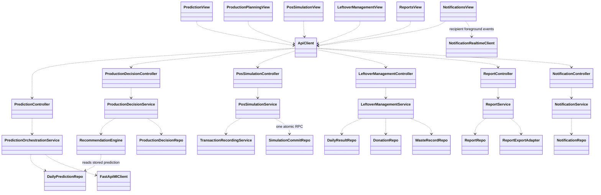
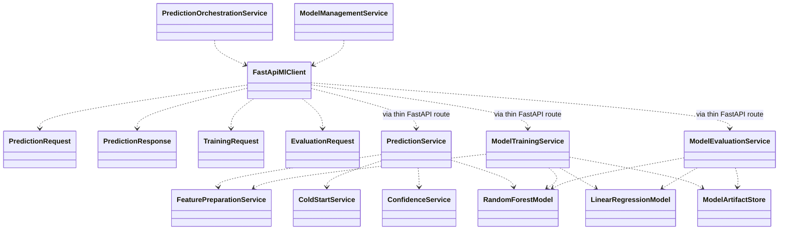
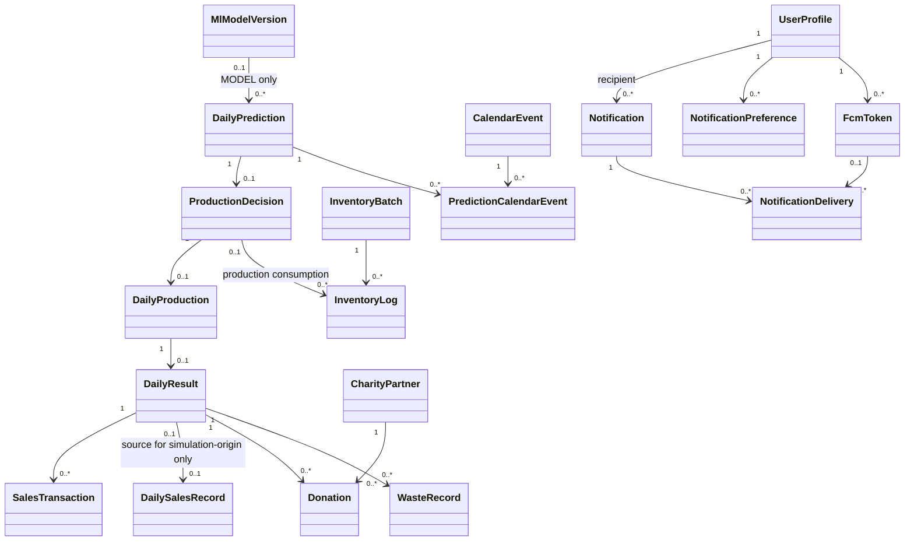

# Smart Bakery proposed Logical View

**Design revision - 2026-10-16:** At the user's request, FEFO replaces the report's FIFO policy: eligible batches are consumed by `expiry_date ASC, received_date ASC, id ASC`. The DOCX/report mirror remain unchanged; this is an explicit departure from Sections 4.5.3-4.5.4 and 4.9.3, including BR-INV-05/FR-INV-06. Other report requirements still apply.

Reconciled 2026-10-11 with the latest DOCX; [repository report mirror](RSW_SooKinMin_Project1.docx.md), Sections 4.2-4.5 and 4.8-4.9. This specification describes proposed classifiers and relationships, not verified implementation. `FYP Report.md` was deleted by the user and is not restored. Earlier audits remain historical in [the diagram plan](logical_view_class_diagram_plan.md).

## 1. Classifier conventions and diagram scope

Two diagrams divide the core application from the ML boundary. Screen classes end in `View`; TypeScript request, business and persistence classes use `Controller`, `Service` and `Repo`. Named algorithm components are service-layer classes. Express router modules and FastAPI route functions register/delegate calls and are not UML classes. Framework widgets/private State classes, the Flutter counter starter and library classes are excluded.

Dependencies (`..>`) describe calling/using collaborators. Domain associations (`-->`, with multiplicities) describe persisted links. Constructor injection does not imply lifecycle composition. DTOs have no persistence identity. `BaseRepo<T>` may be a shared proposed abstract Repo, but inheritance is unnecessary for every concrete Repo and is not claimed to exist.

Use `DailyPrediction` as the prediction entity. `DailyResult` is the detailed simulation outcome; `DailySalesRecord` is validated, provenance-labelled history. `SimulationRun` and `LeftoverRecord` are not persisted classifiers. Donation/waste category is derived through DailyResult.

## 2. Core Application Logical View

These classes are a focused subset. The following catalogue adds concrete collaborators for all eight functional modules. All methods are proposed operation responsibilities, not implemented APIs.

### Views and client boundaries

| Proposed classifier | Responsibility/dependencies |
|---|---|
| LoginView / ProfileView | SupabaseAuthClient login/logout; ApiClient own-profile reads/updates |
| ManagerDashboardView / AdministratorDashboardView | Dashboard DTOs and permission-specific pending indicators |
| PredictionView / ProductionPlanningView | Mode-aware prediction/confidence; joint feasibility and explicit confirmation/reason |
| PosSimulationView | Current-date default, prerequisite status, explicit run, simulated result/transactions |
| InventoryView / RecipeView | Administrator master data/batches/recipes; manager permitted stock/shortage visibility |
| ModelManagementView | Administrator candidate training, metric review, activation/restoration confirmation |
| LeftoverManagementView / DonationStatusView / CharityPartnersView | Manager allocation/status; administrator charity management |
| ReportsView | Date/period/category filters, weekly summaries, CSV/PDF exports with shared formulas |
| NotificationsView / NotificationPreferencesView | Own notifications/read state/type preferences |
| UserAdministrationView / SettingsView / ServiceStatusView / AuditView | Administrator accounts/roles, nonsecret settings/service state, audit review |
| ApiClient | Protected HTTPS JSON requests with session JWT; typed response/errors |
| SupabaseAuthClient | Authentication platform exception; session establishment/removal |
| NotificationRealtimeClient | Recipient-only foreground Supabase subscription; unsubscribe on logout/account changes |
| FcmClient | Background reception; token registration/deactivation through Node |

### Controllers, Services, Repos and endpoints

| Functional module | Controller -> Service / principal operations | Repos / adapters | Planned Express endpoints and permission |
|---|---|---|---|
| 1 Access | ProfileController -> ProfileService: get/update own profile | UserProfileRepo | GET/PATCH `/api/profile`, both ACTIVE roles |
| 1 / 8 Accounts | UserAdministrationController -> UserAdministrationService: create/edit role/status, guard final active admin | UserProfileRepo, AuthAdminAdapter, AuditService | GET/POST `/api/admin/users`, PATCH `/api/admin/users/:id`, administrator |
| 2 Prediction | PredictionController -> PredictionOrchestrationService: generate/read; orchestration selects validated category/day records | DailySalesRecordRepo, DailyPredictionRepo, MlModelVersionRepo, ContextService, FastApiMlClient | POST `/api/predictions` manager; GET `/api/predictions/:date` permitted read |
| 2 / 8 Models | ModelManagementController -> ModelManagementService: train candidate, evaluate, activate, restore | MlModelVersionRepo, ModelEvaluationRepo, FeatureImportanceRepo, FastApiMlClient, AuditService | GET `/api/admin/models`; POST `/api/admin/models/train`, `/api/admin/models/:id/evaluate`, `/activate`, `/restore`, administrator |
| 3 Master data | InventoryController / RecipeController -> InventoryService / RecipeService | IngredientRepo, BreadCategoryRepo, RecipeRepo, InventoryRepo, InventoryBatchRepo, InventoryLogRepo | `/api/admin/ingredients`, `/api/admin/batches`, `/api/admin/categories`, `/api/admin/recipes` CRUD administrator; GET `/api/inventory` permitted visibility |
| 3 Planning | RecommendationController -> RecommendationEngine; ProductionDecisionController -> ProductionDecisionService | DailyPredictionRepo, ProductionDecisionRepo, RecipeRepo, InventoryBatchRepo | GET `/api/recommendations/:date`, PUT `/api/production-decisions`, manager |
| 4 Simulation | PosSimulationController -> PosSimulationService: authorize/validate/run; TransactionRecordingService: sales/result payloads; FefoBatchService: ordered deductions; IngredientCostService: snapshot cost | SimulationCommitRepo, InventoryBatchRepo, InventoryLogRepo, DailyProductionRepo, SalesTransactionRepo, DailyResultRepo, DailySalesRecordRepo | POST `/api/simulations` manager; GET `/api/simulations/:date` and `/api/simulations/:date/transactions`, permitted read |
| 5 Allocation | LeftoverManagementController -> LeftoverManagementService: read/recommend/confirm allocation/update status | DailyResultRepo, DonationRepo, WasteRecordRepo, CharityPartnerRepo, AuditService | GET `/api/leftovers`, `/api/leftovers/:resultId/recommendation`; POST `/api/donations`, `/api/waste-records`; PATCH `/api/donations/:id/status`, manager mutation |
| 5 / 8 Charity | CharityPartnerController -> CharityPartnerService: manage active partners | CharityPartnerRepo, AuditService | `/api/admin/charity-partners` CRUD, administrator |
| 6 Reporting | DashboardController -> DashboardService; ReportController -> ReportService: filtered aggregates/export | ReportRepo, ReportExportAdapter | GET `/api/dashboard`, `/api/reports`, `/api/reports/export`, both roles |
| 7 Notifications | NotificationController -> NotificationService: recipient list/read/preferences/token/delivery | NotificationRepo, NotificationPreferenceRepo, FcmTokenRepo, NotificationDeliveryRepo, FcmPushAdapter | GET `/api/notifications`; PATCH `/api/notifications/:id/read`; GET/PATCH `/api/notification-preferences`; POST/DELETE `/api/fcm-tokens`, own records only |
| 7 Pending actions | PendingActionController -> PendingActionService: derive missing manual steps on request | DailyPredictionRepo, ProductionDecisionRepo, DailyResultRepo | GET `/api/pending-actions`, role-scoped; no scheduler |
| 8 Settings | SettingsController -> SettingsService: validate singleton/settings changes and service configuration | BakerySettingsRepo, SystemSettingsRepo, AuditService, external adapters | GET/PATCH `/api/admin/settings`, GET `/api/admin/service-status`, administrator |
| 8 Audit | AuditController -> AuditService: append important actions, read immutable audit history | SystemLogRepo | GET `/api/admin/audit`, administrator |

`ContextService` composes `WeatherService`/`CalendarService`, `WeatherRepo`/`CalendarRepo`, and `OpenWeatherMapClient`/`NagerDateClient`. Report-export and external adapters do not access application tables. No Controller directly invokes a Repo. Record/read permissions follow Table 4.27 and purpose-specific DTOs; permitted read visibility never grants an administrator manager-only write operations.

## 3. Machine-Learning Logical View

| Class / DTO | Required behavior |
|---|---|
| PredictionRequest / PredictionCategoryInput | Target date, category, deduplicated validated history, context, configured cold-start factors/base, active artifact metadata; no database credentials |
| TrainingObservation | observation date/category, unitsSold, dataOrigin, source traceability and context; no estimatedDemand target |
| PredictionService | RF only with >=30 distinct validated days and valid active model; otherwise ColdStartService |
| ConfidenceService | From tree mean mu and standard deviation sigma: `100 * max(0, min(1, 1 - sigma / max(abs(mu), 1)))`; numerical [0,100], low below threshold initially75 |
| ColdStartService | Bc from observed mean or configured base only if empty; `max(0, round(Bc * Dt * Mt * Wt * Ht))`; null confidence/model reference, low-confidence heuristic label |
| PredictionResponse | Discriminated MODEL result (numeric confidence, modelVersionId) or COLD_START result (both null); nonnegative integer predictedUnitsSold |
| TrainingRequest / ModelTrainingService | Administrator-provided validated datasets/split and parameters; inactive RF candidate and LR comparison; no activation |
| EvaluationRequest / ModelEvaluationService | Untouched chronologically later holdout, same RF/LR datasets; comparable active/candidate metrics |
| ModelMetrics | MAE/RMSE include zeros; MAPE excludes zero actuals only; R^2/other undefined metrics nullable with reason; sample counts and origin composition; simulation label |
| ModelArtifactStore | Versioned artifacts and metadata; no Supabase connection and no active-model database writes |

Node `ModelManagementService` enforces NFR-ACC-05: compare candidate and active MAE on the same valid later test dataset and reject a worse candidate. Activation/restoration are separate confirmed administrator operations with audit and failure retaining the active version. First activation requires a valid candidate, valid chronological evaluation, administrator review and explicit confirmation; with no incumbent, no active-model comparison or invented MAE is used.

## 4. Domain associations and storage mappings

Unique foreign keys enforce prediction -> decision -> production -> result. Zero-or-one represents prerequisites not yet processed; a committed official simulation creates its production, result and validated simulation history together. `DailySalesRecord` source references are origin-specific; imported history has no invented simulation FK. Model references are mandatory for MODEL and absent for COLD_START. A notification delivery's optional token belongs to the same intended recipient.

The [database catalogue](database_canonical_design.md) contains 29 public tables, one managed `auth.users` dependency and one computed `sales_by_timeslot` view. The catalogue uses controlled text CHECK domains rather than PostgreSQL ENUM types. DB snake_case maps to DTO camelCase (`prediction_mode` -> `predictionMode`, `bread_category_id` -> `breadCategoryId`, `predicted_units_sold` -> `predictedUnitsSold`, `units_sold` -> `unitsSold`, `model_version_id` -> `modelVersionId`, `recipient_user_id` -> `recipientUserId`). Quantity and cost units must be explicit. InventoryLog consumption retains batch links/cost traceability; donation/waste rows obtain category from DailyResult.

## 5. Invariants at service boundaries

- Authorization: JWT plus ACTIVE stored profile precedes permissions. Manager operational actions and administrator management actions are distinct; own-profile edits cannot alter role/status; final active admin survives concurrent changes.
- RecommendationEngine reserves existing unprocessed commitments, then allocates remaining balances in display order. ProductionDecisionService replaces previous quantities and validates the combined plan; no inventory changes on confirmation.
- SimulationCommitRepo coordinates one Node-owned PostgreSQL transaction/RPC. Lock/revalidate, consume eligible batches in expiry_date/received_date/id order, then process sales and persist all linked rows; rollback is complete and duplicate calls cannot deduct again. TransactionRecordingService shares this transaction, never independently commits its portion.
- IngredientCostService reads actual consumed batch quantities and stored unit_cost snapshots, with consistent units. It does not use current ingredient master prices. ReportService preserves signed error/profit and displays zero-denominator percentages as Not Applicable.
- LeftoverManagementService locks remaining stock and maintains `leftover = donated + wasted + remaining_unallocated`; donations require active charity and waste a reason. PENDING/COLLECTED/COMPLETED/CANCELLED are status concepts; cancellation/reallocation accounting remains open.
- NotificationRealtimeClient has only recipient-limited authenticated SELECT for foreground notifications; all writes use Node. Push checks preferences and valid recipient tokens and records PENDING/SUBMITTED/DELIVERED/FAILED/SKIPPED accurately.
- ReportService supplies common filtered calculations to screen and export; daily totals and their detailed transactions are not added together. Simulation provenance is visible.
- PendingActionService runs on request. No reminder or notification triggers operational actions or training; timed scheduling is future work.

## 6. Review and implementation order

Follow build modules 0-6 in [the project plan](Final%20Year%20Project/fyp_food_waste.md). Verify shared DTO/storage constraints before UI work, then authorization/administration, ML lifecycle, joint planning, atomic simulation, allocation/reporting and notification integration. [Traceability](planning_documents_change_report.md#requirements-traceability-matrix) maps every BR/FR/NFR to implementation boundaries and planned checks. No implementation or performance claims arise from these diagrams.
